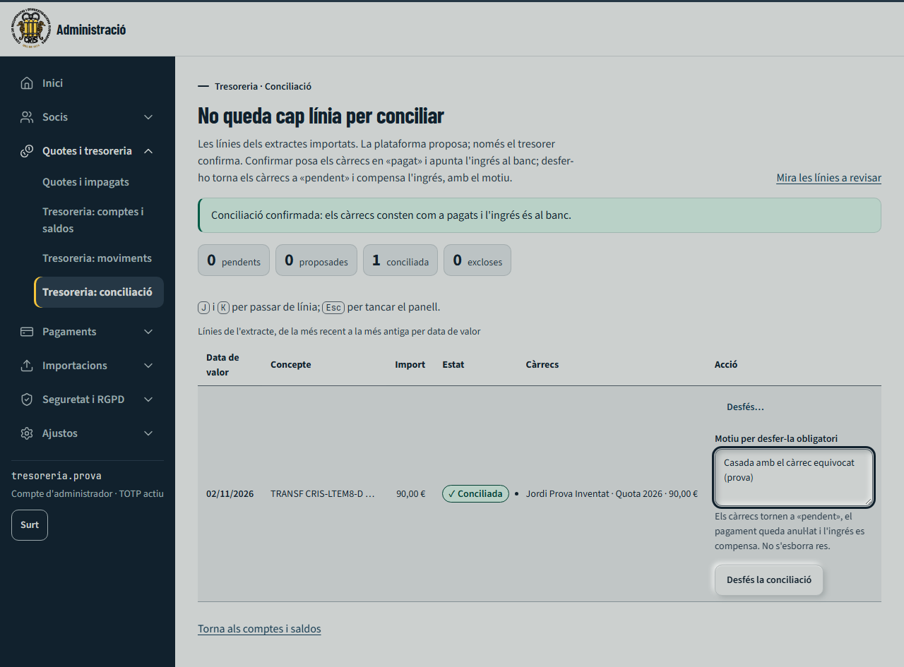
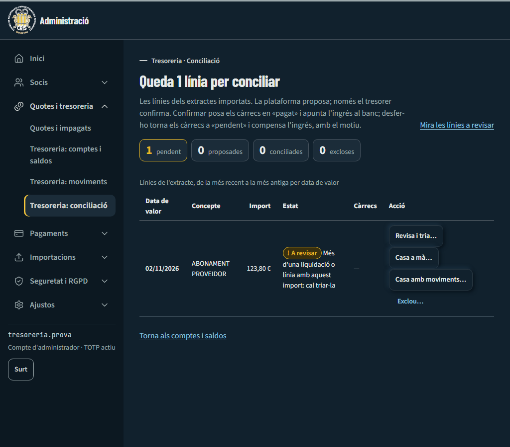

# T-DX-85 · Conciliació a l'escriptori: accions en una línia i formulari obert amb prou amplada

| Data i hora (Europa/Madrid) | Commit | Proves | CI |
|---|---|---|---|
| 20/11/2026 21:26 | f931f12a | 2 comprovacions noves a 1 e2e; 10 e2e de conciliació i exclusions | [A comprovar] |

**En tres línies:** revisant les captures de la V15 (T-DX-79, #314) a totes les amplades, a 1024 px (sense panell) «Casa amb moviments…» es partia en dues línies, i a 1280 px el formulari de «Desfés…» quedava espremut a la columna d'accions. La columna del concepte s'endú l'amplada que sobra i la d'accions només té la del botó més llarg. Ara, a partir de 1024 px, les accions van en una línia i un formulari obert té una amplada mínima.

## Què s'ha fet
- `static/css/disposicio.css`: `@media (min-width: 1024px)` amb `white-space: nowrap` per a cada acció de la fila i el botó d'un formulari obert, i `min-inline-size: calc(var(--amplada-estreta) / 2)` per a `details[open]`. La regla de la T-DX-79 per als botons amb el panell obert queda dins d'aquesta; la de l'etiqueta d'estat i el motiu, igual.
- `apps/core/tests/e2e/test_tresoreria.py`: la funció que detecta elements partits rep el selector; comprova les accions a 1024 px i el botó «Desfés la conciliació» a 1280 px.
- `docs/design-system.md` (conciliació) i `docs/estat/DX.md`.

## Decisions i perquè
- **A partir de 1024 px i no de 600:** entre 600 i 1023 px la taula ja és estreta i, sense poder partir, els botons la farien més ampla que la pantalla. Allà es queden com eren.
- **Meitat de `--amplada-estreta` (14rem):** n'hi ha prou per a un motiu llegible i el botó en una línia, sense deixar el concepte sense lloc. Cap token nou.
- **Seguretat i privacitat:** només CSS; cap canvi de vista, de permís ni de dades.

## Problemes trobats
- Cap més. A la tauleta (600–1023 px), la columna d'accions continua estreta, com abans.

## Com se sap que funciona
- Les dues comprovacions noves fallaven (`['Casa amb moviments…']` i `['Desfés la conciliació']`) i ara passen.
- E2e `test_tresoreria.py` i `test_tresoreria_exclusions.py`: 10 passen. Ruff net.

## Comprovació §15.5
- **Cap peça nova** ni cap token nou; cap `style=`.
- **Captures mirades** a 1280 i 1024 px, en clar i en fosc: conciliació proposada, tria de liquidació amb el panell, conciliada, desfer amb motiu, excloure una proposada, exclosa, desfer l'exclusió, casar a mà, liquidació proposada i confirmada. A 390 i 320 px la regla no s'aplica i no canvia res.

## Evidències
- Desfer una conciliació a 1280 px: el motiu i el botó a l'amplada mínima. `captures/2026-11-20_2126_T-DX-85_conciliacio-desfer-1280.png`

  

  *20/11/2026 21:26 (Europa/Madrid) · local, prova e2e, dades inventades · commit f931f12a*

- La tria de liquidació a 1024 px en fosc, sense panell: cada acció en una línia. `captures/2026-11-20_2126_T-DX-85_conciliacio-tria-1024-fosc.png`

  

  *20/11/2026 21:26 (Europa/Madrid) · local, prova e2e, dades inventades · commit f931f12a*
