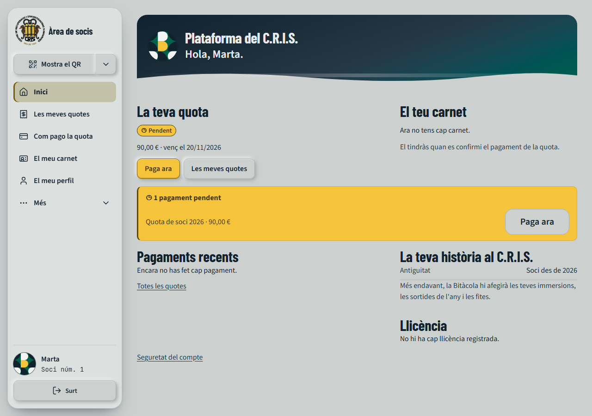
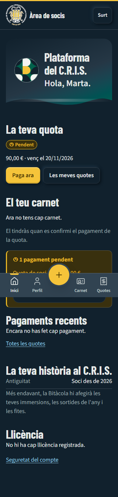

# T-DX-86 · Inici del soci sense carnet: «El teu carnet» diu quan arribarà

| Data i hora (Europa/Madrid) | Commit | Proves | CI |
|---|---|---|---|
| 20/11/2026 21:44 | 10d99897 | 1 unitària nova; 95 unitàries de l'inici i del carnet, 3 e2e | [A comprovar] |

**En tres línies:** revisant les captures de la V20 (T-DX-77, #316), un soci amb la quota pendent i sense carnet veia a l'inici «Ara no tens cap carnet.» i l'enllaç «Obre el carnet», que porta a una pàgina que només repeteix que no n'hi ha. Ara el bloc diu quan arribarà: quan es confirmi el pagament de la quota. Amb un carnet revocat (sense pendents), l'enllaç es queda, perquè allà es demana un carnet nou.

## Què s'ha fet
- `templates/core/home.html`: sense carnet i amb un pendent, «El tindràs quan es confirmi el pagament de la quota.» (`text-2`) en lloc de l'enllaç.
- `apps/members/tests/test_oleaje.py`: prova nova del bloc del carnet.
- `docs/design-system.md` (inici) i `docs/estat/DX.md`.

## Decisions i perquè
- **El text segueix el flux de CLAUDE.md** («pagament confirmat → actiu i carnet»): no inventa cap regla nova.
- **L'enllaç es queda sense pendents:** un soci amb el carnet revocat hi pot demanar un carnet nou (CA-M01-105).
- **Seguretat i privacitat:** només plantilla i text; la vista i les dades no canvien.

## Problemes trobats
- Cap.

## Com se sap que funciona
- La prova nova fallava (el bloc portava l'enllaç a `/socis/carnet/`) i ara passa.
- Unitàries `test_oleaje.py`, `test_cards.py` i `test_cards_079.py`: 95 passen. E2e `test_oleaje.py` i `test_flux_fer_se_soci.py`: 3 passen. Ruff net.

## Comprovació §15.5
- **Cap peça nova**; cap `style=`.
- **Captures mirades** a 1280, 1024, 390 i 320 px, en clar i en fosc: inici amb la quota pendent i sense carnet. L'inici «al dia» té carnet i no passa per aquesta branca.

## Evidències
- Inici amb la quota pendent i sense carnet, a 1280 px. `captures/2026-11-20_2144_T-DX-86_inici-sense-carnet-1280.png`

  

  *20/11/2026 21:44 (Europa/Madrid) · local, prova e2e, dades inventades · commit 10d99897*

- El mateix a 320 px en fosc. `captures/2026-11-20_2144_T-DX-86_inici-sense-carnet-320-fosc.png`

  

  *20/11/2026 21:44 (Europa/Madrid) · local, prova e2e, dades inventades · commit 10d99897*
