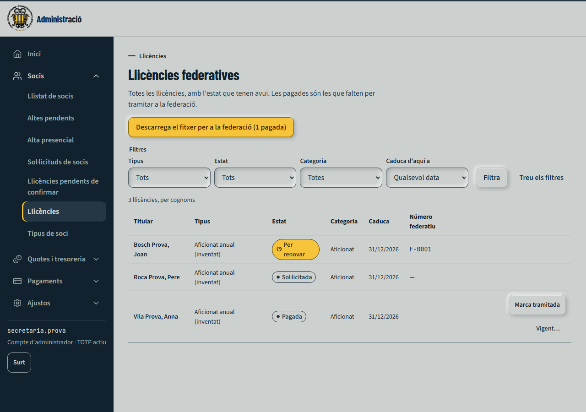
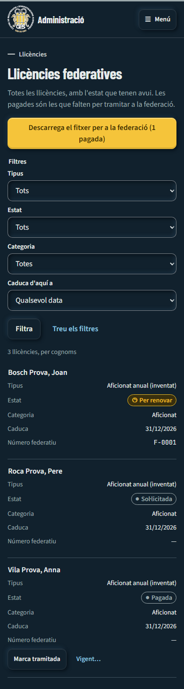

# T-DX-88 · Llicències: cel·la d'accions sense etiqueta buida i un sol botó principal

| Data i hora (Europa/Madrid) | Commit | Proves | CI |
|---|---|---|---|
| 21/11/2026 04:34 | 353ed89f | 1 unitària nova; 16 unitàries de les vistes del 06, 3 e2e | [A comprovar] |

**En tres línies:** primera revisió d'una pantalla de la fase 2: el llistat de llicències de la secretaria (`/gestio/llicencies/`, #386). A 390 px, les fitxes sense cap acció mostraven l'etiqueta «Acció» buida; a l'escriptori, els botons quedaven a l'esquerra d'una columna alineada a la dreta, i hi havia dos botons principals. Ara la cel·la és la `cel-accions` de la resta de llistats, les accions van a la dreta i «Filtra» és un botó normal.

## Què s'ha fet
- `templates/licences/list.html`: `td.cel-accions` sense `data-etiqueta` i capçalera «Accions» `visualment-amagat`; «Filtra» amb `boto` en lloc de `boto-principal`.
- `static/css/comptes.css`: a partir de 600 px, `.taula td.cel-accions > .accions` va a la dreta; a partir de 1024 px, el text d'un botó de fila no es parteix.
- `apps/licences/tests/test_list_actions_cell.py`: prova nova.
- `docs/design-system.md` (cel·la d'accions d'una taula) i `docs/estat/DX.md`.

## Decisions i perquè
- **El patró ja existia** (`members/fees.html`): la cel·la d'accions no porta etiqueta, perquè els botons ja diuen què fan (D3).
- **D19:** el botó principal és el fitxer per a la federació, la feina de la pantalla; «Filtra» passa a botó normal. Als altres llistats, «Filtra» és l'únic botó principal i no es toca.
- **Regla general a la taula:** la dreta també val per als enllaços de convidat, l'altre llistat amb un `.accions` dins la cel·la (mirat a les captures).
- **La prova no és e2e:** el pilot tenia oberta una PR a `apps/core` (#388, després #390), i les e2e hi viuen; la prova és a `apps/licences` i les captures en són l'evidència visual.
- **L'entrada «Llicències» del menú** es queda com la va posar el pilot: el text i el lloc (grup «Socis», després de «Llicències pendents de confirmar») són clars.
- **Seguretat i privacitat:** només plantilla i CSS; els botons segueixen sortint només amb LC5 i el servidor ho torna a comprovar.

## Problemes trobats
- «Per renovar» encara es parteix en dues línies a 1280 px: la taula té set columnes i hi va justa. Treure'n el salt a totes les taules pot desbordar a 1024 px; no s'hi toca.

## Com se sap que funciona
- La prova nova fallava (`data-etiqueta="Acció"`) i ara passa, amb les 15 de `test_views.py`.
- E2e `test_llicencies.py` i `test_enllacos_convidat.py`: 3 passen. Ruff net.

## Comprovació §15.5
- **Cap peça nova**: la cel·la d'accions ja existia; s'hi documenta el que fa. Cap `style=`.
- **Captures mirades** a 1280, 1024, 390 i 320 px, en clar i en fosc: llistat de llicències, «Deixa vigent una llicència» amb l'error i enllaços de convidat.
- **Regles B, C i D:** D19 (un botó principal), D3 (cap etiqueta que repeteix el botó), B14 (els botons de fila mantenen la mida), D7 (el número federatiu en monoespai, com una referència).

## Evidències
- Llistat de llicències a 1280 px. `captures/2026-11-21_0434_T-DX-88_llicencies-1280.png`

  

  *21/11/2026 04:34 (Europa/Madrid) · local, prova e2e, dades inventades · commit 353ed89f*

- El mateix a 390 px en fosc. `captures/2026-11-21_0434_T-DX-88_llicencies-390-fosc.png`

  

  *21/11/2026 04:34 (Europa/Madrid) · local, prova e2e, dades inventades · commit 353ed89f*
