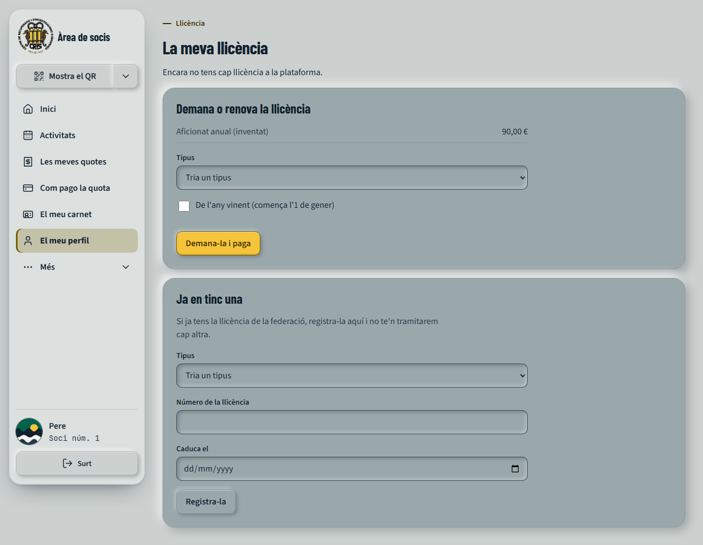
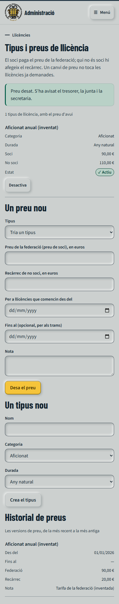

# T-DX-89 · Llicències v2 i v3: navegació, preus com a dades i un sol botó principal

| Data i hora (Europa/Madrid) | Commit | Proves | CI |
|---|---|---|---|
| 21/11/2026 08:02 | daa1461b | 4 unitàries noves; 243 unitàries del 06 i 30 de la navegació personal, 3 e2e | [A comprovar] |

**En tres línies:** és la revisió de les pantalles «La meva llicència» i «Tipus i preus de llicència» (#401). Quan el soci era a «La meva llicència», no quedava marcada cap entrada del menú. Els preus surten sagnats en una llista d'historial, damunt del formulari. A «Tipus i preus», a 390 px sortia l'etiqueta «Acció» buida i hi havia dos botons principals. Ara queda marcat «El meu perfil», els preus són dades alineades amb el formulari i hi ha un sol botó principal.

## Què s'ha fet
- `templates/members/_personal_nav.html` i `_ramillete.html`: `licences:mine` marca «El meu perfil». Ho havia demanat el pilot.
- `templates/licences/mine.html`: els preus per tipus fan servir `dl.dades-soci` en lloc de `ul.historial`.
- `templates/licences/prices.html`: la columna d'accions fa servir `td.cel-accions` i té la capçalera «Accions» amagada a la vista. «Crea el tipus» és un `boto` normal.
- `apps/licences/tests/test_personal_nav_licence.py` i `test_screens_dx89.py`: proves noves.
- `docs/estat/DX.md`.

## Decisions i perquè
- **«El meu perfil»** perquè «La meva llicència» s'obre des del bloc «Llicència» del perfil, igual que les altres subpàgines del perfil (T-DX-76).
- **La prova de navegació és a `apps/licences`.** El pilot tenia oberta la #419, que toca `apps/core`, i l'ordre del propietari diu que no es toca `apps/core` mentre sigui així. La prova reutilitza les eines de `apps/core/tests/test_personal_nav_subpages.py`. La parella de PAGES es pot moure quan es fusioni la #419.
- **`dades-soci`:** és el component de dades del perfil i ja té l'amplada del formulari a l'àrea del soci. No calia cap peça nova. No he posat el preu dins de l'opció del desplegable perquè l'e2e tria l'opció pel nom exacte, i aquell fitxer és a `apps/core`.
- **D19:** «Desa el preu» és la feina freqüent. «Crea el tipus» es fa rarament.
- **Seguretat i privacitat:** només plantilles. El soci continua veient només les seves llicències i el servidor torna a comprovar LC8.

## Problemes trobats
- Una passada de l'e2e de llicències va fallar al llistat de la secretaria, una pantalla que aquest canvi no toca. Passada sola, va en verd: és la mateixa espera que falla quan la màquina té càrrega.

## Com se sap que funciona
- Les quatre proves noves fallaven: no hi havia `aria-current` a «La meva llicència», hi havia `data-etiqueta="Acció"` i hi havia `class="historial"`. Ara passen.
- Han passat totes les unitàries del 06 (243) i les de navegació personal (30). E2e de `test_llicencies.py`: 3 passen. Ruff net.

## Comprovació §15.5
- **Cap peça nova** i cap `style=`.
- **Captures mirades** a 1280, 1024, 390 i 320 px, en clar i en fosc: «La meva llicència» (sense llicència i després de demanar-la) i «Tipus i preus» (amb el preu desat i amb l'error de la nota).
- **Regles B, C i D:**
  - D19: un botó principal.
  - D3: cap etiqueta buida.
  - D14: imports alineats a la dreta.
  - D16: xifres tabulars amb `import`.

## Evidències
- «La meva llicència» a 1280 px. `captures/2026-11-21_0802_T-DX-89_la-meva-llicencia-1280.png`

  

  *21/11/2026 08:02 (Europa/Madrid) · local, prova e2e, dades inventades · commit daa1461b*

- «Tipus i preus de llicència» a 390 px. `captures/2026-11-21_0802_T-DX-89_tipus-i-preus-390.png`

  

  *21/11/2026 08:02 (Europa/Madrid) · local, prova e2e, dades inventades · commit daa1461b*
