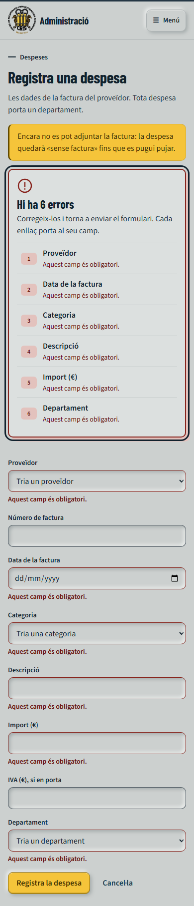
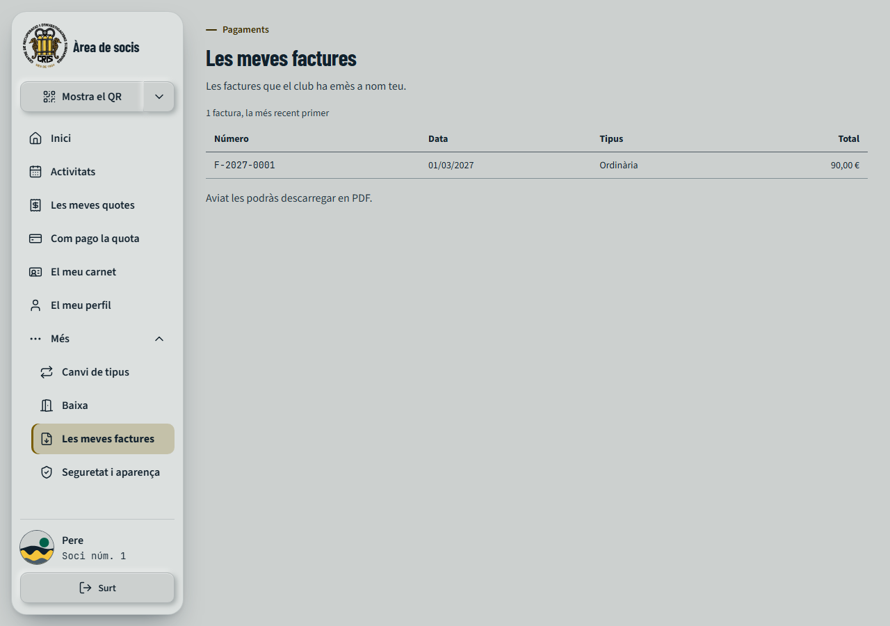

# T-DX-90 · Despeses, marge i factures (09): «Tria…» als desplegables, imports a la dreta i «Les meves factures» al menú

| Data i hora (Europa/Madrid) | Commit | Proves | CI |
|---|---|---|---|
| 23/11/2026 11:05 | 82f0e774 | 6 unitàries noves; 256 unitàries del 09 i de navegació personal, 3 e2e | [A comprovar] |

**En tres línies:** és la revisió de les quatre pantalles del 09 que el pilot ha fet funcionals (#442): «Registra una despesa», «Despeses sense factura», el marge d'una activitat i «Les meves factures». Els desplegables deien «---------», els imports anaven a l'esquerra i, amb errors, els desplegables no tenien la vora vermella dels altres camps. «Les meves factures» no tenia cap entrada al menú del soci. Ara els desplegables diuen què cal triar, els imports van a la dreta, tots els camps amb error porten la mateixa vora i la pàgina té entrada dins de «Més».

## Què s'ha fet
- `apps/expenses/views.py` i `apps/margins/views.py`: `empty_label` «Tria un proveïdor», «Tria una categoria» i «Tria un departament».
- `templates/expenses/without_invoice.html`, `templates/margins/activity.html` i `templates/invoicing/mine.html`: `cel-import` a la capçalera i a les cel·les de la columna d'imports.
- `static/css/comptes.css`: la vora de `--c-error` amb `aria-invalid` passa d'`input` a `input`, `select` i `textarea`. Django ja marcava els desplegables; només hi faltava la regla.
- `templates/members/_personal_nav.html` i `_ramillete.html`: «Les meves factures» (`invoicing:my_invoices`, icona `file-down`), dins de «Més», que surt obert en aquesta pàgina.
- `apps/core/tests/e2e/test_despeses.py`: es torna a carregar el formulari abans d'omplir-lo. Abans, la captura «despesa-nova» sortia plena però amb els errors del primer intent encara a la vista.
- Proves noves: `apps/expenses/tests/test_screens_dx90.py`, `apps/margins/tests/test_screens_dx90.py` i `apps/invoicing/tests/test_personal_nav_invoices.py`.
- `docs/design-system.md` (formularis) i `docs/estat/DX.md`.

## Decisions i perquè
- **«Les meves factures» dins de «Més» (B15):** la fan servir poc, i la barra i el lateral ja tenen les entrades del dia a dia.
- **La prova de navegació és a `apps/invoicing`:** quan es va escriure, el pilot tenia una PR oberta a `apps/core`. Fa servir les eines de `apps/core/tests/test_personal_nav_subpages.py`, com la de la T-DX-89.
- **La vora als desplegables és un canvi de CSS comú:** val per a tots els formularis, no només per als del 09. És la mateixa regla del sistema de disseny; abans s'aplicava a mitges.
- **Seguretat i privacitat:** només textos, plantilles i CSS. El soci continua veient només les seves factures; el servidor ho comprova igual que abans.

## Problemes trobats
- Dues sessions de DISSENY treballaven alhora al mateix worktree. Una s'ha aturat i ha traspassat la feina a l'altra. No s'ha perdut res.
- `test_ramillete.py::test_mobile_bar_and_the_more_fan` falla en local també a master sense aquest canvi (el focus quan s'obre el ventall). No és d'aquesta tasca.

## Com se sap que funciona
- Les proves noves fallaven abans de l'arreglo: hi havia «---------», no hi havia `cel-import` ni l'entrada al menú, i el desplegable amb error no duia `aria-invalid`. Ara passen.
- Passen 256 unitàries (09, navegació personal) i les e2e `test_despeses`, `test_marge_activitat` i `test_meves_factures`. Ruff net.

## Comprovació §15.5
- **Cap peça nova** i cap `style=`. Una regla de `comptes.css` s'amplia.
- **Captures mirades** a 1280, 1024, 390 i 320 px, en clar i en fosc: la despesa nova (buida amb errors i plena), les despeses sense factura, el marge previst i congelat, i «Les meves factures».
- **Regles B, C i D:**
  - B15: l'entrada poc freqüent va a «Més».
  - D14: imports a la dreta.
  - D16: xifres tabulars amb `import`.
  - Errors: cada camp amb error, també els desplegables, porta la vora i el missatge a sota.

## Evidències
- «Registra una despesa» amb errors a 390 px. `captures/2026-11-23_1105_T-DX-90_despesa-nova-errors-390.png`

  

  *23/11/2026 11:05 (Europa/Madrid) · local, prova e2e, dades inventades · commit 82f0e774*

- «Les meves factures» a 1280 px. `captures/2026-11-23_1105_T-DX-90_meves-factures-1280.png`

  

  *23/11/2026 11:05 (Europa/Madrid) · local, prova e2e, dades inventades · commit 82f0e774*
