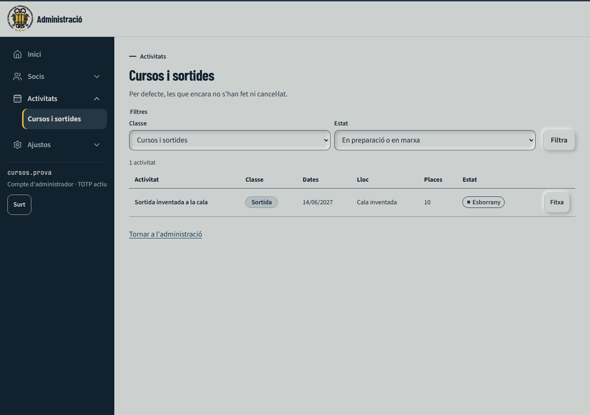

# T-DX-92 · «Cursos i sortides»: tota la fila porta a la fitxa de l'activitat

| Data i hora (Europa/Madrid) | Commit | Proves | CI |
|---|---|---|---|
| 23/11/2026 15:34 | c3e7d430 | 1 nova; 10 de les pantalles del 02 | [A comprovar] |

**En tres línies:** he revisat les pantalles d'administració del 02 que el pilot ha fet funcionals (#465): el llistat «Cursos i sortides» i la fitxa d'una activitat. Compleixen les regles B, C i D, i el menú queda com es va acordar. L'única falta era que, al llistat, la fila no portava a la fitxa (B14) com al llistat de socis. Ara hi porta.

## Què s'ha fet
- `templates/activities/activity_list.html`: el botó «Fitxa» porta `enllac-fila`.
- `apps/activities/tests/test_screens_dx92.py`: prova nova.
- `docs/estat/DX.md`.

## Decisions i perquè
- **Una sola classe, sense CSS nou:** `disposicio.css` ja fa clicable tota la fila d'una `taula` que té un `enllac-fila`, a partir de 600 px. L'enllaç continua sent l'element que rep el focus i el que llegeix el lector de pantalla.
- **Fet després de la #475:** aquella PR del pilot tocava la mateixa plantilla, i el pilot hi té prioritat.
- **La resta de la revisió, sense canvis:**
  - el grup «Activitats» va després de «Socis», amb `calendar-days`, i la fitxa marca «Cursos i sortides»;
  - hi ha un sol botó per acció;
  - els estats porten icona i text;
  - els preus fan servir `import`.
- **Seguretat i privacitat:** només és una classe; el servidor continua comprovant AC7 al llistat i a la fitxa.

## Problemes trobats
- Les captures de la prova surten sense sessions ni material. La taula de sessions i el bloc de material de la fitxa queden per revisar quan una prova els faci sortir.

## Com se sap que funciona
- La prova nova fallava sense `enllac-fila` i ara passa. També passen les altres de `test_admin_activities.py`, 10 en total.

## Comprovació §15.5
- **Captures mirades** a 1280, 1024, 390 i 320 px, en clar i en fosc, del llistat i de la fitxa (`test_activitats_admin.py`). La classe no canvia res del que es veu: canvia el cursor i on es pot fer clic.

## Evidències
- «Cursos i sortides» a 1280 px. `captures/2026-11-23_1534_T-DX-92_cursos-i-sortides-1280.png`

  

  *23/11/2026 15:34 (Europa/Madrid) · local, prova e2e, dades inventades · captura de la revisió, abans de la classe (no canvia res del que es veu)*
