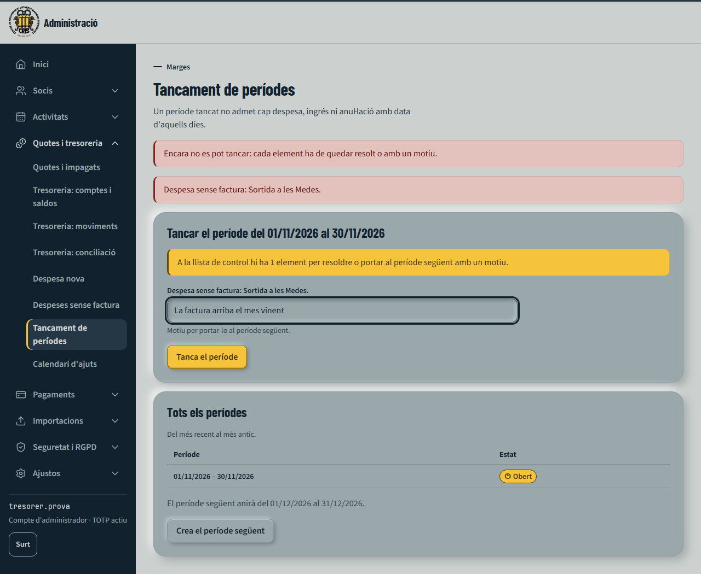

# T-DX-93 · «Tancament de períodes»: el títol de la pàgina diu el mateix que el menú

| Data i hora (Europa/Madrid) | Commit | Proves | CI |
|---|---|---|---|
| 23/11/2026 17:56 | 39a94839 | 1 nova; 19 dels períodes; 1 e2e | [A comprovar] |

**En tres línies:** he revisat la pantalla dels períodes del 09 que el pilot ha fet funcional (#494). El menú diu «Tancament de períodes» des de la revisió del menú, però la pàgina es titulava només «Períodes». Ara el títol de la pestanya, l'`h1` i la guia del tresorer diuen el mateix que el menú.

## Què s'ha fet
- `templates/margins/periods.html`: títol i `h1`.
- `apps/core/tests/e2e/test_periodes.py`: la prova busca el títol nou.
- `docs/guies/guia-despeses-i-marges.md`: el nom de la pantalla i on és al menú.
- `apps/margins/tests/test_screens_dx93.py`: prova nova.
- `docs/estat/DX.md`.

## Decisions i perquè
- **El títol de la pàgina segueix el del menú:** és el mateix criteri de la V7. Qui hi arriba des del menú ha de veure el mateix nom.
- **Els errors en tancar no s'han tocat:** quan es prova de tancar, els errors surten com a missatges a dalt de la pàgina, no amb el resum d'errors (Errata) enllaçat al camp. Canviar-ho toca la vista (`apps/margins`), i per això ho he passat al pilot.
- **La resta de la revisió, sense canvis:**
  - un sol botó principal («Tanca el període»);
  - els estats porten icona i text;
  - les targetes i la taula apilada estan bé a 390 i a 320 px.

## Com se sap que funciona
- La prova nova fallava amb el títol vell i ara passa. També passen 19 proves dels períodes i l'e2e `test_periodes.py`.

## Comprovació §15.5
- **Captures mirades** a 1280, 1024, 390 i 320 px, en clar i en fosc: la llista de control amb un element i la reobertura.
- **Seguretat i privacitat:** només són textos. El servidor continua comprovant MG11 i MG12.

## Evidències
- «Tancament de períodes» a 1280 px. `captures/2026-11-23_1756_T-DX-93_tancament-de-periodes-1280.png`

  

  *23/11/2026 17:56 (Europa/Madrid) · local, prova e2e, dades inventades · commit 39a94839*
