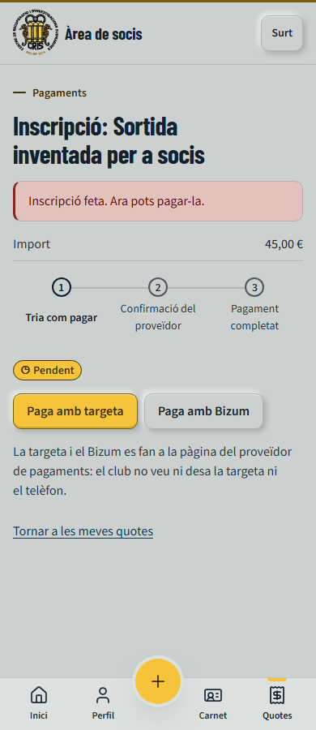
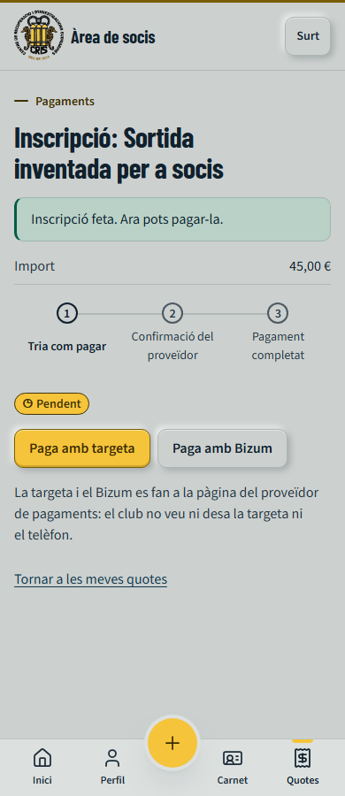

# T-DX-94 · Pantalla de pagament: el missatge d'èxit de la inscripció ja no surt com a error

| Data i hora (Europa/Madrid) | Commit | Proves | CI |
|---|---|---|---|
| 23/11/2026 19:00 | 5c8e8acb | 1 nova; 1733 de pagaments i d'inscripció; 1 e2e | [A comprovar] |

**En tres línies:** en revisar la inscripció del soci (#497), he vist que la pantalla de pagament mostrava «Inscripció feta. Ara pots pagar-la.» en un avís vermell d'error. La plantilla de la pantalla de pagament pintava tots els missatges com a error: fins ara només n'hi arribaven d'error, i la inscripció hi envia el primer d'èxit. Ara l'error surt en vermell i la resta, com a avís d'èxit.

## Què s'ha fet
- `templates/payments/charge.html`: el missatge es pinta segons el nivell, com a `fee_method.html` i `campaign.html`.
- `apps/activities/tests/test_screens_dx94.py`: prova nova.
- `docs/estat/DX.md`.

## Decisions i perquè
- **L'arreglo és a la plantilla de pagament, no a la vista d'inscripció:** el missatge és d'èxit i ha de dir-ho. És la plantilla la que suposava que tot era error.
- **Els errors no canvien:** les dues crides que porten a aquesta pantalla amb un missatge (`apps/payments/views.py`) són `messages.error`, i continuen en `avis-error` amb `role="alert"`.
- **La resta de la revisió de la #497, sense canvis:**
  - la inscripció de convidat té el resum d'errors i la casella «Soc major d'edat»;
  - la del soci mostra els requisits amb l'estat (✓, ✕ o !) i un sol botó principal;
  - la inscripció presencial és a la fitxa d'activitat.
- **Seguretat i privacitat:** només és la presentació d'un missatge; no canvia res del pagament.

## Com se sap que funciona
- La prova nova fallava (el missatge sortia dins d'`avis-error`) i ara passa.
- Passen les proves de pagaments i de la inscripció del soci, 1733 en total, i l'e2e `test_activitats_inscripcio_soci.py`.

## Comprovació §15.5
- **Captures mirades:** la pantalla de pagament després d'inscriure's, abans i després, a 390 px.

## Evidències
- Abans, a 390 px. `captures/2026-11-23_1900_T-DX-94_pagament-inscripcio-390-abans.png`

  

  *23/11/2026 18:40 (Europa/Madrid) · local, prova e2e, dades inventades · master 58b9587b*

- Després, a 390 px. `captures/2026-11-23_1900_T-DX-94_pagament-inscripcio-390.png`

  

  *23/11/2026 19:00 (Europa/Madrid) · local, prova e2e, dades inventades · commit 5c8e8acb*
