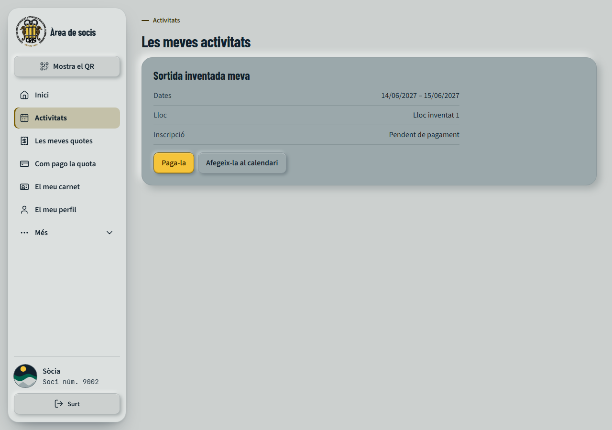
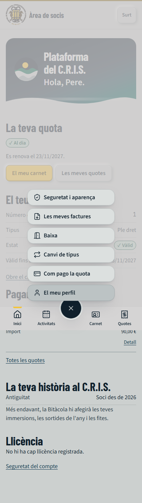

# T-DX-95 · «Les meves activitats» al menú del soci i retirada de les pantalles en construcció del 02

| Data i hora (Europa/Madrid) | Commit | Proves | CI |
|---|---|---|---|
| 23/11/2026 20:00 | c7b10aea | 4 noves (1 parametritzada); 131 unitàries de navegació i pantalles; 30 e2e | [A comprovar] |

**En tres línies:** el pilot ha fet funcionals les pàgines públiques del 02, les inscripcions i «Les meves activitats» (#497, #498 i #499). Ara l'entrada «Activitats» del Ramillete porta a «Les meves activitats», i el menú sense JavaScript hi té una entrada. Retiro les quatre pantalles «En construcció» que aquelles substitueixen, amb el criteri de la T-DX-74.

## Què s'ha fet
- `templates/members/_ramillete.html`:
  - `activitats_url` ara és `activities:mine`, no la pantalla en construcció;
  - l'entrada queda marcada a «Les meves activitats» i a la inscripció del soci;
  - com que sempre hi és, la barra porta Inici, Activitats, «+», Carnet i Quotes, i «El meu perfil» passa al ventall.
- `templates/members/_personal_nav.html`: «Les meves activitats» després d'«Inici».
- **Pantalles retirades:** `activitats`, `activitats_per_a_tu`, `fitxa_activitat` i `inscripcio` (fitxer de `apps/previews/screens/` i plantilla), amb les seves proves (`apps/core/tests/e2e/test_activitats.py` i `apps/previews/tests/test_inscripcio.py`) i l'entrada del mapa d'e2e del hook.
- **Proves adaptades:**
  - `test_member_nav.py`: «Activitats» hi és també a producció;
  - `test_navegacio_soci.py`: l'enllaç va a `/socis/activitats/`;
  - `test_ramillete.py`: el primer element del ventall és «El meu perfil»;
  - `test_screens.py`: les quatre pantalles ja no hi són.
- **Prova nova:** `apps/activities/tests/test_personal_nav_activities.py`.
- `docs/design-system.md` (§6.12 i les seccions de les peces) i `docs/estat/DX.md`.

## Decisions i perquè
- **«Activitats per a tu» també es retira:** era el bloc de la mateixa T-DX-63 i en feia servir el contingut d'exemple. Ara no hi ha cap pantalla real que el mostri.
- **Les peces es queden:** `activitats.css`, `activitats.js`, `convite.css`, `camilla.css`, `comanda.css` i les plantilles parcials de `templates/previews/`. Són components del sistema de disseny que una pantalla real pot reaprofitar. Esborrar-los és una altra decisió.
- **L'etiqueta de la barra continua sent «Activitats»:** és curta per a la barra del mòbil, i la pàgina es titula «Les meves activitats». Al menú sense JavaScript hi ha espai, i l'entrada diu el nom sencer.
- **Seguretat i privacitat:** és només navegació. `activities:mine` mostra només les inscripcions de la persona del compte, i la vista ho torna a comprovar.

## Com se sap que funciona
- La prova nova fallava amb les plantilles d'abans (4 de 4) i ara passa.
- Passen 131 unitàries de navegació personal, Ramillete i pantalles en construcció, i 30 e2e: navegació del soci, Ramillete, previews, «Les meves activitats», pàgines públiques i inscripció del soci.

## Comprovació §15.5
- **Captures mirades** a 1280, 1024, 390 i 320 px, en clar i en fosc: «Les meves activitats» (entrada marcada al panell i a la barra) i el ventall obert.

## Evidències
- «Les meves activitats» a 1280 px. `captures/2026-11-23_2000_T-DX-95_meves-activitats-1280.png`

  

  *23/11/2026 20:00 (Europa/Madrid) · local, prova e2e, dades inventades · commit c7b10aea*

- El ventall obert a 390 px. `captures/2026-11-23_2000_T-DX-95_ventall-390.png`

  

  *23/11/2026 20:00 (Europa/Madrid) · local, prova e2e, dades inventades · commit c7b10aea*
