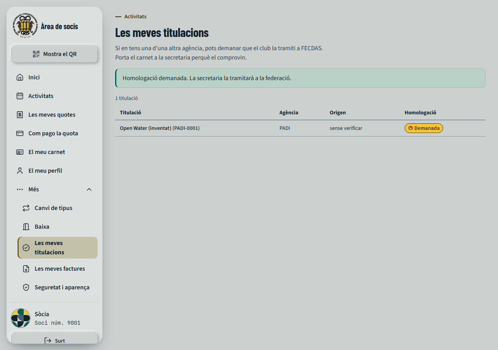

# T-DX-96 · «Les meves titulacions» al menú del soci

| Data i hora (Europa/Madrid) | Commit | Proves | CI |
|---|---|---|---|
| 23/11/2026 22:50 | 3c058bd5 | 3 noves; 45 de navegació personal; 5 e2e | [A comprovar] |

**En tres línies:** el pilot ha fet la pàgina «Les meves titulacions» (#514), on el soci veu les seves titulacions i pot demanar una homologació. Cap pàgina no hi enllaçava. Ara té entrada dins de «Més» al Ramillete i al panell de l'escriptori, i al menú sense JavaScript.

## Què s'ha fet
- `templates/members/_ramillete.html`:
  - «Les meves titulacions» (`activities:my_certifications`, icona `badge-check`) al ventall i a «Més» de l'escriptori, abans de «Les meves factures»;
  - a la seva pàgina, «Més» surt obert.
- `templates/members/_personal_nav.html`: l'entrada després de «Les meves activitats».
- `apps/activities/tests/test_personal_nav_certifications.py`: proves noves.
- `docs/estat/DX.md`.

## Decisions i perquè
- **Dins de «Més» (B15):** es consulta poc, i la barra i el lateral ja porten les entrades del dia a dia. És el mateix lloc que «Les meves factures».
- **Una entrada pròpia, no filla de «Activitats»:** cap pàgina de les activitats no hi enllaça. Si fos filla, s'hi arribaria només coneixent l'adreça.
- **Seguretat i privacitat:** només és navegació. La vista mostra només les titulacions de la persona del compte i torna a comprovar l'homologació.

## Problemes trobats
- A l'escriptori, a 900 px d'alçada i amb «Més» obert, el panell lateral és més llarg que la pantalla i «Surt» queda a baix de tot. El panell té `overflow-y: auto` i es desplaça, com ja passava amb altres combinacions d'entrades.

## Com se sap que funciona
- Les proves noves fallaven sense el canvi (3 de 3) i ara passen. També passen les altres 42 de navegació personal i les e2e de «Les meves titulacions», del Ramillete i de la navegació del soci.

## Comprovació §15.5
- **Captures mirades** a 1280, 1024, 390 i 320 px, en clar i en fosc: «Les meves titulacions» i el ventall obert.

## Evidències
- «Les meves titulacions» a 1280 px. `captures/2026-11-23_2250_T-DX-96_meves-titulacions-1280.png`

  

  *23/11/2026 22:50 (Europa/Madrid) · local, prova e2e, dades inventades · commit 3c058bd5*
