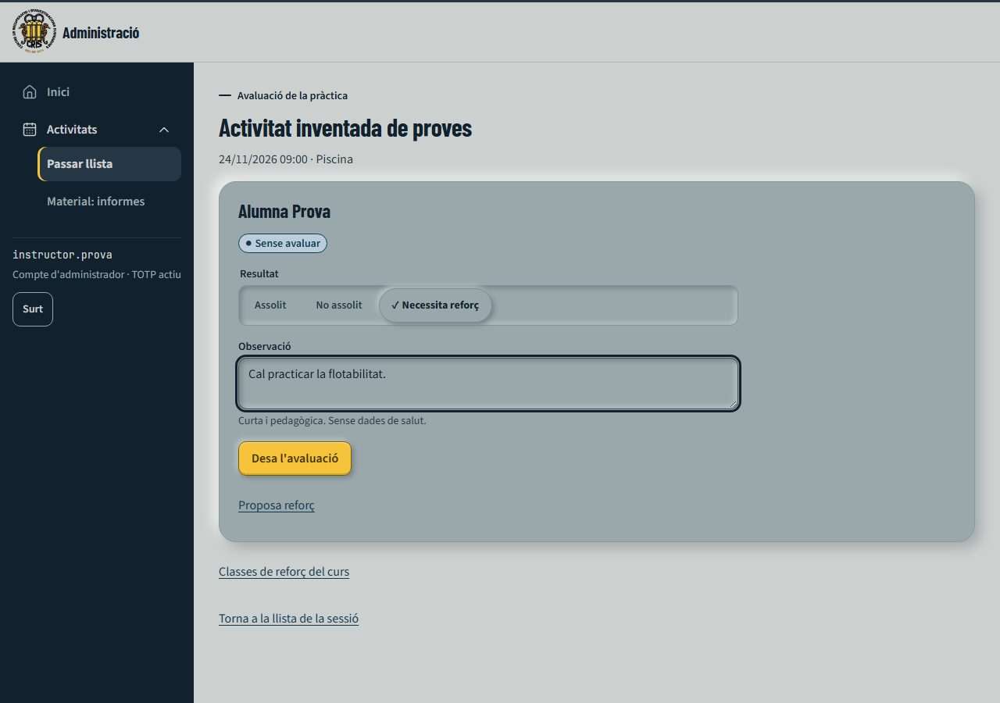
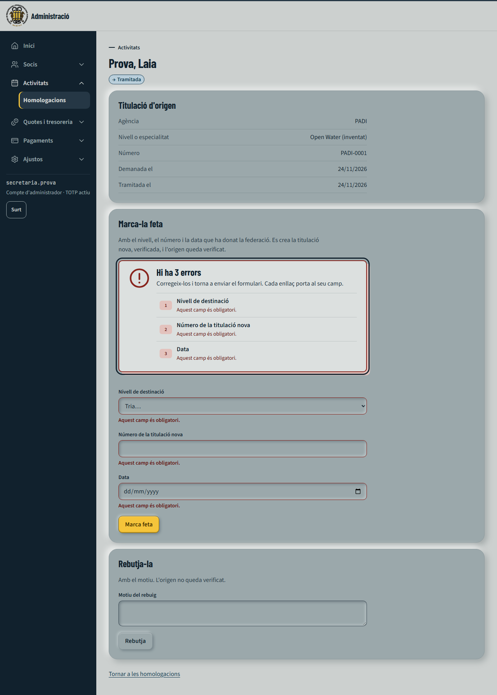

# T-DX-97 · Avaluació amb el botó principal i homologacions amb l'avantítol en text

| Data i hora (Europa/Madrid) | Commit | Proves | CI |
|---|---|---|---|
| 24/11/2026 01:34 | f423a5dd | 2 noves; 14 d'avaluació i homologacions; 5 e2e | [A comprovar] |

**En tres línies:** he revisat les pantalles del 02 que el pilot ha fet funcionals a la #513 i a la #518: homologacions, passar llista, avaluació de la pràctica, resultats del curs i certificat. A l'avaluació, l'única acció del formulari no era el botó principal, i la pantalla no en tenia cap (D19). A la fitxa i a la sol·licitud d'homologació, l'avantítol era un enllaç, i era l'única manera de tornar a la llista.

## Què s'ha fet
- `templates/activities/assessment_sheet.html`: «Desa l'avaluació» passa a `boto boto-principal`.
- `templates/activities/filing_detail.html` i `filing_request.html`: l'avantítol és «Activitats» en text, com a la llista, i «Tornar a les homologacions» va a sota (`enllacos`).
- `apps/activities/tests/test_screens_dx97.py`: proves noves.
- `docs/estat/DX.md`.

## Decisions i perquè
- **Els resultats del curs i el certificat es queden marcant «Passar llista»:** s'hi arriba des de la llista de la sessió, i la regla és que una pantalla marca l'entrada des d'on s'obre (T-DX-49). A més, l'instructor no veu «Cursos i sortides», i amb aquesta entrada no li quedaria res marcat. Ho havia proposat al pilot i ho retiro.
- **L'enllaç de tornada fa servir «Tornar a …»:** és la forma de la fitxa d'activitat. Les pantalles de passar llista fan servir «Torna a …», i unificar-les és una altra tasca.
- **No toco el comptador de passar llista:** que no s'actualitzi després d'una marca feta sense connexió és lògica del pilot (C7).
- **Seguretat i privacitat:** només són plantilles. Els permisos AC9, AC26 i el de l'avaluació continuen a les vistes.

## Com se sap que funciona
- Les dues proves noves fallaven sense el canvi i ara passen. També passen les d'avaluació i homologacions (14 en total) i les e2e `test_homologacions.py` i `test_passar_llista.py` (5).

## Comprovació §15.5
- **Captures mirades** a 1280, 1024, 390 i 320 px, en clar i en fosc: l'avaluació (formulari i desada), la fitxa d'homologació amb errors i la llista de pendents; i, de la mateixa revisió, passar llista, els resultats del curs i el certificat.

## Evidències
- Avaluació de la pràctica a 1280 px. `captures/2026-11-24_0134_T-DX-97_avaluacio-1280.png`

  

  *24/11/2026 01:34 (Europa/Madrid) · local, prova e2e, dades inventades · commit f423a5dd*

- Fitxa d'homologació amb errors a 1280 px. `captures/2026-11-24_0134_T-DX-97_homologacio-1280.png`

  

  *24/11/2026 01:34 (Europa/Madrid) · local, prova e2e, dades inventades · commit f423a5dd*
