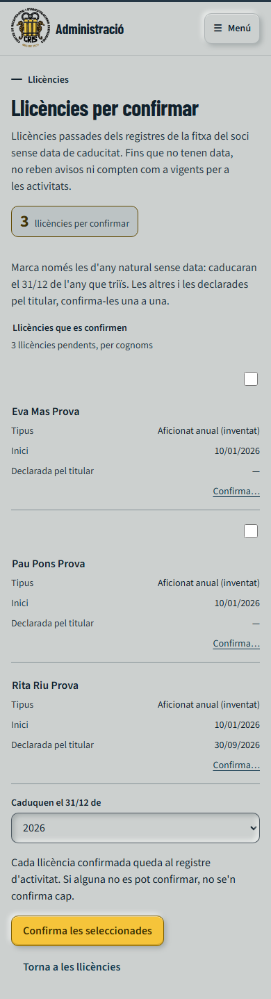

# T-DX-98 · «Llicències per confirmar»: «Confirma…» a la cel·la d'accions

| Data i hora (Europa/Madrid) | Commit | Proves | CI |
|---|---|---|---|
| 24/11/2026 03:05 | aa350611 | 1 nova; 13 de la confirmació del 06; 1 e2e | [A comprovar] |

**En tres línies:** he revisat les dues pantalles noves del 06 de la #530: «Llicències per confirmar» i «Confirma la caducitat». Estan bé, amb un sol retoc. A la taula apilada del mòbil, cada fila acabava amb l'etiqueta «Acció» davant de l'enllaç «Confirma…». Ara l'enllaç va a la cel·la d'accions, com a les altres taules (T-DX-88).

## Què s'ha fet
- `templates/licences/unconfirmed.html`:
  - la capçalera «Acció» queda amagada a la vista («Accions», `visualment-amagat`);
  - la cel·la de l'enllaç és `cel-accions`.
- `apps/licences/tests/test_screens_dx98.py`: prova nova.
- `docs/estat/DX.md`.

## Decisions i perquè
- **La casella es queda a la primera cel·la:** al mòbil surt sola en una línia, a dalt de la fila. És el patró de la confirmació en bloc del 01 (`members/licence_bulk_confirm.html`, T-M01-36), i les dues pantalles han de fer el mateix.
- **El menú, en una altra PR:** la secretaria veu dues entrades amb noms gairebé iguals. Una és «Llicències pendents de confirmar», del 01, per als registres de la fitxa. L'altra és aquesta pantalla, filla de «Llicències». El pilot ha respost B: totes dues són vigents fins que es faci a producció el pas únic de les llicències de la fitxa al 06 (T-M06-14), i la del 01 es reanomenarà. Ho faré quan cap PR toqui `navigation.py`.
- **Seguretat i privacitat:** només és la plantilla. El servidor continua comprovant LC5, que les llicències siguin pendents i les dates.

## Com se sap que funciona
- La prova nova fallava amb l'etiqueta «Acció» i ara passa. També passen les 13 proves de la confirmació del 06 i l'e2e `test_secretary_confirms_pending_licences`.

## Comprovació §15.5
- **Captures mirades** a 1280, 1024, 390 i 320 px, en clar i en fosc: «Llicències per confirmar» i «Confirma la caducitat».

## Evidències
- «Llicències per confirmar» a 390 px. `captures/2026-11-24_0305_T-DX-98_llicencies-per-confirmar-390.png`

  

  *24/11/2026 03:05 (Europa/Madrid) · local, prova e2e, dades inventades · commit aa350611*
