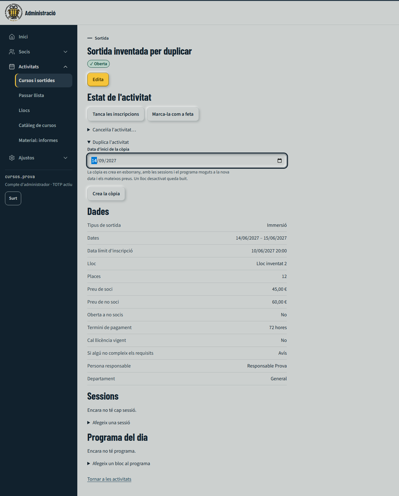

# T-DX-99 · Fitxa d'una activitat: «Cancel·la l'activitat…» plegat i els canvis d'estat en una fila

| Data i hora (Europa/Madrid) | Commit | Proves | CI |
|---|---|---|---|
| 24/11/2026 04:06 | ab300d66 | 1 nova; 17 de les pantalles d'activitats; 2 e2e | [A comprovar] |

**En tres línies:** he revisat les pantalles de la #526: sessions, programa del dia i duplicar, des de la fitxa d'una activitat. Al bloc «Estat de l'activitat», el formulari per cancel·lar sortia sempre obert, amb el camp del motiu, a dalt de tot de la fitxa. Els botons d'estat («Tanca les inscripcions», «Marca-la com a feta») sortien cadascun en una línia. Ara cancel·lar va plegat, com «Duplica l'activitat», i els canvis d'estat d'un sol clic van en una sola fila.

## Què s'ha fet
- `templates/activities/activity_detail.html`:
  - els canvis d'estat sense camps van en una sola `accions`, un formulari per botó;
  - reobrir, que porta la data límit nova, continua en el seu propi formulari;
  - «Cancel·la l'activitat…» va dins d'un `details`.
- `apps/core/tests/e2e/test_activitats_estats.py`: obre el plegat abans d'escriure el motiu.
- `apps/activities/tests/test_screens_dx99.py`: prova nova.
- `docs/estat/DX.md`.

## Decisions i perquè
- **Plegat, com «Duplica l'activitat»:** cancel·lar es fa poc i no es desfà. Si va obert a dalt de la fitxa, competeix amb «Edita» i amb les dades. El `summary` acaba amb «…» perquè obre un formulari.
- **Cap peça nova:** `accions` i `details` ja hi eren. No hi ha cap classe ni cap CSS nou.
- **Fet després de la #535:** aquella PR del pilot tocava la mateixa plantilla, per l'enllaç als resultats ambientals.
- **Seguretat i privacitat:** només és la disposició. El servidor continua comprovant AC7, l'estat, el motiu i les transicions.

## Com se sap que funciona
- La prova nova fallava sense el canvi i ara passa. També passen les 17 de les pantalles d'activitats (`test_admin_states.py` i `test_admin_activities.py`) i les e2e d'estats i de duplicar.

## Comprovació §15.5
- **Captures mirades** a 1280, 1024, 390 i 320 px, en clar i en fosc: la fitxa en esborrany, oberta amb «Duplica» desplegat, i cancel·lada.

## Evidències
- Fitxa d'una activitat oberta a 1280 px. `captures/2026-11-24_0406_T-DX-99_fitxa-activitat-1280.png`

  

  *24/11/2026 04:06 (Europa/Madrid) · local, prova e2e, dades inventades · commit ab300d66*
