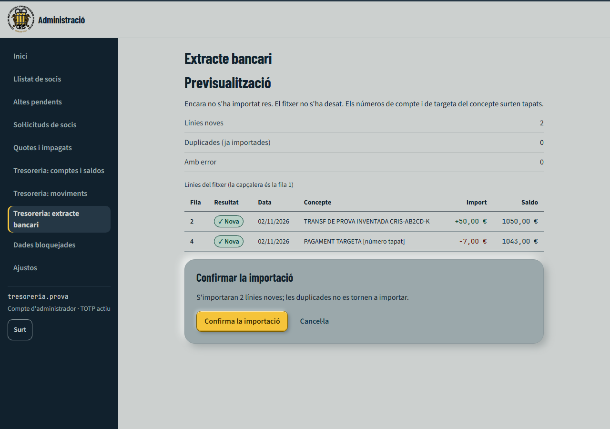

# T-M00-09 · Lector de Norma 43 per a l'extracte bancari

| Data i hora (Europa/Madrid) | Commit | Proves | CI |
|---|---|---|---|
| 16/11/2026 17:15 | [A comprovar] | 16 noves, 1 e2e nova, 2 canviades | [A comprovar] |

**En tres línies:** l'extracte bancari ja es pot pujar en el format Norma 43 que donen els bancs, a més del CSV d'ara. La pantalla i els passos són els mateixos: previsualitzar, confirmar i, si cal, desfer. Si el fitxer és incomplet o els totals no quadren, es rebutja sencer i no s'importa res.

## Què s'ha fet
- `apps/core/imports/bank_statement.py`: `_parse_norma43`, que el `parse` fa servir si la primera línia és un registre «11». Torna les mateixes línies que el CSV, i la detecció de duplicats, la conciliació (T-M04-11) i el desfer no canvien.
- `apps/core/files.py`: tipus `text/plain` amb les extensions `.n43` i `.txt`, permès només a l'extracte (`BANK_STATEMENT_TYPES`); el CSV de Cluber i els adjunts no l'accepten.
- Pantalla de l'extracte: el text d'ajuda diu que també s'accepta Norma 43.

## Decisions i perquè
- Opcions per defecte a la [P-103](../decisions/pendents.md) (reversible): data d'operació, concepte amb els registres 23 i les referències, un sol compte en euros, fitxer sencer o res.
- **Cap línia amb error que es pugui excloure**, al contrari del CSV: el saldo de cada línia és el saldo inicial més els moviments, i treure'n una faria mal tots els saldos següents.
- **El número de compte de la capçalera (11 i 33) no es llegeix mai** (044); els números del concepte es tapen com al CSV.

## Problemes trobats
- Una prova de la T-M00-01 esperava que `.txt` es rebutgés; ara és una extensió de l'extracte, i la prova fa servir `.xls`.

## Com se sap que funciona
- Lectura: saldo calculat línia a línia, saldo inicial deutor, concepte amb la targeta tapada.
- Rebutjos: totals, saldo final, sense registre 33, data, clau de deure o haver, 23 sense 22, registre desconegut, dos comptes, una altra divisa, cap moviment.
- Previsualitzar, confirmar i tornar a pujar el mateix fitxer: les dues línies surten com a duplicades.
- Al navegador: el tresorer puja un `.n43` inventat, veu la targeta tapada i confirma.

## Evidències

*16/11/2026 17:00 (Europa/Madrid) · local, dades inventades (prova e2e)*
- Sortida de proves · executada el 16/11/2026 en local (PostgreSQL 16):
  ```
  $ pytest -q -m "not e2e" apps/core
  1456 passed, 64 deselected
  $ pytest -q -m e2e apps/core/tests/e2e/test_extracte_bancari.py
  2 passed
  ```

## Termes nous
- **Norma 43** (quadern 43 de l'AEB): format de text de 80 posicions per línia en què els bancs espanyols donen l'extracte d'un compte.
