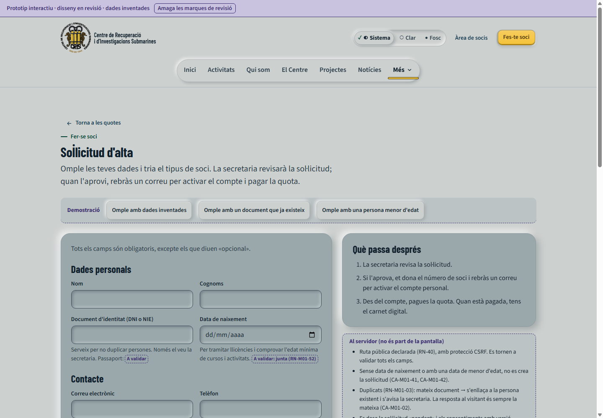
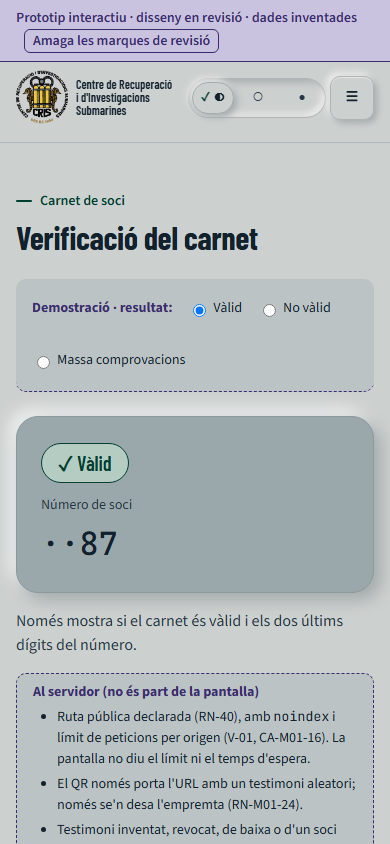
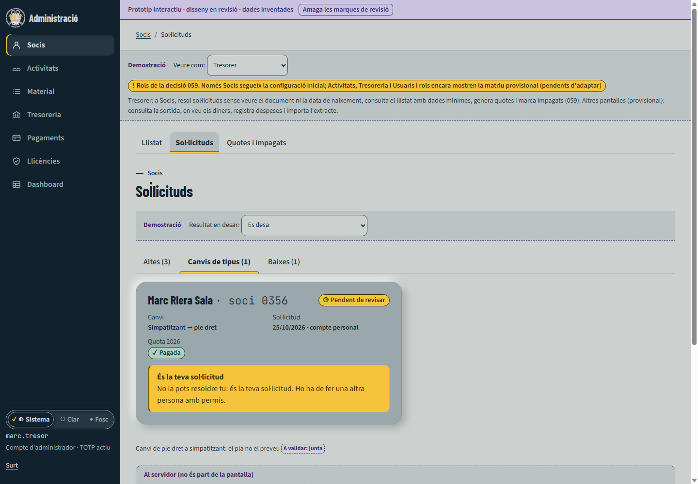
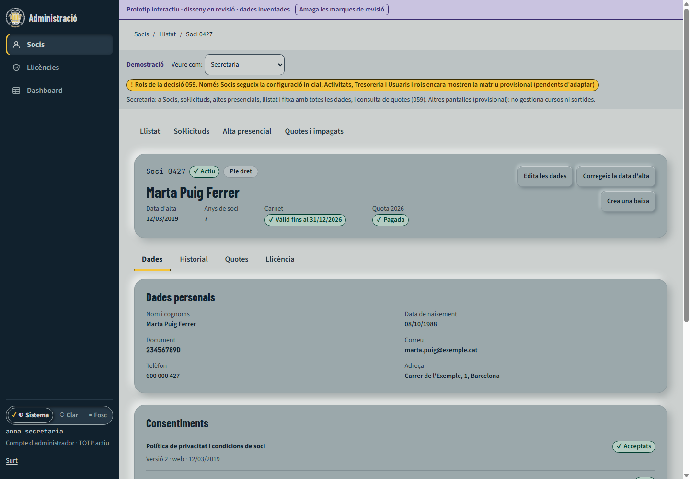
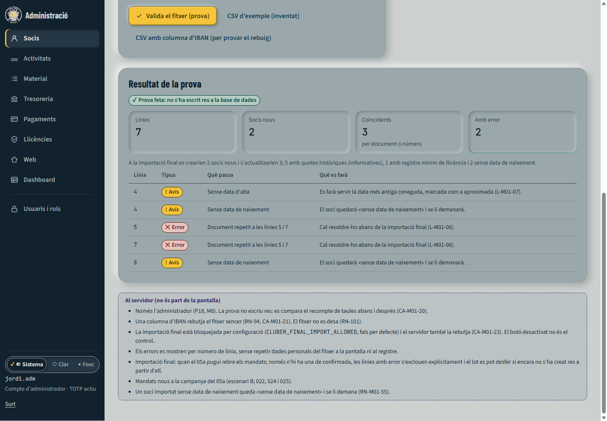
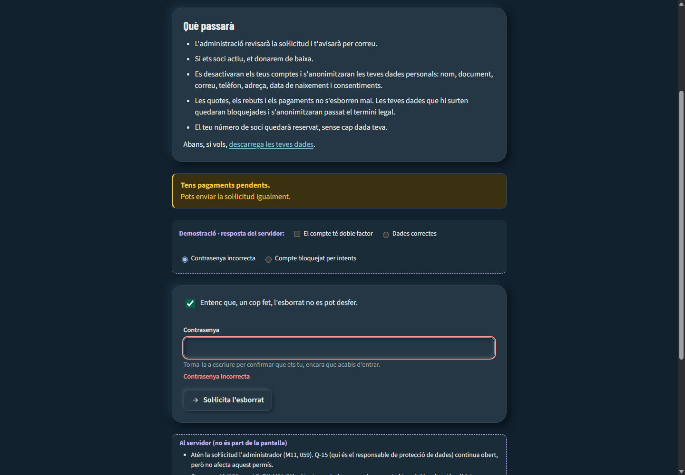

# T-M01-02 · Wireframes que falten del mòdul 01

| Data i hora (Europa/Madrid) | Commit | Proves | CI |
|---|---|---|---|
| 03/11/2026 01:29 – 02:13 | 994c200 (norma), 28402de (selector), 961117b, f37c182, 2d86a35, 2ab6390, a1c9adc (pantalles), ac5aaf6, 6c0ba5b (ajustos), 9b69ff9 (docs) | 795 | verd (PR #4, dues execucions; també a 47d9b84) |

**En tres línies:** ja hi ha un esbós clicable de totes les pantalles de socis: demanar l'alta, comprovar un carnet, revisar sol·licituds, el llistat i la fitxa, les quotes, la importació de Cluber i el perfil del soci. Cada pantalla es pot veure amb el rol de cada persona de la junta. També diu què ha de controlar el servidor, perquè amagar un botó no protegeix res.

## Què s'ha fet
- **Web pública:** formulari «Fer-se soci» i verificació del carnet («Vàlid ··87» o «No vàlid»).
- **Administració:** el selector de rols té els onze rols de la [059](../decisions/059-rols-i-permisos-editables.md). L'esbós d'«Altes pendents» passa a ser la vista de sol·licituds (altes, canvis de tipus i baixes). Són noves l'alta presencial, el llistat, la fitxa, les quotes i impagats i la importació de Cluber.
- **Compte personal:** perfil, canvi a ple dret, baixa, esborrar el compte i «no trobat».
- **Documentació:** inventari de wireframes al [pla (M01-5)](../planning.md#M01-5-processos), [sistema de disseny](../design-system.md) 1.5 i una norma nova al `CLAUDE.md`: disseny amb seguretat i privacitat.

## Decisions i perquè
- **Dins dels tres fitxers existents:** és el que demana el pla, i així les pantalles noves no afegeixen cap càrrega de Google Fonts. El risc que ja hi havia (l'adreça IP dels visitants va a Google) queda documentat, no resolt.
- **Permisos de la configuració inicial de la 059, sense ampliar-los:** el President només veu les sol·licituds, i el tresorer i el President resolen sense veure la data de naixement ni el document. Les pantalles d'altres tasques no s'han adaptat, i l'avís del selector ho diu.
- **Import del canvi a ple dret:** «pendent de determinar per la secretaria» (RN-M01-15). La contradicció amb HU-M01-09 queda anotada al pla, sense resoldre.
- **«No trobat» només on el pla el demana** (CA-M01-25). A l'administració es manté «Sense accés a aquesta pantalla».

## Problemes trobats
- `tokens.css` té la paleta revisada el 31/10, que encara no és cap decisió, i `design-system.md` §2 descrivia l'anterior. Mana el fitxer; queda anotat.
- Al tema clar, la barra daurada de l'element actiu feia 1,16:1. Ara porta la mateixa vora fosca que el subratllat.
- El número 0311 ja era d'un altre soci a la fitxa de sortida: el canvi de tipus és del 0356.
- No hi havia Playwright ni cap client de WebSocket. Les proves de teclat s'han fet amb un client propi de Chrome DevTools Protocol, fora del repositori.

## Com se sap que funciona
- Proves amb tecles reals (Tab, Intro, Espai, fletxes, Esc) a Chrome sense finestra, a les tres zones i a les pantalles existents (per descartar regressions): 151 comprovacions superades, cap error a la consola. Inclouen: el focus visible a tot arreu, cap objectiu de menys de 24 px (excepte enllaços dins d'una frase), errors a prop del camp, diàlegs que retenen el focus i es tanquen amb Esc, i permisos simulats per rol.
- Contrast amb els valors de `tokens.css`: 51 de les 53 combinacions que s'hi poden calcular superen el mínim. Les dues que no ho són: la barra daurada (decorativa, ara amb una vora de 6,98:1) i l'interruptor actiu al tema fosc (1,64:1, component existent; l'estat també surt en text).
- **Pendent:** la revisió del responsable del projecte (criteri «Revisats»), un lector de pantalla real i l'auditoria amb axe i Playwright (T-M01-28). La suite de Python no s'ha pogut executar en local (falta `DATABASE_URL`); no s'hi ha tocat cap fitxer.

## Revisió del responsable (03/11/2026, en curs)
- Aplicat (6c68573 a 4afcfd8): preus validats, text de conservació sense etiqueta, mateixes dades al llistat i a les quotes, etiquetes de l'estat del soci, menys text a pantalla (els codis van a la nota «Al servidor»), interruptor «Amaga les marques de revisió», preus només al formulari d'alta, baixa que es pot rebutjar (P-M01-C, P-50) i requisit de la inscripció amb el correu d'un soci (P-51).
- Aplicat després (3018b88 a e5e39c4): el pla de la contrasenya abans d'esborrar el compte (RN-M01-57, CA-M01-46) amb el servei de reautenticació de la 00, que no tenia tasca (T-M00-05); les decisions [063](../decisions/063-validacions-de-la-revisio-de-la-t-m01-02.md) i [064](../decisions/064-una-baixa-es-pot-rebutjar-amb-motiu.md), amb els camps separats per al motiu de la sol·licitud i el de la resolució; i el wireframe de l'esborrat amb contrasenya i codi.
- Pendent: la revisió final del responsable del projecte.
- Proves repetides amb tecles reals: 41 comprovacions noves superades i les anteriors tornades a passar. Captures refetes. L'esborrat amb contrasenya en té 23 més (errors al costat del camp, camp buidat després d'un error, compte bloquejat sense llindar ni temps, codi TOTP), totes superades.

## Evidències
- 
  *03/11/2026 11:09 (Europa/Madrid) · wireframe a Chrome sense finestra, dades inventades del prototip · commit 4afcfd8*
- 
  *03/11/2026 11:09 (Europa/Madrid) · wireframe a Chrome sense finestra, dades inventades del prototip · commit 4afcfd8*
- 
  *03/11/2026 11:09 (Europa/Madrid) · wireframe a Chrome sense finestra, dades inventades del prototip · commit 4afcfd8*
- 
  *03/11/2026 11:09 (Europa/Madrid) · wireframe a Chrome sense finestra, dades inventades del prototip · commit 4afcfd8*
- 
  *03/11/2026 11:09 (Europa/Madrid) · wireframe a Chrome sense finestra, dades inventades del prototip · commit 4afcfd8*
- 
  *03/11/2026 13:07 (Europa/Madrid) · wireframe a Chrome sense finestra, dades inventades del prototip · commit e5e39c4*

## Termes nous
- **Wireframe**: esbós de pantalla per decidir-ne l'estructura abans de programar-la.
- **Chrome DevTools Protocol** (protocol de les eines de desenvolupament): manera de controlar Chrome des d'un programa, per exemple per prémer tecles.
- **Contrast**: diferència de lluminositat entre el text i el fons; WCAG demana 4,5:1 per al text i 3:1 per a les vores i els controls.
