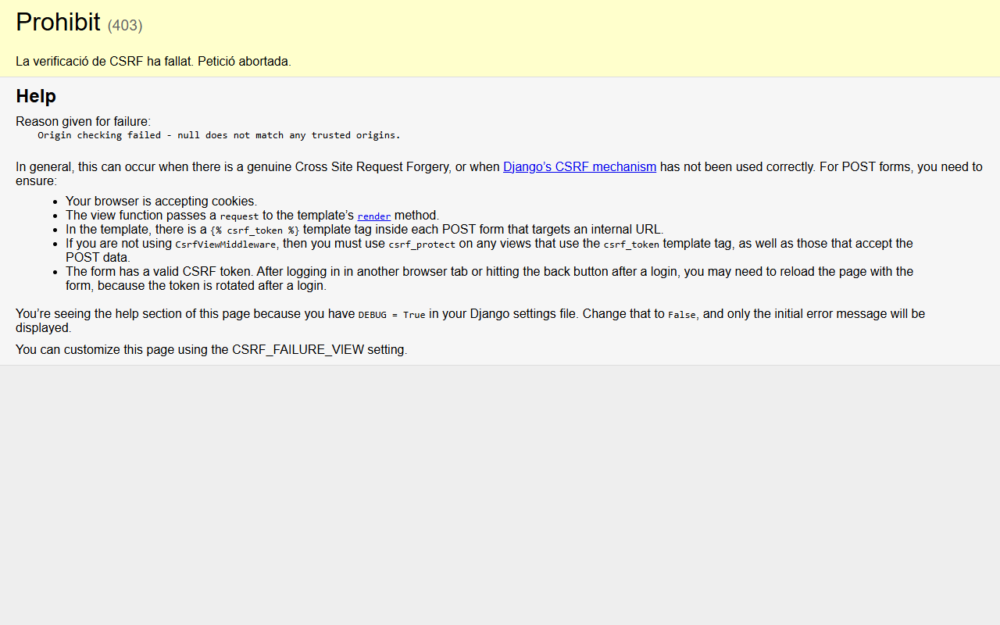
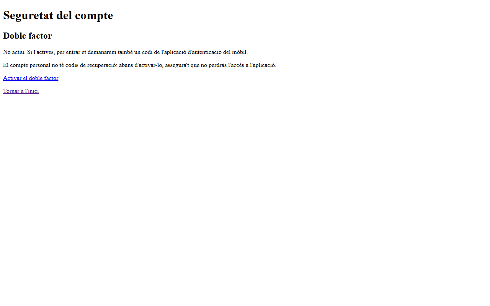
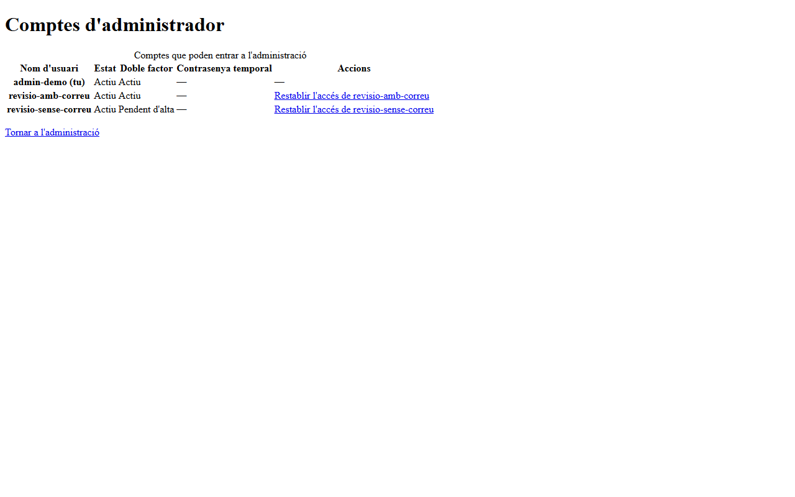
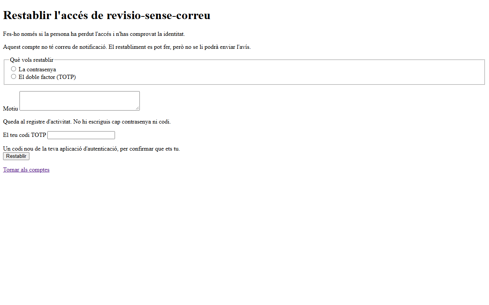
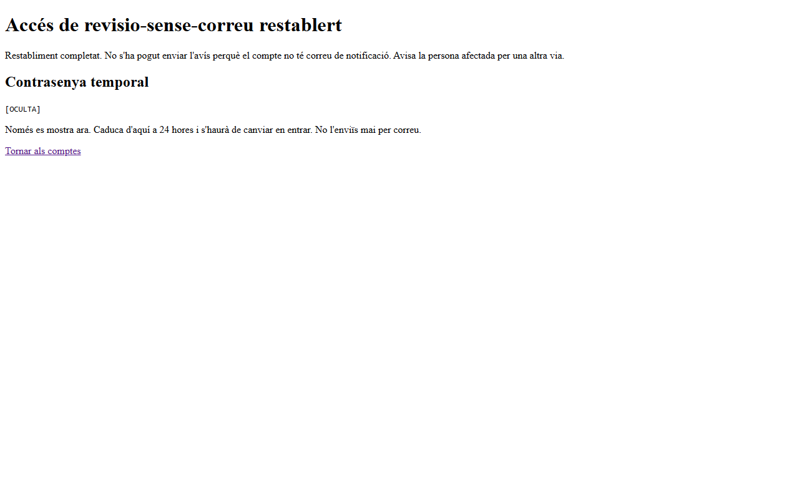
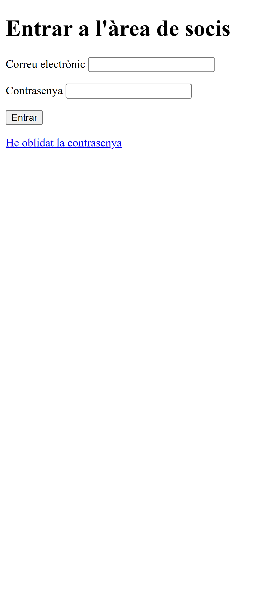
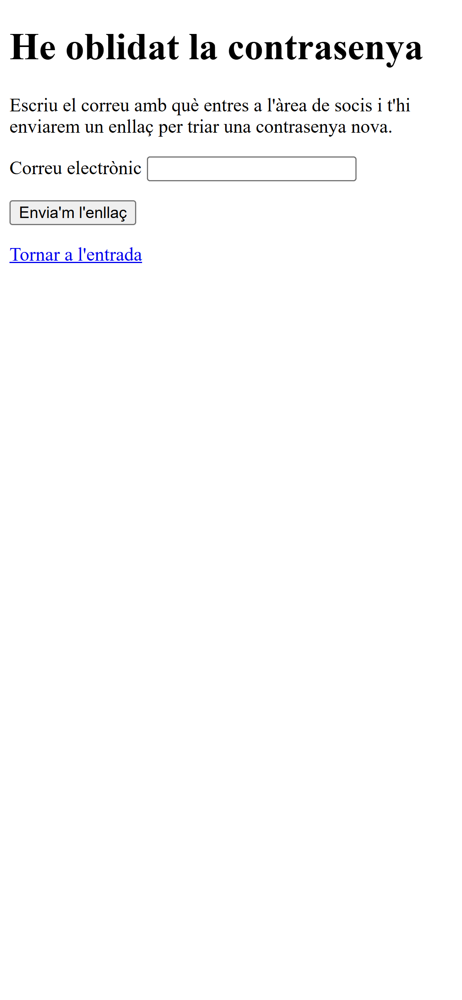
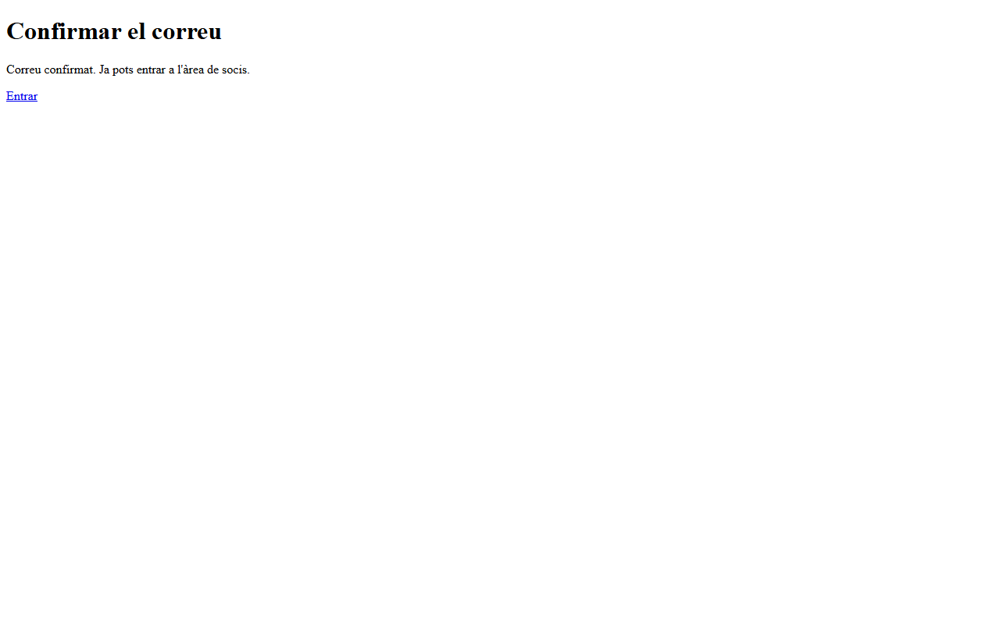
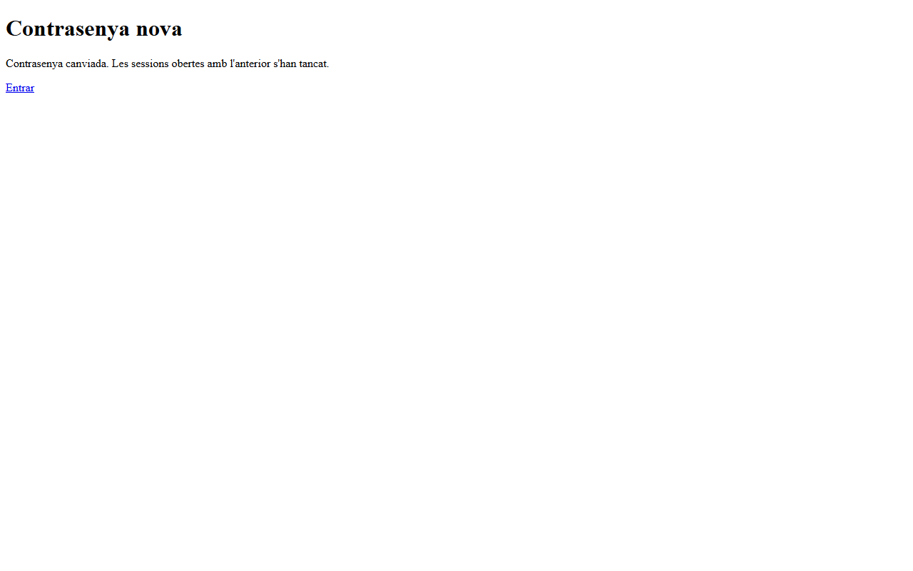

# T-M01-05 · Entrades separades i doble factor (en part)

| Data i hora (Europa/Madrid) | Commit | Proves | CI |
|---|---|---|---|
| 01/11/2026 00:31 | d5abc59 | 133 | vermell (#3) |

**En tres línies:** els socis i l'administració entren per portes diferents, i cada porta només reconeix els seus comptes. A l'administració no s'hi entra sense un segon codi del mòbil. Després de massa intents fallits, l'entrada es bloqueja una estona.

## Què s'ha fet
- Dues entrades: socis amb correu i administració amb nom d'usuari.
- La sessió s'obre només després del segon factor; un administrador sense TOTP només pot donar-ne d'alta un.
- TOTP amb el secret xifrat, sense acceptar dues vegades el mateix codi, i 10 codis de recuperació d'un sol ús, mostrats una vegada.
- Bloqueig per compte i per origen després d'intents fallits, amb un missatge que no diu si el compte existeix.
- Cada sessió val només per a la seva entrada i caduca; la sortida es fa amb un botó, no amb un enllaç.

Detall: [pla, tasques del 01](../planning.md#M01-10-tasques).

## Decisions i perquè
- **TOTP obligatori per a tothom qui entra per l'administració** ([015](../decisions/015-doble-factor-i-comptes-administrador.md)): és on hi ha les dades de tots els socis.
- **Missatge d'error únic:** si digués «aquest compte no existeix», ajudaria a endevinar comptes.
- **Codis de recuperació guardats com a empremta:** ni qui té accés a la base de dades els pot llegir.
- **Usar un codi de recuperació obliga a tornar a donar d'alta el TOTP:** si s'ha perdut el mòbil, el secret antic ja no ha de servir.

## Problemes trobats
- La tasca queda en part: la verificació i la recuperació per correu del compte personal depenen del correu de la T-M01-10, que encara no hi és. També queden el restabliment per un altre administrador, l'alta i la baixa del TOTP personal i la prova de càrrega del bloqueig.
- El CI va fallar (execució #3): falsa alarma de gitleaks (regla `generic-api-key`) sobre la contrasenya inventada de les proves, a `conftest.py` i `apps/accounts/tests/test_sessions.py`. Les proves passaven. Corregit a 383c0df amb una excepció per a aquest valor exacte.

## Com se sap que funciona
- `test_login.py`, `test_totp.py` i `test_sessions.py`: entrades separades, segon factor, codis reutilitzats rebutjats, bloquejos i caducitat de les sessions.

## Evidències
- Captures: [A completar: entrada de socis i entrada d'administració sense la barra d'adreces]. Mai la pantalla d'alta del TOTP ni la dels codis de recuperació.
- Sortida de proves · commit d5abc59 · executada el 02/11/2026 en local (PostgreSQL 16):
  ```
  $ pytest -q
  133 passed
  $ pytest -q apps/accounts/tests/test_login.py apps/accounts/tests/test_totp.py apps/accounts/tests/test_sessions.py
  68 passed
  ```
- `apps/accounts/security.py · commit d5abc59 · 01/11/2026`
  ```python
  # El mateix missatge per a identificador desconegut, contrasenya incorrecta, compte bloquejat
  # o desactivat i origen bloquejat: no revela si el compte existeix.
  GENERIC_ERROR = (
      "Les dades no són correctes, o s'han fet massa intents. Torna-ho a provar d'aquí a una estona."
  )
  ```

## Termes nous
- **TOTP** (*time-based one-time password*, «contrasenya d'un sol ús basada en el temps»): codi de 6 xifres que l'app del mòbil canvia cada 30 segons.
- **Doble factor** (2FA): entrar amb dues proves, una cosa que saps (la contrasenya) i una que tens (el mòbil).
- **QR**: codi de quadrets que el mòbil llegeix amb la càmera; aquí porta el secret del TOTP.
- **Empremta** (*hash*): resultat d'una funció que no es pot desfer; serveix per comprovar un codi sense guardar-lo.
- **Sessió**: període en què el servidor recorda que has entrat.
- **IP**: adreça numèrica del dispositiu des d'on arriba una petició.
- **Proxy** («intermediari»): servidor que rep les peticions abans que la plataforma i les hi passa.

---

# T-M01-05 · Segona tanda: correu, doble factor personal, restabliment i càrrega (en part)

| Data i hora (Europa/Madrid) | Commit | Proves | CI |
|---|---|---|---|
| 03/11/2026 17:05 | 3e4b1ae, be08bed, cd80f9e, c5dc59f, 5b75d08, 43673af | 880 | verd (PR #4: sis feines, dues execucions; confirmat pel responsable el 03/11/2026) |

La primera tanda (a dalt) no es modifica: el CI vermell (#3) i les 133 proves eren l'estat d'aquell moment.

**En tres línies:** un soci nou ja pot confirmar el correu amb un enllaç, i qui té l'enllaç de recuperació pot posar una contrasenya nova. Els socis poden activar o desactivar el segon codi del mòbil. Es prepara que un administrador pugui restablir l'accés d'un altre, i una prova amb moltes peticions alhora demostra que el bloqueig per intents aguanta.

## Què s'ha fet
- Verificació del correu (C5) i contrasenya nova amb l'enllaç de recuperació (CA-04.4): enllaços d'un sol ús, amb caducitat i separats per finalitat.
- Doble factor opcional del compte personal (HU-05): activar-lo amb un codi; desactivar-lo amb la contrasenya i un codi.
- Restabliment per un altre administrador (HU-08), preparat: credencial temporal que s'ha de canviar en entrar, avís sense enllaç i llista protegida. Falta l'acció de la pantalla.
- Prova de càrrega de C3 i correcció dels intents simultanis.

Detall: [pla, tasques del 01](../planning.md#M01-10-tasques).

## Decisions i perquè
- **Testimonis sense desar-los a la base de dades:** la firma i l'estat del compte decideixen si encara valen; quan es fan servir, deixen de valer tots.
- **Obrir l'enllaç no fa res; cal prémer un botó:** els programes que revisen els enllaços dels correus no han de confirmar res.
- **Comprovacions de credencials d'una en una per origen i per compte:** amb peticions alhora, el límit es podia superar.
- **Sense codis de recuperació per al compte personal:** V-01 només en preveu per a l'administració. Què fa un soci que perd el mòbil queda a [P-52](../decisions/pendents.md), abans de producció.
- **Canal de la credencial temporal (Q-03):** obert; la plataforma només garanteix que no surt per correu.

## Problemes trobats
- La prova de càrrega va trobar que, amb peticions alhora, s'avaluaven més contrasenyes i codis dels que permet el límit, per compte i per origen. Corregit; sense la correcció, la prova falla.
- Les proves de concurrència no poden fer servir la neteja habitual: el registre d'activitat no deixa buidar la taula. S'esborren només les files noves, i les proves es neguen a funcionar fora de la base de proves.
- La primera petició d'un enllaç passa pel proxy amb el testimoni a la ruta: queda com a comprovació d'informàtica abans de dades reals.

## Com se sap que funciona
- `test_email_links.py`, `test_password_reset.py`, `test_personal_totp.py`, `test_credentials_reset.py` i `test_concurrency.py`: CA-04.2, 04.4, 05.1, 05.2, 08.1, 08.2 i 08.4; caducitat, reutilització, manipulació, exposició dels testimonis i consum simultani.

## Evidències
- Captures: [A completar: «Seguretat del compte» i confirmació del correu, amb dades inventades]. Mai el QR ni la clau del doble factor.
- Sortida de proves · commit 43673af · executada el 03/11/2026 en local (PostgreSQL 16):
  ```
  $ pytest -q
  880 passed
  ```

## Termes nous
- **Testimoni** (*token*): cadena aleatòria i signada que fa de clau d'un sol ús dins d'un enllaç.
- **Bloqueig consultiu** (*advisory lock*): torn que PostgreSQL dona a una sola petició alhora per a una mateixa clau.
- **Prova de càrrega:** moltes peticions alhora per veure si el sistema es comporta igual que amb una sola.

---

# T-M01-05 · Tercera tanda: demanar els enllaços i restablir un altre compte

| Data i hora (Europa/Madrid) | Commit | Proves | CI |
|---|---|---|---|
| 03/11/2026 18:14 | a8fe478, cf5e7f3, 0802245, 2b671cd | 926 | verd (0bfcee8; confirmat pel responsable) |

Les dues tandes anteriors (a dalt) no es modifiquen, excepte el CI de la segona, que el responsable ha confirmat. El CI d'aquesta tercera tanda també l'ha confirmat el responsable; la revisió d'una persona continua pendent.

**En tres línies:** qui ha oblidat la contrasenya ja la pot demanar per correu, i qui no ha confirmat el correu pot demanar-ne un altre enllaç. Hi ha límits perquè ningú no pugui omplir de correus la bústia d'un soci. Un administrador ja pot restablir l'accés d'un altre, amb un codi del seu mòbil i un motiu que queda al registre.

## Què s'ha fet
- Decisió [065](../decisions/065-enllacos-del-correu-i-restabliment-per-un-altre-administrador.md) i addenda del M01 (RN-M01-58 a 61) abans del codi.
- «He oblidat la contrasenya»: la mateixa resposta per a qualsevol adreça; només un compte actiu rep l'enllaç.
- Reenviament de la verificació, només després d'escriure la contrasenya correcta d'un compte pendent.
- Límits per destinatari i per origen, en un sol fitxer i sense guardar cap adreça.
- Restabliment per un altre administrador: codi nou del mòbil de qui ho fa, motiu, credencial mostrada una sola vegada i avís separat al registre.

Detall: [addenda de la 065](../planning.md#M01-addenda-065).

## Decisions i perquè
- **Només es desen les peticions acceptades:** així una petició limitada no allarga el límit.
- **De l'adreça, només una empremta:** n'hi ha prou per comptar, i no queda cap correu de ningú.
- **Codi nou per restablir:** el codi amb què s'ha entrat no serveix; cal un altre interval.
- **Sense correu de notificació, es restableix igualment i es diu clarament** que no s'ha pogut avisar (validació del responsable, 065).
- **Les contrasenyes de proves addicionals** porten el prefix de la de proves i l'excepció de gitleaks a la mateixa línia, com diu el CLAUDE.md.

## Problemes trobats
- Les rutes amb testimoni capturaven «oblidada» i «reenviar»: les rutes fixes van ara al davant.
- La prova del límit per origen amb peticions simultànies passava encara que es tragués la protecció. Ara la prova alenteix la comprovació per fer visible la cursa, i sense la protecció falla.
- La plantilla de cada pàgina porta el testimoni CSRF: per comparar respostes «iguals», es compara sense aquest valor.

## Com se sap que funciona
- `test_link_requests.py`, `test_credentials_reset.py` i `test_concurrency.py`: CA-M01-48 a CA-M01-55, amb ràfegues simultànies per destinatari i per origen i dos enllaços diferents de la mateixa operació alhora.
- Comprovat només als registres de l'aplicació: el proxy queda pendent (arquitectura §7).

## Evidències
- Captures: [A completar: «He oblidat la contrasenya», resposta enviada i restabliment sense correu de notificació, sense la barra d'adreces]. Mai la credencial temporal, el QR ni la clau del doble factor.
- Sortida de proves · commit 2b671cd · executada el 03/11/2026 en local (PostgreSQL 16):
  ```
  $ pytest -q
  926 passed
  ```

## Termes nous
- **Empremta d'una adreça:** valor calculat a partir del correu que permet comptar-ne els enviaments sense guardar el correu.
- **Cursa** (*race condition*): dues peticions que llegeixen alhora el mateix comptador abans que cap l'actualitzi.

# T-M01-05 · Revisió al navegador i correcció d'E1 (en part)

| Data i hora (Europa/Madrid) | Commit | Proves | CI |
|---|---|---|---|
| 03/11/2026 21:15 | ad5d53d | 946 | verd (942b80a, PR #4: sis feines, dues execucions; confirmat pel responsable) |

Les tandes anteriors (a dalt) no es modifiquen. El CI d'aquesta entrada l'ha confirmat el responsable el 04/11/2026 a 942b80a, que inclou ad5d53d. E1 queda corregit i comprovat a Chrome; la revisió d'una persona de tota la T-M01-05 continua pendent.

**En tres línies:** una revisió en un navegador real (Chrome) va trobar que, a 50324e9, ni la confirmació del correu ni la contrasenya nova des de l'enllaç es podien completar: el formulari donava un error 403. Les proves automàtiques no ho veien. A ad5d53d funcionen al mateix navegador, sense cap manipulació.

## Què s'ha fet
- Revisió funcional al navegador (Chrome amb un perfil temporal buit) de la verificació, la recuperació, el doble factor personal i el restabliment per un altre administrador, amb comptes inventats a la base de dades local.
- Correcció d'E1: «no-referrer» només a la redirecció que surt de l'adreça amb el testimoni; les pàgines netes dels formularis, «same-origin».
- Proves de regressió amb la comprovació CSRF activada (`test_link_forms_csrf.py`).

## Decisions i perquè
- **Per què fallava:** amb «Referrer-Policy: no-referrer», el navegador envia «Origin: null» als formularis, i la comprovació CSRF de Django el rebutja. Les proves fan servir un client que no envia aquesta capçalera.
- **Per què «same-origin» a la pàgina neta:** l'adreça ja no porta el testimoni, i aquesta política no envia res a cap altre lloc. La de producció ja és aquesta (`SECURE_REFERRER_POLICY`).
- **El que no es toca:** la comprovació CSRF, els orígens de confiança i la memòria cau («no-store») continuen igual.

## Problemes trobats
- A 50324e9, en un navegador: «Origin checking failed - null does not match any trusted origins» en confirmar el correu i en desar la contrasenya nova. Les proves que hi havia comprovaven, precisament, «no-referrer» a les pàgines netes; s'han corregit.
- La prova darrere d'un proxy HTTPS necessita la capçalera Host, com la que reenvia el proxy; sense, el client de proves calcula l'origen amb el port 80.
- Altres troballes de la revisió, fora d'aquesta correcció i pendents de decisió: el límit per origen compta les peticions limitades per destinatari (RN-M01-58 diu que una petició limitada no compta); el reenviament d'un sol ús continua [A validar]; la diferència de temps de la recuperació continua oberta; les pantalles no tenen cap full d'estil ni wireframe.

## Com se sap que funciona
- `test_link_forms_csrf.py`: POST legítim; rebuig d'un origen aliè, d'«Origin: null» i de testimoni CSRF absent o incorrecte, sense gastar l'enllaç; capçaleres a cada pas; consum únic; i darrere d'un proxy HTTPS com a producció. Amb el codi de 50324e9, 6 d'aquestes proves fallen.
- Al navegador, sense manipular cap capçalera, a ad5d53d: verificació completa, recuperació completa, reutilització rebutjada, sessió d'un altre context tancada i recuperació d'un compte amb doble factor que el conserva. Només s'ha provat Chrome; HTTPS real, no (només simulat a les proves).

## Evidències
- Captures de Chrome amb un perfil temporal buit, revisades una per una el 04/11/2026 abans d'afegir-les: cap contrasenya, credencial temporal, QR, clau, codi de recuperació ni enllaç amb testimoni. Pantalles sense estils perquè encara no n'hi ha (T-M01-38). Les de 50324e9 són l'evidència del fallo, que no es reescriu:
  - 
    *03/11/2026 20:54 (Europa/Madrid) · local, comptes de revisió inventats · commit 50324e9 (el fallo E1)*
  - 
    *03/11/2026 20:58 (Europa/Madrid) · local, comptes de revisió inventats · commit 50324e9*
  - 
    *03/11/2026 21:07 (Europa/Madrid) · local, comptes de revisió inventats · commit 50324e9*
  - 
    *03/11/2026 21:13 (Europa/Madrid) · local, comptes de revisió inventats · commit 50324e9*
  - 
    *03/11/2026 21:16 (Europa/Madrid) · local, comptes de revisió inventats · commit 50324e9 · la credencial temporal es va substituir per «[OCULTA]» a la pàgina abans de capturar-la; aquella credencial ja no val (restabliment nou el 04/11/2026)*
  - 
    *03/11/2026 21:23 (Europa/Madrid) · local, emulació de mòbil · commit 50324e9*
  - 
    *03/11/2026 21:23 (Europa/Madrid) · local, emulació de mòbil · commit 50324e9*
  - 
    *03/11/2026 22:05 (Europa/Madrid) · local, comptes de revisió inventats · commit ad5d53d (E1 corregit)*
  - 
    *03/11/2026 22:13 (Europa/Madrid) · local, comptes de revisió inventats · commit ad5d53d (E1 corregit)*
- Sortida de proves · commit ad5d53d · executada el 03/11/2026 en local (PostgreSQL 16, base de dades de proves):
  ```
  $ pytest -q
  946 passed
  ```

## Termes nous
- **Política de referència** (*Referrer-Policy*): què diu el navegador a la pàgina següent sobre d'on ve.
- **Origen** (*Origin*): l'adreça del lloc que envia un formulari; Django la compara amb la seva per evitar falsificacions de peticions.

---

# T-M01-05 · Ajustos de la decisió 066 (en part)

| Data i hora (Europa/Madrid) | Commit | Proves | CI |
|---|---|---|---|
| 04/11/2026 01:40 | fc49620, b56dc5e | 951 | [A comprovar] |

Les entrades anteriors (a dalt) no es modifiquen, excepte les captures de la revisió al navegador, que ara hi són.

**En tres línies:** qui no ha confirmat el correu ja pot demanar l'enllaç més d'una vegada mentre dura l'avís, sempre amb els límits de sempre. S'ha deixat per escrit que les peticions limitades per adreça compten per al límit d'origen, perquè no es pugui deduir si una adreça té compte. La resta de propostes (disseny, límit diari dels correus i la cua) queden al pla, sense fer.

## Què s'ha fet
- Decisió [066](../decisions/066-revisio-de-la-t-m01-05-reenviament-limit-d-origen-i-tasques.md) i [addenda del M01](../planning.md#M01-addenda-066), abans del codi: canvien el text de RN-M01-58, RN-M01-59, CA-M01-50 i CA-M01-51; afegeixen la T-M01-38 i la T-M00-06 (aprovades) i la T-M01-39 (proposta, [P-53](../decisions/pendents.md)).
- Reenviament de la verificació sense el límit d'un sol ús: l'estat de 10 minuts ja no es consumeix; cada reenviament passa pels límits de RN-M01-58 i torna a comprovar que el compte és pendent.
- RN-M01-58: el codi ja comptava per a l'origen les limitades per destinatari. Ara ho diu la regla i una prova ho fixa.
- Captures de la revisió afegides (vegeu l'entrada anterior).
- `cris_dev` (autoritzat): restabliment nou de `revisio-sense-correu` sense mostrar la credencial (l'anterior ja no val) i esborrades les 6 sessions que hi havia.

## Decisions i perquè
- **Per què no «no compta»:** si les limitades per destinatari no comptessin per a l'origen, deu peticions per a una adreça i una per a una bústia pròpia dirien si l'adreça té compte actiu. La resposta de la pàgina seria la mateixa, però no l'efecte. Es descarta un comptador separat amb llindar 30: no tanca aquest canal.
- **Per què treure el límit d'un sol ús:** tornar a escriure la contrasenya ja en donava un de nou; no protegia de res que no cobreixin els límits per destinatari i per origen.

## Problemes trobats
- Res de nou al codi. Abans de documentar res sobre el proxy de producció, s'ha separat el que s'ha comprovat del que només es dedueix:
  - **Comprovat al codi de Django 5.2.18 instal·lat:** la comprovació CSRF compara l'`Origin` amb el protocol que diu `is_secure()` i l'amfitrió de `get_host()`; si l'amfitrió no és a `ALLOWED_HOSTS`, prova `CSRF_TRUSTED_ORIGINS`. `SecurityMiddleware` és el primer middleware i `CommonMiddleware` crida `get_host()` a totes les peticions. `client_ip` (`apps/accounts/security.py`) compta `DJANGO_NUM_PROXIES` des de la dreta de `X-Forwarded-For`.
  - **Segons la documentació oficial de Django 5.2** (consultada el 04/11/2026): `SECURE_SSL_REDIRECT` pot fer redireccions infinites darrere d'un proxy que no diu quines peticions són segures; `SECURE_PROXY_SSL_HEADER` només s'ha de fer servir si el proxy **esborra** l'`X-Forwarded-Proto` que envia el client i el posa només a les peticions HTTPS; `get_host()` només llegeix `X-Forwarded-Host` amb `USE_X_FORWARDED_HOST`; `CSRF_TRUSTED_ORIGINS` amplia els orígens acceptats.
  - **Deduït, no comprovat:** què fa realment el proxy de Coolify (si reenvia `Host` i `X-Forwarded-Proto`, si esborra els que envia el client, quants salts hi ha). Per tant, no se sap quins formularis o pàgines fallarien amb una configuració incorrecta: depèn del cas, i es comprova a l'entorn de proves abans de producció.
- La revisió d'una persona de la T-M01-05 continua pendent.

## Com se sap que funciona
- `test_link_requests.py`:
  - **reenviament:** un segon reenviament dins dels 10 minuts surt cap a l'adreça del compte, i en surten tres com a màxim (el quart queda limitat per destinatari amb la mateixa resposta);
  - **estat del compte:** si el compte deixa de ser pendent, el reenviament següent no envia res;
  - **límit d'origen:** deu peticions per a un compte actiu, per a una adreça sense compte o per a un compte pendent deixen l'origen limitat igual, i la bústia pròpia no rep res.
- Amb el codi anterior, les tres proves del reenviament fallen. Amb la lectura «no compta» (esborrar la fila limitada), la prova del límit d'origen falla per al compte actiu.

## Evidències
- Sortida de proves · commit b56dc5e · executada el 04/11/2026 en local (PostgreSQL 16, base de dades de proves creada de nou):
  ```
  $ pytest -q --create-db
  951 passed
  $ ruff check . && ruff format --check .
  All checks passed!
  $ python manage.py makemigrations --check --dry-run
  No changes detected
  ```

## Termes nous
- **Límit per origen:** quantes peticions accepta la plataforma d'una mateixa adreça IP en un temps; serveix perquè ningú no pugui provar adreces sense parar.
