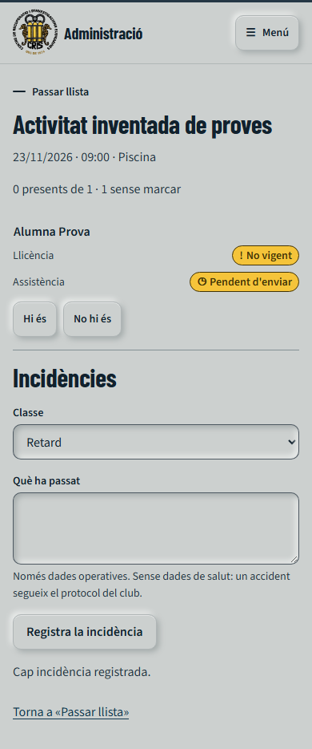

# T-M02-16b · Passar llista des del mòbil i incidències

| Data i hora (Europa/Madrid) | Commit | Proves | CI |
|---|---|---|---|
| 23/11/2026 19:18 | (vegeu la PR) | 5 noves; 1 e2e | [A comprovar] |

**En tres línies:** l'instructor obre «Passar llista» al mòbil, tria la seva sessió i marca cada alumne amb un toc. Si es queda sense cobertura, la marca surt «Pendent d'enviar» i s'envia sola quan torna la connexió, sense duplicar-se. A la mateixa pantalla registra les incidències operatives, mai de salut.

## Què s'ha fet
- `apps/activities/views/attendance.py` (rutes a `apps/activities/admin_urls.py`): «Passar llista», la llista d'una sessió o d'una sortida i les incidències, sobre els serveis de la T-M02-16a.
- `static/js/passar-llista.js`: envia cada marca amb `fetch`; si falla per la xarxa, la guarda i la reenvia en tornar la connexió (i cada 15 s).
- Nucli (commit propi): l'entrada «Passar llista» al menú (grup Activitats; AC9), provisional per a DISSENY.

## Decisions i perquè
- La pantalla no repeteix cap control: els serveis ja comproven AC9 per objecte i deixen al registre l'intent fora de l'abast.
- Sense JavaScript, els botons envien el formulari normal i tornen a la llista: la feina es pot fer igual.
- Un error del servidor (per exemple, una inscripció que ja no és confirmada) no es reintenta: la fila diu «No s'ha desat».
- El recompte de dalt és el de quan s'obre la pàgina; no s'actualitza amb cada toc.

## Problemes trobats
- La comprovació del navegador de les proves e2e compta com a error la petició que falla sense connexió; la prova la declara esperada.

## Com se sap que funciona
`apps/activities/tests/test_attendance_views.py`: l'instructor només llista i obre les seves sessions (CA-M02-16, amb el registre), la marca reenviada es desa una vegada (CA-M02-17), el formulari sense JavaScript, les incidències (sense descripció, error) i qui no té AC9 rep «no trobat». Al navegador, `apps/core/tests/e2e/test_passar_llista.py` talla la connexió, comprova «Pendent d'enviar» i que la marca arriba en tornar; captures a 1280, 390 i 320 px mirades.

*23/11/2026 19:18 (Europa/Madrid) · local, dades inventades · commit (vegeu la PR)*

## Termes nous
- **fetch:** la funció del navegador que envia una petició sense recarregar la pàgina.
