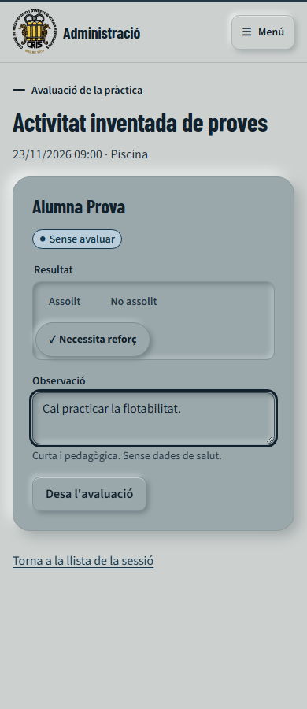

# T-M02-17b · Full d'avaluació d'una pràctica

| Data i hora (Europa/Madrid) | Commit | Proves | CI |
|---|---|---|---|
| 23/11/2026 20:36 | (vegeu la PR) | 3 noves; 1 e2e | [A comprovar] |

**En tres línies:** l'instructor que fa classe en una sessió pràctica obre, des de la llista de la sessió, el full d'avaluació. Per a cada alumne confirmat tria assolit, no assolit o necessita reforç i hi deixa una observació curta. Cap altre instructor no hi entra, i ningú no s'avalua a si mateix.

## Què s'ha fet
- `apps/activities/views/assessment.py` (ruta `assessment_sheet`) i `templates/activities/assessment_sheet.html`, sobre `assessment.sheet` i `assess`.
- L'enllaç «Avalua la pràctica» a la llista de la sessió (T-M02-16b), només si la sessió és pràctica i qui mira hi fa classe.

## Decisions i perquè
- Sense entrada de menú: s'hi arriba des de «Passar llista». Per això aquesta branca surt de la T-M02-16b i va al mateix lot de navegació.
- El resultat és un control segmentat amb botons de ràdio (sistema de disseny); l'observació porta l'ajuda «Sense dades de salut» (RN-M02-17).

## Problemes trobats
- Dins d'un `.formulari`, un `fieldset` es pinta en graella: el control segmentat va dins del `fieldset`, no al mateix element.

## Com se sap que funciona
`apps/activities/tests/test_assessment_views.py`: l'instructor avalua la seva pràctica (i un resultat desconegut es rebutja), un altre instructor rep «no trobat» amb el registre, i una sessió teòrica no s'avalua ni té l'enllaç. Al navegador, `test_the_instructor_assesses_a_practice`; captures a 1280, 390 i 320 px mirades.

*23/11/2026 20:36 (Europa/Madrid) · local, dades inventades · commit (vegeu la PR)*

## Termes nous
Cap.
