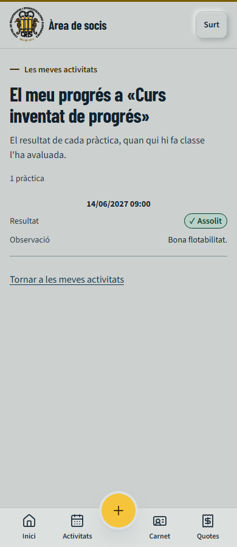

# T-M02-17b · «El meu progrés» a l'àrea personal

| Data i hora (Europa/Madrid) | Commit | Proves | CI |
|---|---|---|---|
| 24/11/2026 17:55 | (vegeu la PR) | 2 noves i 1 e2e | [A comprovar] |

**En tres línies:** un alumne ja pot veure com li han anat les pràctiques del seu curs: per a cada pràctica, el resultat que ha posat qui hi fa classe i l'observació. Ho obre des de «Les meves activitats», i només veu les seves.

## Què s'ha fet
- La pàgina `/socis/activitats/inscripcions/<id>/progres/` sobre el servei `assessment.progress` (HU-M02-14, RN-M02-17; [M02](../planning.md#M02-10-tasques)) i el botó «El meu progrés» a cada curs amb pràctiques de «Les meves activitats».
- Sense entrada de menú pròpia: és una subpàgina de «Les meves activitats» (que el menú personal la marqui, DISSENY).

## Com se sap que funciona
- `test_my_progress.py`: les seves pràctiques amb el resultat i l'observació, la que encara no s'ha avaluat, cap observació d'una altra alumna i, d'una altra persona o d'un compte d'administrador, «no trobat».
- `test_meu_progres.py` (e2e): de «Les meves activitats» al progrés; captures a 1280, 390 i 320 px, mirades.

## Captures

*24/11/2026 17:55 (Europa/Madrid) · local, dades inventades*
