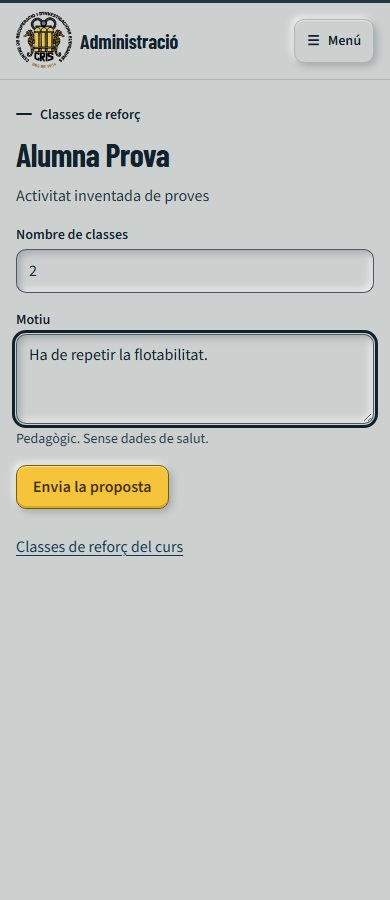

# T-M02-18b · Pantalles de les classes de reforç

| Data i hora (Europa/Madrid) | Commit | Proves | CI |
|---|---|---|---|
| 23/11/2026 22:24 | (vegeu la PR) | 4 noves; 1 e2e | [A comprovar] |

**En tres línies:** des del full d'avaluació, l'instructor proposa classes de reforç per a un alumne amb un motiu pedagògic. El responsable de cursos les veu a «Classes de reforç» del curs i les confirma posant dia, hores, lloc i instructor a cada classe (es crea el càrrec del preu de reforç), o les rebutja amb un motiu.

## Què s'ha fet
- `apps/activities/views/reinforcement.py` (rutes `reinforcement_list` i `reinforcement_propose`) i les plantilles `reinforcement_propose.html` i `reinforcement_list.html`, sobre `reinforcement.propose`, `confirm` i `reject`.
- Enllaços des del full d'avaluació (proposar, per a qui fa classe al curs) i des dels resultats del curs (la llista).
- Nucli (commit propi): les rutes pengen de l'entrada «Passar llista».

## Decisions i perquè
- Sense entrada de menú pròpia: s'hi arriba des del full d'avaluació i dels resultats del curs.
- El formulari de confirmació té una secció per classe proposada: el servei demana exactament tantes sessions com classes.
- Un camp que falta es diu amb el número de la classe; les regles (lloc actiu, requisits per fer classe, preu de la fitxa) les comprova el servei.

## Problemes trobats
Cap.

## Com se sap que funciona
`apps/activities/tests/test_reinforcement_views.py`: l'instructor proposa des del full (sense motiu, error), el responsable confirma amb la sessió i el càrrec de 30 € (CA-M02-18), rebutjar demana motiu i una confirmació incompleta es diu, i un instructor de fora, l'instructor del curs que vol decidir i la secretaria reben «no trobat». Al navegador, `test_the_instructor_proposes_reinforcement`; captures a 1280, 390 i 320 px mirades.

*23/11/2026 22:24 (Europa/Madrid) · local, dades inventades · commit (vegeu la PR)*

## Termes nous
Cap.
