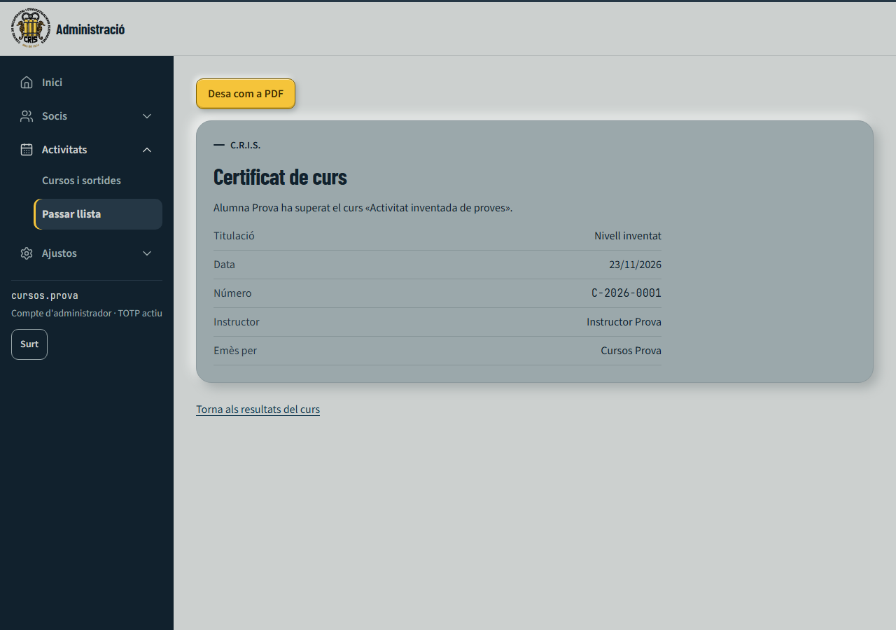

# T-M02-19b · Resultats del curs i certificat

| Data i hora (Europa/Madrid) | Commit | Proves | CI |
|---|---|---|---|
| 23/11/2026 21:37 | (vegeu la PR) | 4 noves; 1 e2e | [A comprovar] |

**En tres línies:** l'instructor del curs posa apte o no apte a cada alumne (si no és apte, amb un motiu). El responsable de cursos emet el certificat d'un apte, que rep un número únic, i el pot imprimir o desar com a PDF des del navegador. S'hi arriba des de la llista de la sessió.

## Què s'ha fet
- `apps/activities/views/outcomes.py` (rutes `course_outcomes` i `course_certificate`) i les plantilles `course_outcomes.html` i `certificate.html`, sobre `certificates.record_outcome`, `issue` i `certificate`.
- L'enllaç «Resultats del curs» a la llista de la sessió, per a qui hi fa classe (AC12) o té AC13.
- Nucli (commit propi): les dues rutes pengen de l'entrada «Passar llista».

## Decisions i perquè
- Una sola pàgina per a tots dos rols: l'instructor hi veu el formulari del resultat i el responsable, el botó d'emetre; el servidor ho torna a comprovar.
- Si la fitxa del curs no diu quin nivell dona, el responsable el tria en emetre el certificat.
- El certificat de l'alumne a «Les meves activitats» és de la T-M02-22.

## Problemes trobats
- A les proves, `login_as` torna sempre el mateix client: per comprovar un segon compte cal tornar-hi a entrar.

## Com se sap que funciona
`apps/activities/tests/test_outcome_views.py`: l'instructor posa el resultat (sense motiu, «no apte» es rebutja), un instructor de fora rep «no trobat» amb el registre, una sortida no té resultats, el responsable emet el certificat `C-AAAA-0001` i el veu (l'instructor no), i sense AC12 ni AC13 «no trobat». Al navegador, `test_the_manager_issues_a_certificate`; captures a 1280, 390 i 320 px mirades.

*23/11/2026 21:37 (Europa/Madrid) · local, dades inventades · commit (vegeu la PR)*

## Termes nous
Cap.
