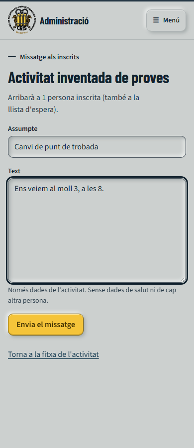

# T-M02-21c · Pantalla del missatge de l'organitzador als inscrits

| Data i hora (Europa/Madrid) | Commit | Proves | CI |
|---|---|---|---|
| 24/11/2026 03:13 | (vegeu la PR) | 2 noves; 1 e2e | [A comprovar] |

**En tres línies:** des de la fitxa d'una activitat, qui la gestiona (AC15) obre «Missatge als inscrits», escriu l'assumpte i el text i l'envia a totes les persones inscrites o a la llista d'espera. La pantalla diu a quantes persones arribarà, però no en mostra cap nom ni adreça.

## Què s'ha fet
- `apps/activities/views/message.py` (ruta `activity_message`) i `templates/activities/activity_message.html`, sobre `notifications.send_message` (T-M02-21b).
- L'enllaç «Missatge als inscrits» a la fitxa de l'activitat, només amb AC15.
- Nucli (commit propi): la ruta penja de l'entrada «Cursos i sortides».

## Decisions i perquè
- Només el nombre de destinataris: el responsable no necessita veure les adreces per escriure'ls.
- Sense ningú inscrit, el botó d'enviar surt desactivat.
- L'ajuda del text recorda que no hi poden anar dades de salut ni d'altres persones.

## Problemes trobats
Cap.

## Com se sap que funciona
`apps/activities/tests/test_message_view.py`: l'enllaç des de la fitxa, el nombre de destinataris sense adreces, l'assumpte buit es rebutja, l'enviament queda a la cua i al registre, i sense AC15 «no trobat». Al navegador, `test_missatge_activitat.py`; captures a 1280, 390 i 320 px mirades.

*24/11/2026 03:13 (Europa/Madrid) · local, dades inventades · commit (vegeu la PR)*

## Termes nous
Cap.
