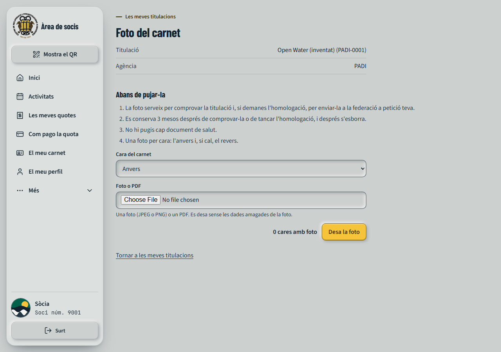
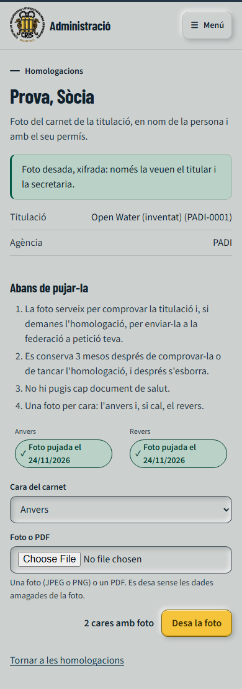

# T-M02-42b · Pantalles per pujar la foto del carnet d'una titulació

| Data i hora (Europa/Madrid) | Commit | Proves | CI |
|---|---|---|---|
| 24/11/2026 13:04 | (vegeu la PR) | 5 noves i 1 e2e | [A comprovar] |

**En tres línies:** quan el club encengui les fotos de titulacions, un soci podrà pujar la foto del carnet des de «Les meves titulacions», i la secretaria podrà fer-ho en nom seu des de la fitxa de l'homologació. Abans de pujar-la, un avís diu per a què serveix, quant temps es guarda i que no s'hi pugi cap document de salut. Mentre l'interruptor sigui apagat, aquestes pantalles no existeixen.

## Què s'ha fet
- `apps/activities/views/card_photos.py` i tres plantilles, amb les regles del servei de la [T-M02-42a](T-M02-42a.md) ([addenda de la 104](../planning.md#M02-addenda-104), RN-M02-47 i 56).
- Enllaços: «Foto del carnet» a cada titulació d'una altra agència de «Les meves titulacions» i «Puja la foto del carnet» a la fitxa de l'homologació (AC25). No cal cap entrada de menú nova.

## Decisions i perquè
- **La pantalla diu quines cares ja tenen foto, però no la mostra:** veure-la, amb permís i registre, és de la T-M02-43.
- **Amb l'interruptor apagat, «no trobat»** a les dues adreces, i cap enllaç hi porta (CA-M02-52).

## Com se sap que funciona
`apps/activities/tests/test_card_photo_views.py` (apagat; el titular puja i torna a la llista; un fitxer dolent torna el formulari amb Errata; una titulació d'una altra persona, «no trobat»; la secretaria des de la fitxa; sense AC25, «no trobat») i `apps/core/tests/e2e/test_fotos_titulacions.py` (captures a 1280, 390 i 320 px, en clar i en fosc, mirades).

## Comprovació de §15.5 del sistema de disseny
- Cap animació nova. «Esborra-la» és un `boto boto-petit` del sistema; la mida mínima de toc és la del component.
- Un sol botó principal («Desa la foto»), títol concret («Foto del carnet» o el nom de la persona), cap insígnia decorativa, dates en format català, cap `style=` ni cap valor fora de `tokens.css`.
- El mapa no hi assigna cap recurs: s'hi reutilitza **Expositor** (regles a la vista, una cel·la per cara i el recompte), sense la zona d'arrossegament ni la vista prèvia, que queden anotades a `docs/estat/DX.md` per a DISSENY.

## Captures

*24/11/2026 13:04 (Europa/Madrid) · local, dades inventades · commit bd55dca3 (pare)*

*24/11/2026 13:04 (Europa/Madrid) · local, dades inventades · commit bd55dca3 (pare)*
