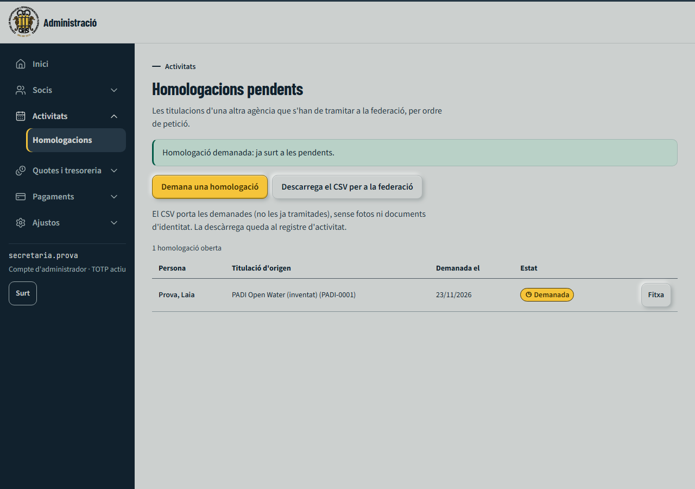
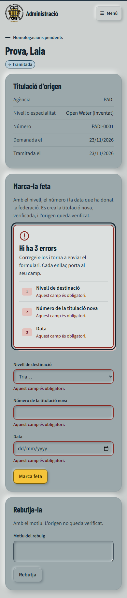

# T-M02-44b · Pantalles de les homologacions

| Data i hora (Europa/Madrid) | Commit | Proves | CI |
|---|---|---|---|
| 23/11/2026 19:18 | (vegeu la PR) | 9 noves; 1 e2e | [A comprovar] |

**En tres línies:** la secretaria ja pot portar les homologacions a la federació des de la plataforma. Veu la llista de pendents i, de cadascuna, la marca tramitada, feta (amb el nivell, el número i la data que dona la federació) o rebutjada amb un motiu. També pot descarregar el CSV per a la federació i demanar una homologació en nom d'una persona.

## Què s'ha fet
- `apps/activities/views/admin_filings.py` i les rutes a `apps/activities/admin_urls.py`: «Homologacions pendents» (`/gestio/homologacions/`, AC26), la fitxa amb els tres formularis, el CSV (POST) i «Demana una homologació» (AC25).
- Plantilles `activities/filings.html`, `filing_detail.html`, `filing_request.html` i `_filing_status.html` (estat amb símbol, text i color), amb Errata als formularis.
- Commit «(nucli)»: l'entrada «Homologacions» al grup «Activitats» del menú.

## Decisions i perquè
- El CSV es descarrega amb POST: cada descàrrega queda al registre amb l'empremta, i un enllaç (GET) es podria precarregar sense que ningú el demanés.
- Per demanar-la en nom d'una persona, només surten les titulacions d'una altra agència sense cap homologació oberta; el servei ho torna a comprovar.
- La petició del titular des de la seva àrea personal queda per a una altra PR: necessita una pàgina i una entrada del menú personal (DISSENY).

## Problemes trobats
El nom accessible de l'enllaç «Fitxa» de la fila porta el text amagat com un bloc a part; la prova al navegador el busca per «Fitxa» al començament, com les altres.

## Com se sap que funciona
`apps/activities/tests/test_admin_filings.py` (sense AC26, «no trobat» a totes; demanar-la en nom d'una persona; CA-M02-53 tramitada i feta; feta sense dades amb Errata; CA-M02-54 rebutjar amb motiu; el CSV i el registre) i `apps/core/tests/e2e/test_homologacions.py` (captures a 1280, 390 i 320 px, mirades).

## Captures

## Termes nous
Cap.
