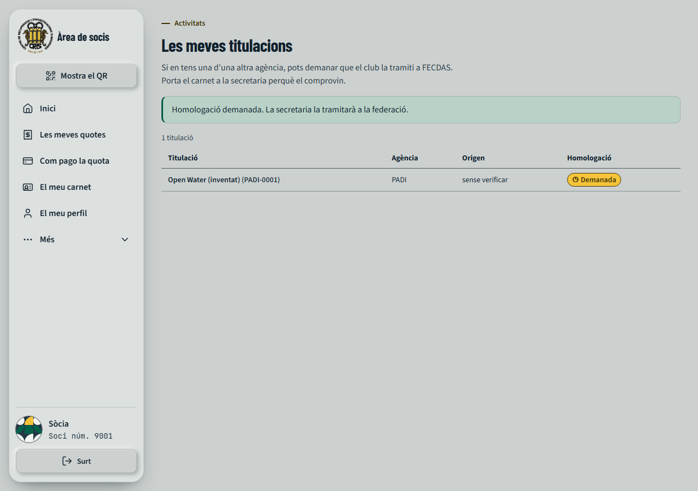
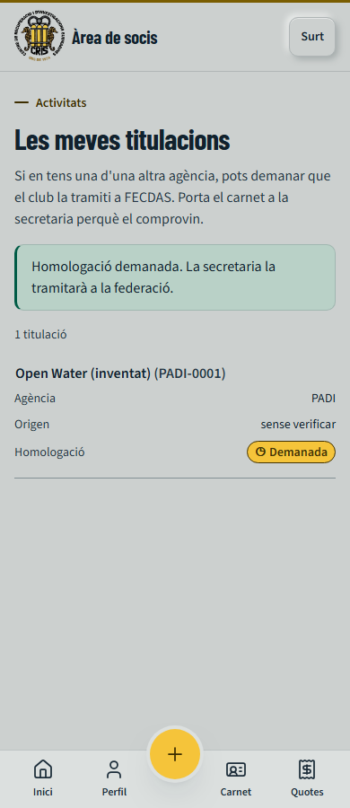

# T-M02-44c · «Les meves titulacions» i demanar l'homologació

| Data i hora (Europa/Madrid) | Commit | Proves | CI |
|---|---|---|---|
| 23/11/2026 19:37 | (vegeu la PR) | 5 noves; 1 e2e | [A comprovar] |

**En tres línies:** cada persona amb compte personal té una pàgina amb les seves titulacions, d'on venen i en quin punt és l'homologació de cadascuna. Si en té una d'una altra agència, pot demanar que el club la tramiti a la federació. La secretaria la veu tot seguit a les homologacions pendents.

## Què s'ha fet
- `apps/activities/views/member_certifications.py`, la ruta `/socis/titulacions/` a `apps/activities/urls.py` i `templates/activities/my_certifications.html`.

## Decisions i perquè
- Només un compte personal hi entra, i la persona és la del compte; la titulació es busca entre les seves (una altra, o un identificador que no és un número, dona «no trobat»).
- L'estat de l'homologació s'escriu a la mateixa plantilla, sense el fragment de la T-M02-44b, perquè les dues branques no depenguin l'una de l'altra.
- L'entrada al menú personal la farà DISSENY (`_personal_nav.html`).

## Problemes trobats
Un identificador de titulació que no era un número feia un error del servidor; ara és «no trobat» (la prova ho cobreix).

## Com se sap que funciona
`apps/activities/tests/test_member_certifications.py` (només les seves; demanar-la; una d'una altra persona o un identificador no vàlid, «no trobat»; amb les fotos obligatòries, el missatge; un compte d'administrador no hi entra; sense sessió, a l'entrada) i `apps/core/tests/e2e/test_meves_titulacions.py` (captures a 1280, 390 i 320 px, mirades).

## Captures

## Termes nous
Cap.
