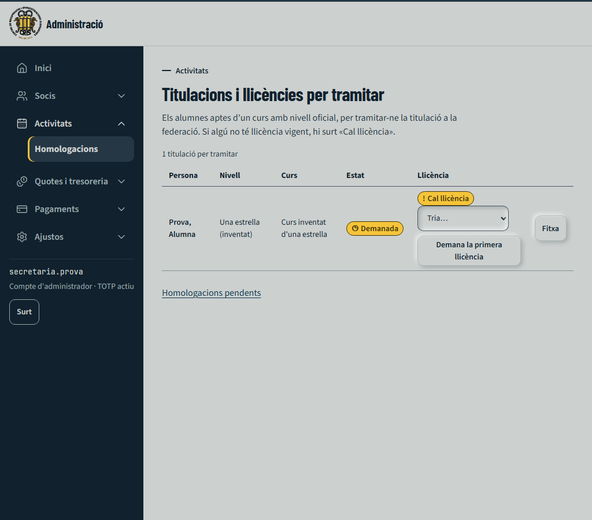
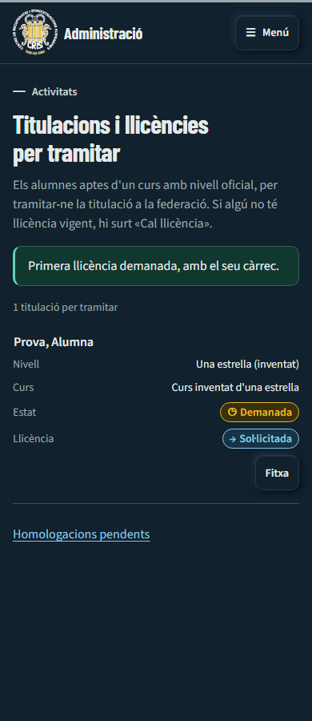

# T-M02-45b · «Titulacions i llicències per tramitar»

| Data i hora (Europa/Madrid) | Commit | Proves | CI |
|---|---|---|---|
| 24/11/2026 17:32 | (vegeu la PR) | 3 noves i 1 e2e | [A comprovar] |

**En tres línies:** la secretaria ja té la llista dels alumnes aptes d'un curs amb nivell oficial (la primera estrella) per tramitar-ne la titulació a la federació. Per a cada alumne diu si té llicència o si «Cal llicència» i, quan el curs no la inclou, la deixa demanar amb el seu càrrec. Un curs que ja la inclou no ofereix mai aquest camí.

## Què s'ha fet
- Vista i plantilla a `apps/activities` sobre `filings.course_pending` i `request_first_licence` ([addenda de la 104](../planning.md#M02-addenda-104), RN-M02-52 i 58; RN-M06-28).
- Penjada provisionalment com a subpàgina de «Homologacions» (una línia «(nucli)»); l'entrada de menú definitiva i la revisió visual, DISSENY.

## Decisions i perquè
- **La fitxa de cada tramitació és la de l'homologació**: ja sap marcar-la tramitada, feta o rebutjada.
- **Sense `enllac-fila`**: la fila té una acció pròpia (el botó), i l'enllaç estès el tapava.

## Com se sap que funciona
- `test_course_filings_view.py`: «Cal llicència» i la petició amb el càrrec; un curs que la inclou no ofereix el camí amb càrrec i el rebutja; peticions dolentes i sense AC26, «no trobat».
- `test_primera_estrella.py` (e2e, T-M02-49): l'alumne apte surt amb «Cal llicència» i la secretaria la demana; captures a quatre amplades, en clar i en fosc, mirades.

## Captures

*24/11/2026 17:32 (Europa/Madrid) · local, dades inventades*

*24/11/2026 17:32 (Europa/Madrid) · local, dades inventades*
