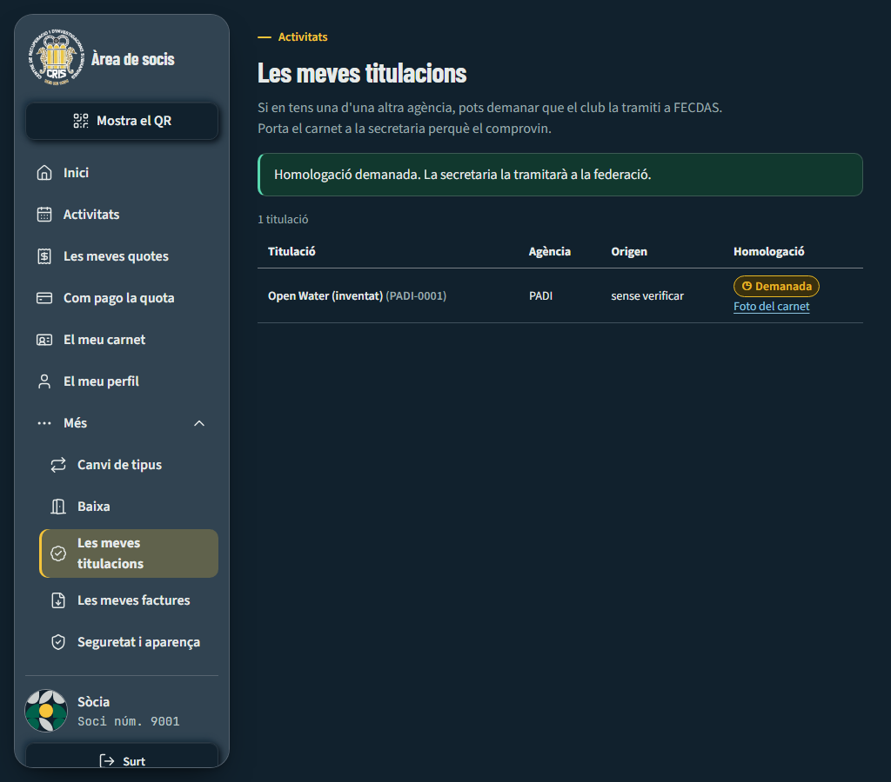
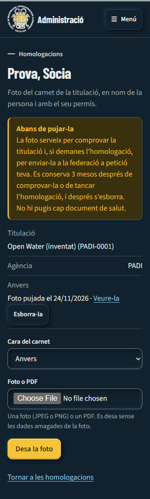

# T-M02-49 (part) · El flux de la foto i l'homologació, al navegador

| Data i hora (Europa/Madrid) | Commit | Proves | CI |
|---|---|---|---|
| 24/11/2026 14:37 | (vegeu la PR) | 1 e2e | [A comprovar] |

**En tres línies:** una prova al navegador fa sencer el camí de la foto del carnet: la sòcia puja la foto i demana l'homologació, i la secretaria la veu i la tramita fins a «feta». Les pantalles s'han capturat a quatre amplades i en clar i en fosc. La part de la primera estrella encara no es pot provar, perquè la seva pantalla no existeix.

## Què s'ha fet
- `apps/core/tests/e2e/test_fotos_homologacio_flux.py`, amb les fotos enceses ([addenda de la 104](../planning.md#M02-addenda-104)), sobre les pantalles de la [T-M02-42b](T-M02-42b.md), la [T-M02-43](T-M02-43.md) i les homologacions de la T-M02-44b.
- La prova comprova que la foto s'obre amb resposta 200 i que l'obertura queda al registre.

## Decisions i perquè
- **La primera estrella fins a «Cal llicència» queda per després:** la llista «Titulacions i llicències per tramitar» només és un servei (T-M02-45). La pantalla necessita una ruta d'administració i una entrada de menú, que són de DISSENY, i la T-M06-26 (primera llicència) encara és en curs.

## Com se sap que funciona
- La prova passa, i les captures a 1280, 1024, 390 i 320 px, en clar i en fosc, són mirades (`E2E_CAPTURES_ALL=1`).

## Captures

*24/11/2026 14:37 (Europa/Madrid) · local, dades inventades*

*24/11/2026 14:37 (Europa/Madrid) · local, dades inventades*
