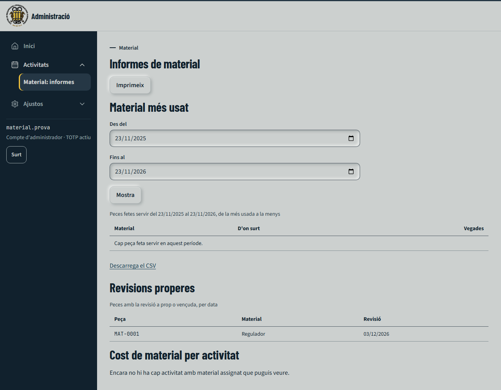
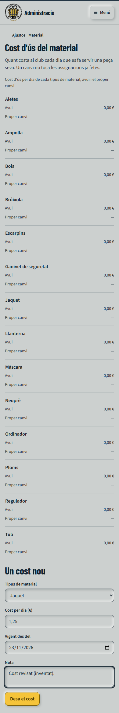

# T-M03-19b i T-M03-22c · Pantalles del material: informes i cost d'ús

| Data i hora (Europa/Madrid) | Commit | Proves | CI |
|---|---|---|---|
| 23/11/2026 15:08 | (vegeu la PR) | 5 noves; 2 e2e | [A comprovar] |

**En tres línies:** l'administració té les primeres pantalles del material. «Material: informes» ensenya el material més usat, les revisions properes i el cost de material de cada activitat, cada bloc només a qui el pot veure, amb CSV i impressió. «Material: cost d'ús» deixa que el tresorer posi quant costa cada dia una peça del club, amb data i nota.

## Què s'ha fet
- `apps/equipment/views.py` i `admin_urls.py`: `reports_view`, `activity_cost_view` i `usage_rates_view`; plantilles a `templates/equipment/`.
- Nucli (commit propi): la ruta a `apps/accounts/admin_urls.py` i les dues entrades a `apps/accounts/navigation.py` (Activitats › «Material: informes» i Ajustos › «Material: cost d'ús»), amb text i lloc provisionals per a DISSENY.
- La guia del material (T-M03-21) ja hi posa els noms del menú i dels botons.

## Decisions i perquè
- Una sola pàgina d'informes amb tres blocs: n'hi ha prou amb un dels tres permisos (MT4, MT11 o MT12) per entrar-hi, i cada bloc torna a mirar el seu. El cost d'una activitat es comprova per objecte (el responsable de cursos i sortides, només les seves).
- El cost per participant va per número d'inscripció, sense noms (RN-M03-09). El CSV fa servir el mateix format que la resta (punt i coma, BOM i fórmules desactivades).
- Imprimir és la impressió del navegador (`data-imprimeix`, §6.8 del sistema de disseny).

## Problemes trobats
- Les entrades noves no sortien al menú fins que no són també en un grup (`GROUPS`).

## Com se sap que funciona
`apps/equipment/tests/test_views.py` (permisos per rol i per objecte, CSV, canvi del cost amb data passada rebutjada i lectura sense edició) i la prova de navegació del menú per a tots els rols. Al navegador, `apps/core/tests/e2e/test_material.py`; captures a 1280, 390 i 320 px mirades.

*23/11/2026 15:08 (Europa/Madrid) · local, dades inventades · commit (vegeu la PR)*

*23/11/2026 15:08 (Europa/Madrid) · local, dades inventades · commit (vegeu la PR)*

## Termes nous
Cap.
