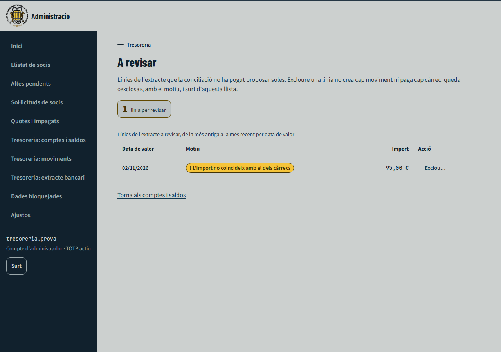
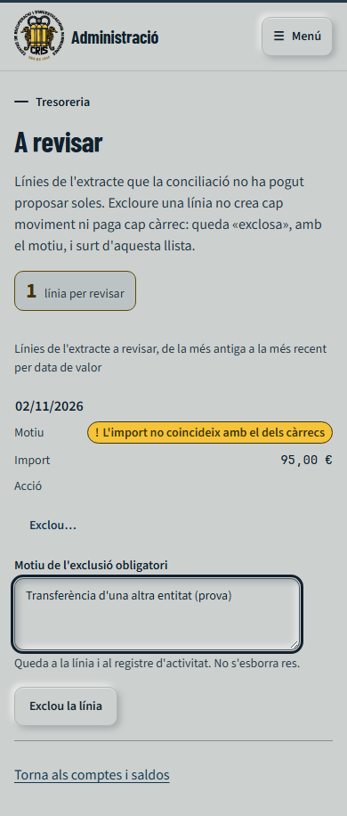

# T-M04-14 · Excloure línies de l'extracte i llista «a revisar»

| Data i hora (Europa/Madrid) | Commit | Proves | CI |
|---|---|---|---|
| 16/11/2026 21:04 | 4a6afcb | 4963 (14 noves i 1 e2e nova) | [A comprovar] |

**En tres línies:** el tresorer ja té una pantalla amb les línies de l'extracte que la conciliació no ha sabut proposar soles, cadascuna amb el motiu. Des d'allà pot excloure'n una escrivint per què: queda «exclosa», no es crea cap moviment ni es paga cap càrrec, i surt de la llista. Quan no hi ha res, la pantalla ho diu.

## Què s'ha fet
- `reconciliation.exclude(line, reason=..., by=...)` ([RN-T15](../planning.md#M04-7-regles), CA-T12.1, LT11): motiu obligatori, només una línia pendent d'un extracte vigent; registre d'activitat amb el compte, el motiu i l'estat anterior, sense el concepte. Una línia exclosa no torna enrere.
- Camp `exclusion_reason` a `StatementLineState` ([M04-6](../planning.md#M04-6-entitats)) i restricció a la base de dades: «exclosa» si i només si té motiu. Migració `treasury/0011`.
- `reconciliation.to_review()` i la pantalla C6 «A revisar» ([M04-3](../planning.md#M04-3-capacitats)): data de valor, motiu i import, amb el comptador de Deposito i «Exclou…» amb el motiu a sota.

## Decisions i perquè
- **Sense el concepte de la línia.** Pot portar noms de persones de fora del club i [M04-4](../planning.md#M04-4-rols) només el deixa veure a la conciliació.
- **Permisos sense codi nou** ([P-190](../decisions/pendents.md)): excloure demana T4 (només el Tresorer) i veure la llista, T1 (Tresorer i Administrador), que tenen les mateixes cel·les inicials que T8 i T10. Així no es toca el catàleg del nucli.
- **Només línies, encara no pagaments** ([P-191](../decisions/pendents.md)): els intents «a revisar» són del 05b (T-M05b-16) i la 04 no en pot dependre. CA-T13.1 queda en part.
- **Només una línia pendent i sense desfer** ([P-192](../decisions/pendents.md)): lectura literal de RN-T15.

## Problemes trobats
- Una prova antiga creava una línia «exclosa» sense motiu; amb la restricció nova ja no es pot, i ara en porta.
- La pantalla no té entrada al menú: la navegació és de la sessió de disseny.

## Com se sap que funciona
- `apps/treasury/tests/test_reconciliation.py`, classe `TestExclude`: motiu obligatori, cap moviment ni pagament, registre sense concepte, línia proposada o d'un extracte desfet, T8 (administrador, secretaria, soci i sistema: «no trobat»), restricció a la base de dades i la llista.
- `apps/treasury/tests/test_views.py`: cel·les de cada rol, només GET a la llista, llista buida, motiu sense concepte, l'administrador veu la llista però no pot excloure, i excloure des de la pantalla.
- `apps/core/tests/e2e/test_tresoreria.py`: el tresorer exclou una transferència de més i la llista queda buida.
- Sortida de proves · commit 4a6afcb · executada el 16/11/2026 en local (PostgreSQL 16): `4963 passed`; e2e de tresoreria, `2 passed`.

*16/11/2026 21:04 (Europa/Madrid) · local, dades inventades · commit 4a6afcb*

*16/11/2026 21:04 (Europa/Madrid) · local, dades inventades · commit 4a6afcb*

## Termes nous
- **Línia exclosa:** una línia del banc que no es concilia amb res de la plataforma (una despesa, un ingrés d'una altra entitat); queda guardada amb el motiu i no compta com a pendent.
