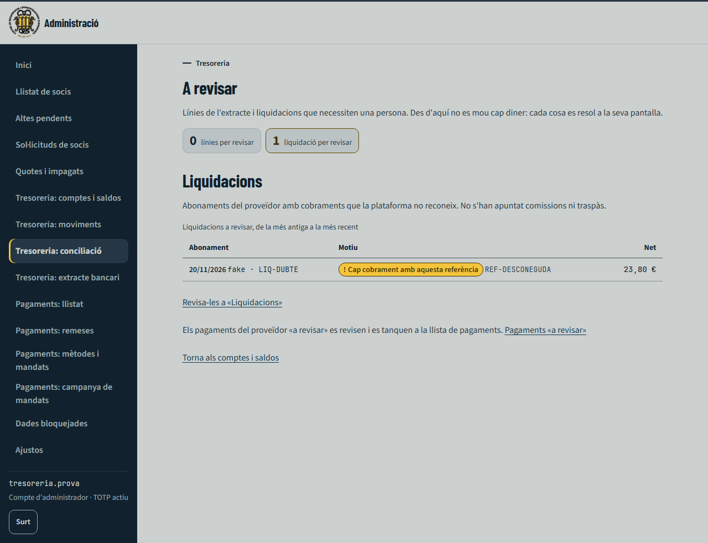
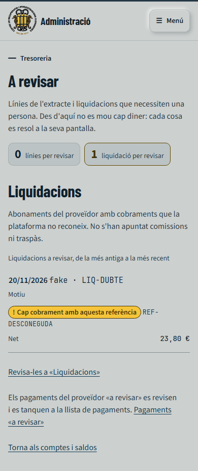

# T-M04-14b · Liquidacions «a revisar» a la llista de la tresoreria

| Data i hora (Europa/Madrid) | Commit | Proves | CI |
|---|---|---|---|
| 18/11/2026 | cd0e5e96 | 1 nova (2 rols); 1 e2e | [A comprovar] |

**En tres línies:** la llista «A revisar» de la tresoreria només mostrava les línies de l'extracte. Ara també mostra les liquidacions del proveïdor que han quedat «a revisar» perquè porten un cobrament que la plataforma no reconeix, amb l'enllaç a «Liquidacions». Des de la llista no es tanca ni es mou res.

## Què s'ha fet
- `treasury.views.review_view`: les liquidacions «a revisar» (CA-T11.2), de la més antiga a la més recent, amb la data, el proveïdor i l'identificador, cada referència amb el seu problema i el net. Un comptador nou al resum. `entry_views.problems_of` és el text dels problemes que ja feia servir «Liquidacions».
- `review.html`: dues seccions («Línies de l'extracte» i «Liquidacions»), «No hi ha res a revisar.» només si totes dues són buides, i l'enllaç **Pagaments «a revisar»** a la llista del 05b, només per a qui té B6.
- La línia de la [guia de tresoreria](../guies/guia-tresoreria.md#4-excloure-una-línia), la fila de l'estat i la fila de la P-191 amb el que s'ha construït.

## Decisions i perquè
- **Opció per defecte de la [P-191](../decisions/pendents.md) (oberta).** Les liquidacions són de la mateixa 04: llegir-les no fa dependre la 04 d'un mòdul posterior. Els intents del 05b continuen a la seva llista (T-M05b-16 i 16b, on ja es tanquen); aquí només hi ha l'enllaç. Les quotes d'A-17 continuen a «Quotes i impagats». CA-T13.1 queda en part.
- **Cap tancament.** La P-191 no en parla i el pla no preveu cap sortida per a una liquidació «a revisar»: s'hi queda. Dubte nou: [P-390](../decisions/pendents.md) (recomanada: tancar-la amb una nota com al 05b).
- **Permís T10 (= T1), sense canvis.** Cap codi nou ni canvi al catàleg (la [P-190](../decisions/pendents.md) és d'una altra tasca).
- **Dades mínimes.** De la liquidació, només la referència del proveïdor i el problema: cap nom, cap IBAN.

## Problemes trobats
- Cap.

## Com se sap que funciona
`apps/treasury/tests/test_views.py`: el Tresorer i l'Administrador veuen la liquidació «a revisar» amb la referència, el problema, el net i els dos enllaços; una liquidació rebuda no hi surt, ni cap nom. Les proves de rutes que ja hi havia cobreixen la cel·la de cada rol («no trobat» sense T10). Al navegador, `test_tresoreria.py`: el tresorer veu la liquidació «a revisar» i l'enllaç el porta a «Liquidacions», a 1280, 390 i 320 px.

