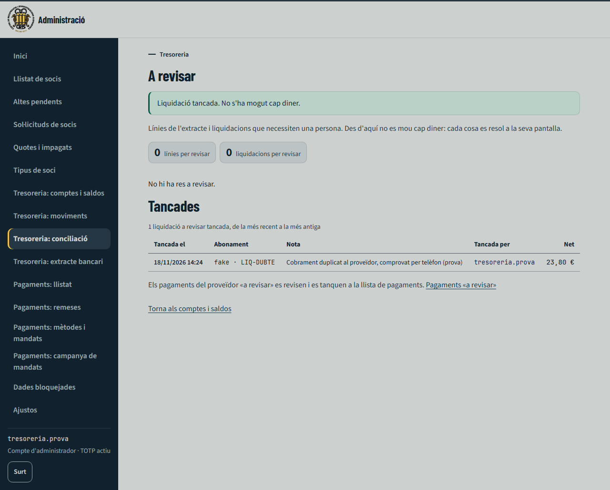
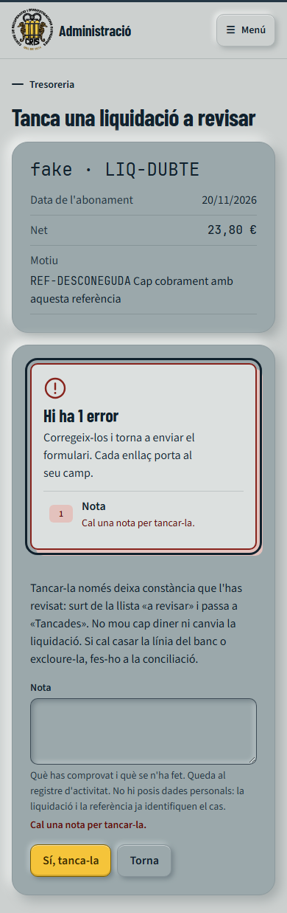

# T-M04-14c · Tancar una liquidació «a revisar» amb nota

| Data i hora (Europa/Madrid) | Commit | Proves | CI |
|---|---|---|---|
| 18/11/2026 | 8354d692 | 10 noves (20 casos), la ruta i el servei a les proves de rutes; 1 e2e | [A comprovar] |

**En tres línies:** una liquidació del proveïdor «a revisar» es quedava per sempre a la llista de la tresoreria. Ara el tresorer la tanca amb una nota obligatòria: surt de la llista i passa a «Tancades». Tancar-la no mou cap diner ni canvia la liquidació.

## Què s'ha fet
- `SettlementReviewClosure` (migració `treasury/0018`): una fila per liquidació tancada, amb qui i quan. Només INSERT, també amb SQL directe (com `payments/0022`).
- `treasury.settlements.close_review`: comprova T10 amb edició, la nota (obligatòria, 500 caràcters com a molt), que la liquidació sigui «a revisar» i que no estigui tancada (amb la liquidació bloquejada), i desa la fila i el registre `treasury.settlement_review_closed` amb la nota i l'estat anterior.
- `/gestio/tresoreria/revisar/liquidacio/<id>/tanca/`: confirmació amb el proveïdor, l'identificador, la data, el net i les referències amb el problema; POST amb CSRF. A «A revisar», «Tanca» a cada liquidació (només amb edició) i «Tancades» amb els 50 tancaments més recents.
- Esborrat RGPD: `apps/treasury/privacy.py`, registrat des de `TreasuryConfig.ready`, torna els tancaments de les liquidacions que citen un cobrament de la persona, i el registre en substitueix la nota. El pagaments no importa la tresoreria. L'exportació de la persona porta una secció «tresoreria» buida: la 04 no té dades personals pròpies.
- P-390 passa a «Resolts» i surt del tauler; la fila de la P-191, la de l'estat i la línia de la [guia de tresoreria](../guies/guia-tresoreria.md#4-excloure-una-línia).

## Decisions i perquè
- **Resposta B de la [P-390](../decisions/pendents.md)** (propietari, 18/11/2026): el mateix patró que el 05b (T-M05b-16b). La nota no és a la taula, que no es pot modificar: és a l'entrada del registre, que l'esborrat sí que pot anonimitzar.
- **La liquidació no canvia d'estat.** Continua «a revisar» a «Liquidacions»; el tancament és una fila a part.
- **Permís T10 amb edició** (`reconciliation.REVIEW`, el codi propi de la P-190) a la vista i al servei. T10 admet ara «Cons.» (veure) i «Sí» (veure i editar): «Cons.» veu la llista i «Tancades», però no la nota ni «Tanca».
- **La nota, només a qui pot tancar.** Qui només té «Cons.» veu «—».
- **Límits coneguts (acceptats pel propietari):** (1) una liquidació la referència de la qual no és de cap cobrament no porta a cap persona, i l'esborrat RGPD no en troba la nota; per això l'ajuda diu «No hi posis dades personals». (2) El tancament duplica el del 05b (T-M05b-16b): mateixa forma (taula de qui i quan, nota al registre), en dues apps, perquè la 04 no pot dependre del 05b.

- **Revisió de la PR #233:** una liquidació tancada surt «Revisada i tancada» a «Liquidacions» amb l'enllaç a «Tancades»; «Tancada per» mostra el nom de la persona, no el login; el ganxo RGPD és a `apps/treasury/privacy.py`; l'etiqueta de T10 diu que «Sí» també tanca. Una liquidació d'una remesa no pot quedar «a revisar» (`settle_remittance` és atòmica i la confirma al moment), de manera que no es pot tancar des d'aquí. Pla (fila T10 de la matriu M04-4): aprovat pel propietari, 18/11/2026.

## Problemes trobats
- Cap.

## Com se sap que funciona
`apps/treasury/tests/test_settlement_review_close.py`: la cel·la de cada rol (200 o «no trobat», a la pàgina i al POST), el servei sense permís, la nota buida i massa llarga, que surt de la llista i entra a «Tancades» sense cap moviment ni pagament nou ni canvi de la liquidació, el segon tancament rebutjat, només una liquidació «a revisar», el registre amb la nota i l'estat anterior, que l'esborrat del pagador no deixa la nota enlloc, un rol amb «Cons.» a T10 veu la llista sense la nota ni «Tanca» i rep «no trobat» en tancar i que la fila no es pot modificar ni esborrar. `test_route_permissions.py` declara la ruta i el servei. Al navegador, `test_tresoreria.py`: el tresorer prem «Tanca», veu l'error sense nota, tanca amb la nota i la troba a «Tancades», a 1280, 390 i 320 px.

## Termes nous
- **Tancar una liquidació «a revisar»:** deixar constància que el tresorer l'ha revisada, amb una nota. No mou diners.
