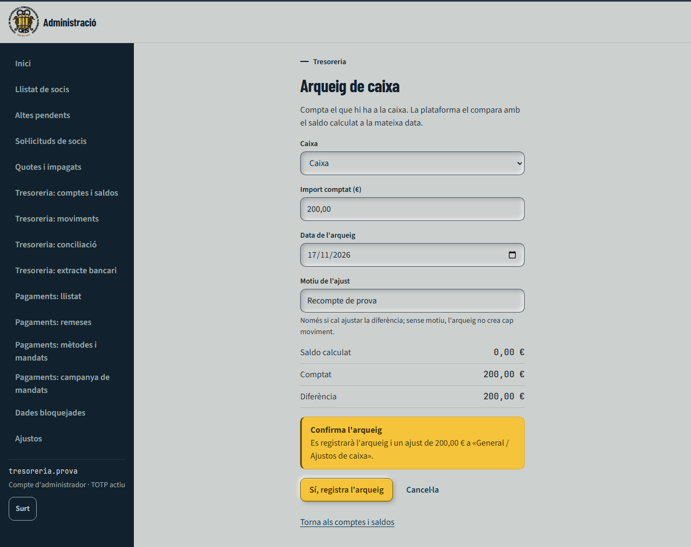
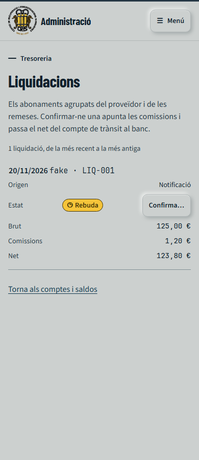

# T-M04-15c · Pantalles de tresoreria que mouen diners

| Data i hora (Europa/Madrid) | Commit | Proves | CI |
|---|---|---|---|
| 17/11/2026 09:30 | 052ed8c | 5811 (9 noves, 1 e2e) | [A comprovar] |

**En tres línies:** el tresorer ja pot registrar des de la pantalla un traspàs entre el banc i la caixa, fer l'arqueig de la caixa amb l'ajust de la diferència, anul·lar un moviment amb motiu i confirmar les liquidacions del proveïdor. Tot es fa en dos passos: primer veu què passarà i després ho confirma.

## Què s'ha fet
- `apps/treasury/entry_views.py` i cinc plantilles a `templates/treasury/`: traspàs (T6), arqueig (T7), anul·lar (T5) i liquidacions (veure amb T1, confirmar amb T4). Fan servir els serveis que ja hi havia; cap servei ni model nou.
- Enllaços des de «Comptes i saldos», «Anul·la…» a cada moviment que es pot anul·lar i els missatges a la llista de moviments.

## Decisions i perquè
- **Sense wireframe propi:** `admin.html` només té l'extracte; les pantalles segueixen les de tresoreria que ja hi ha.
- **Només els tipus que es poden anul·lar** tenen «Anul·la…»: un ingrés de cobrament, un traspàs o un contramoviment es corregeixen d'una altra manera, i el servei també ho rebutja.
- **L'arqueig mostra el saldo calculat i la diferència abans de desar-lo**, perquè l'ajust només es pot demanar en aquell moment.

## Com se sap que funciona
- `apps/treasury/tests/test_entry_views.py`: permisos, els dos passos de cada pantalla, un traspàs rebutjat pel servei, l'ajust de l'arqueig, l'anul·lació, un traspàs que no s'anul·la i les liquidacions. `apps/core/tests/e2e/test_tresoreria_entrades.py`: el recorregut sencer.
- Sortida de proves · commit 052ed8c · executada el 17/11/2026 en local (PostgreSQL 16): `5811 passed`; e2e `1 passed`.

*17/11/2026 09:30 (Europa/Madrid) · local, dades inventades · commit 052ed8c*

*17/11/2026 09:30 (Europa/Madrid) · local, dades inventades · commit 052ed8c*
