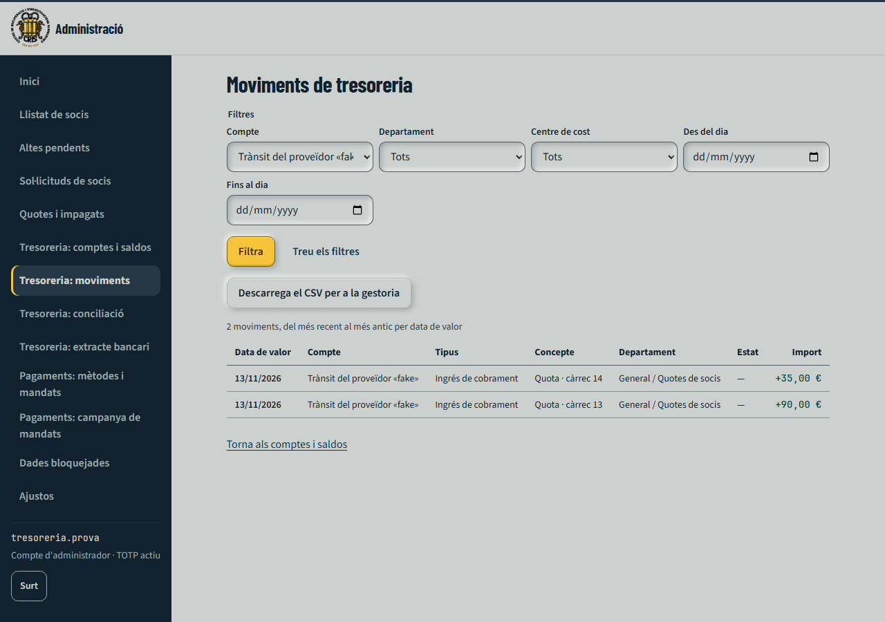
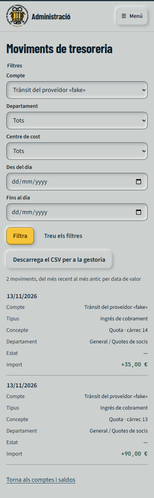

# T-M04-16 · Exportació CSV dels moviments per a la gestoria

| Data i hora (Europa/Madrid) | Commit | Proves | CI |
|---|---|---|---|
| 17/11/2026 04:35 | ee66bd4 | 20 noves (19 i 1 al navegador) i 1 de B4 | [A comprovar] |

**En tres línies:** el tresorer filtra els moviments de tresoreria per compte, departament, centre de cost o dates i en descarrega un CSV per a la gestoria. Porta data, compte, concepte, departament, centre de cost, entrada, sortida i referència, en euros amb dos decimals. No hi surt cap nom ni cap IBAN, i cada descàrrega queda al registre d'activitat.

## Què s'ha fet
- `apps/treasury/exports.py`: les columnes de CA-T15.1, en el format de les exportacions del 01 (UTF-8 amb BOM i «;»). Un concepte que comenci com una fórmula porta un apòstrof davant.
- «Moviments»: filtre nou per centre de cost i el botó «Descarrega el CSV per a la gestoria», que envia els mateixos filtres de la llista.
- Permís nou T9, «Exportar moviments en CSV» (Tresorer i Administrador, segons M04-4). La mateixa migració `core/0040` completa el catàleg de la fase 1 amb T2, T3 i B3 a B7, amb les cel·les de la matriu inicial (B3, protegit, només el tresorer).
- Retornats: `charges.mark_returned` i `reopen_returned` ja demanen B4, «Registrar retornats i decidir el reintent», en lloc de T4.
- Detall: [P-M04-G i CA-T15.1](../planning.md#M04-10-tasques).

## Decisions i perquè
- **POST, no un enllaç:** cada exportació escriu una fila al registre, i un enllaç el podria obrir sol el navegador o una vista prèvia. Com l'exportació del llistat de socis.
- **Sense fitxer desat:** el CSV es genera i es descarrega en el moment, com al 01; només l'exportació RGPD desa un fitxer privat.
- **Referència i format dels imports:** el pla no els concreta ([P-241 i P-242](../decisions/pendents.md), opció per defecte): la referència del pagament o de la liquidació, i `1234,56`.
- **Un moviment anul·lat i el seu contramoviment hi surten tots dos:** sumen zero, com al saldo.
- **Permisos que no s'afegeixen:** T8 i T10 continuen amb T4 i T1 mentre la [P-190](../decisions/pendents.md) sigui oberta; T11 és el mateix que P10 ([P-243](../decisions/pendents.md)); la Secretaria comença sense B7 perquè cap abast no el limita a les quotes ([P-244](../decisions/pendents.md)). A7, A8 i B8 són configuració de l'entorn i A9 no el té ningú.

## Problemes trobats
- El permís T9 no era al catàleg: s'ha afegit, amb la resta dels de la fase 1 que faltaven, després que la T-M04-09 hi posés T6 i T7, per no trepitjar-ne la migració.
- La prova al navegador comptava com a error la petició que Chromium talla quan es converteix en descàrrega; ara la prova la declara esperada.

## Com se sap que funciona
- El CSV porta les columnes, els imports en euros, el compte pel nom i res de la persona ni del compte bancari.
- Els filtres donen les mateixes files que la llista, i un filtre no vàlid no filtra.
- Només el tresorer i l'administrador el descarreguen; la resta, «no trobat».
- Al navegador: el tresorer filtra per compte i descarrega el fitxer amb dues files.
- Sortida de proves · commit ee66bd4 · executada el 17/11/2026 en local (PostgreSQL 16):
  ```
  $ pytest -q -m "not e2e"
  5628 passed, 97 deselected
  ```


*17/11/2026 04:12 (Europa/Madrid) · local, dades inventades (prova e2e) · commit ee66bd4*


*17/11/2026 04:12 (Europa/Madrid) · local, dades inventades (prova e2e) · commit ee66bd4*

## Termes nous
- **CSV:** fitxer de text amb una fila per línia i les columnes separades per «;», que l'Excel obre com un full de càlcul.
