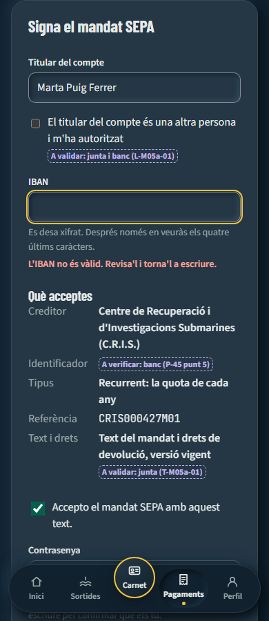
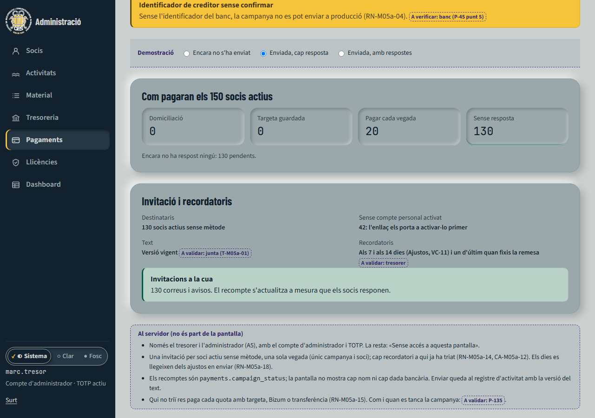

# T-M05a-02 · Wireframes del mètode de pagament, el mandat, la targeta, la campanya i la configuració

| Data i hora (Europa/Madrid) | Commit | Proves | CI |
|---|---|---|---|
| 16/11/2026 19:19 | 293c285 (PR #74) | 0 noves de la suite; 66 comprovacions al navegador | [A comprovar] |

**En tres línies:** ja hi ha un esbós clicable de com un soci tria com pagarà la quota, signa el mandat de domiciliació des del mòbil i guarda una targeta, i de com el tresorer envia la campanya de mandats i consulta qui té mètode. L'IBAN no surt mai sencer. Cada pantalla diu què ha de controlar el servidor, perquè amagar un botó no protegeix res.

## Què s'ha fet
- **Compte personal** (`socis.html`): «Com pago la quota», «Mandat de domiciliació» (signar, veure, canviar l'IBAN i revocar) i «Targeta per a la quota». S'hi arriba des de la targeta de Pagaments. Detall: [M05a-3](../planning.md#M05a-3-capacitats) i [M05a-5](../planning.md#M05a-5-processos).
- **Administració** (`admin.html`): el mòdul Pagaments, amb «Campanya de mandats», «Mètodes i mandats» i «Configuració», i la navegació del mòdul com la de Socis.
- **Demostració:** a cada pantalla, la resposta del servidor (IBAN no vàlid, país no admès, sessió caducada, més de 15 minuts des de l'entrada, proveïdor amb o sense targeta guardada) i, a l'administració, «Veure com» amb el tresorer, l'administrador i la secretaria.
- **Dubtes:** P-130 a P-135 a [`pendents.md`](../decisions/pendents.md) i al tauler.

## Decisions i perquè
- **IBAN:** sempre `ES•• •••• •••• •••• •••• 1332` (RN-M05a-06). Si el servidor el rebutja, el camp torna buit: la resposta no repeteix mai l'IBAN ([044](../decisions/044-domiciliacio-sepa-iban-i-mandat-xifrats.md)).
- **Separació i permisos:** el soci ho fa amb el compte personal; el tresorer no revoca el seu mandat des de l'administració; la secretaria només veu «té mètode: sí o no» (A4, [059](../decisions/059-rols-i-permisos-editables.md)).
- **Configuració només de lectura** (P-131) i **mandat que no es revoca sol** en passar a «pagar cada vegada» (P-134): són les opcions més prudents mentre no hi ha resposta (D2).
- **Cap component nou:** l'opció amb descripció fa servir `casella` amb botó de ràdio (P-130, per a la sessió de disseny). Cap `style=` nou.
- **Textos legals i identificador de creditor:** no s'inventen; surten com a [A validar] o [A verificar] (T-M05a-01, P-45).

## Problemes trobats
- La navegació del mòdul de l'administració només coneixia Socis. Ara cada `vista-subnav` diu el seu prefix i el menú lateral obre la primera pantalla que el rol pot veure.
- El text de la Tresoreria deia «la plataforma no guarda cap IBAN de socis», que ja no és cert des de la 044. S'ha corregit.

## Com se sap que funciona
- Playwright a Chromium, en clar i en fosc: 26 comprovacions de flux i 7 de contrast per tema (errors al costat del camp, IBAN rebutjat que no queda a la pàgina, contrasenya buidada, diàlegs, motiu obligatori, menú per rol i Socis sense canvis). Cap error a la consola.
- Contrast de cada text visible contra el seu fons, a 1280 i 390 px i en els dos temes, també amb errors, resultats i diàlegs oberts: cap per sota de 4,5:1 (el pitjor, 5,02:1). Cap desbordament horitzontal a 390 px.
- Captures a 1280 i 390 px de les set pantalles en els dos temes, mirades.

## Evidències
- 
  *16/11/2026 19:19 (Europa/Madrid) · wireframe a Chromium sense finestra, dades inventades del prototip · commit 293c285*
- 
  *16/11/2026 19:19 (Europa/Madrid) · wireframe a Chromium sense finestra, dades inventades del prototip · commit 293c285*

## Termes nous
- **Mandat SEPA** (domiciliació): autorització del soci perquè el club cobri la quota del seu compte.
- **Tokenització:** el proveïdor guarda la targeta i el club només en té un identificador.
