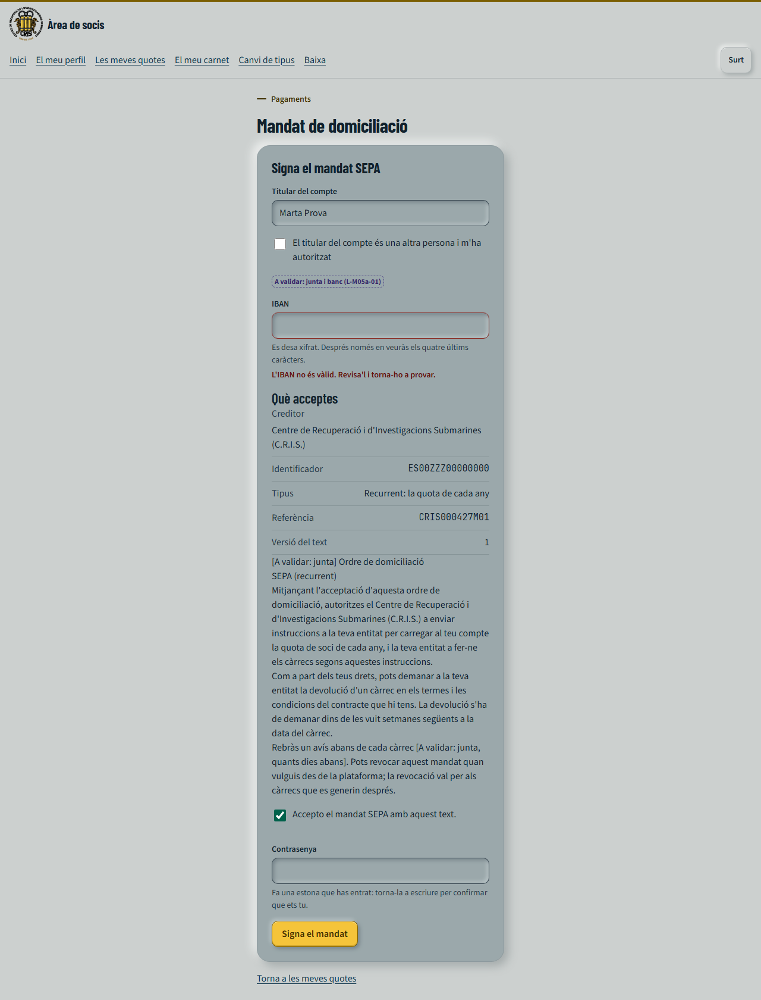
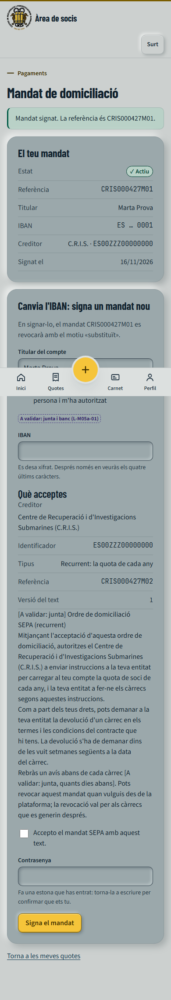

# T-M05a-09 · Signatura del mandat SEPA (primera part)

| Data i hora (Europa/Madrid) | Commit | Proves | CI |
|---|---|---|---|
| 16/11/2026 22:40 | c04ba9e | 5060 (13 noves; 1 e2e nova) | [A comprovar] |

**En tres línies:** el soci ja pot signar el mandat de domiciliació des del seu compte: escriu el titular i l'IBAN, llegeix el text i l'accepta. L'IBAN es comprova al servidor, es desa xifrat i després només se'n veuen els quatre últims caràcters. Encara està apagat a producció: falta que la junta aprovi el text i que el banc doni l'identificador de creditor.

## Què s'ha fet
- Pantalla `/socis/pagaments/mandat/` ([P-M05a-B](../planning.md#M05a-5-processos)), seguint el wireframe `socis.html#pagaments-mandat`: el mandat actiu (IBAN emmascarat, `ES … 1234`, [P-121](../decisions/pendents.md)) i el formulari per signar-ne un, o un de nou que substitueix l'actiu.
- El text que s'accepta és la versió vigent del text legal `sepa_mandate`; el mandat en desa la versió, la data, el compte i el canal (CA-M05a-03).
- Reautenticació ([RN-M05a-12](../planning.md#M05a-7-regles), CA-M05a-08) amb `accounts.require_recent_auth` i la finestra a `MANDATE_REAUTH_MINUTES` (15 per defecte).
- Esborrany del text del mandat a [`docs/esborranys/mandat-sepa.md`](../esborranys/mandat-sepa.md), marcat [A validar: junta].

## Decisions i perquè
- **Apagada a producció** (D2): `MANDATE_SIGNING_ENABLED` és fals per defecte i la ruta respon «no trobat»; en local s'encén. Un soci real veuria un text que la junta no ha aprovat (T-M05a-01).
- **Sense identificador de creditor no es signa:** la pantalla mostra la marca «A verificar: banc (P-45 punt 5)» i no ofereix el formulari ([RN-M05a-04](../planning.md#M05a-7-regles)). Un mandat amb l'identificador buit seria una dada dolenta.
- **L'IBAN no torna mai:** si és invàlid o falla un altre camp, el camp torna buit (CA-M05a-02). La vista marca l'IBAN, la contrasenya i el codi com a sensibles perquè no surtin als informes d'error.
- **Sessió que caduca amb la pàgina oberta:** es demana la contrasenya sense comptar cap intent fallit ([P-126](../decisions/pendents.md)).
- Dubtes nous: [P-123](../decisions/pendents.md) (països de l'IBAN), P-124 (quins socis signen), P-125 (si signar canvia la preferència de mètode) i P-126.

## Problemes trobats
- **El correu G3 (CA-M05a-04) no hi és:** la cua de correu només accepta plantilles amb prioritat declarada a `apps/core/mail.py`, i aquesta tasca no pot tocar `apps/core`. Queda per a la segona part.
- La pantalla no té entrada al menú: la navegació és de la sessió de disseny.

## Com se sap que funciona
- `apps/payments/tests/test_mandate_signing.py`: apagada per defecte, sense identificador o sense text no es signa, estats del soci, IBAN amb el dígit de control canviat (ni a la pantalla, ni als registres, ni al registre d'activitat), signatura completa, titular diferent, finestra de reautenticació i el seu valor configurable.
- `apps/core/tests/e2e/test_mandat_signatura.py`: sense identificador, IBAN invàlid i signatura amb contrasenya, al navegador.

*16/11/2026 22:40 (Europa/Madrid) · local, dades inventades · commit c04ba9e*

*16/11/2026 22:40 (Europa/Madrid) · local, dades inventades · commit c04ba9e*

## Termes nous
- **Identificador de creditor:** el codi que el banc assigna al club per cobrar domiciliacions SEPA. Surt al mandat i a cada rebut.
