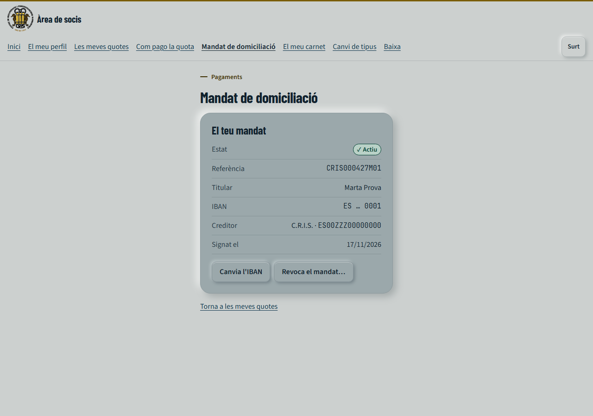
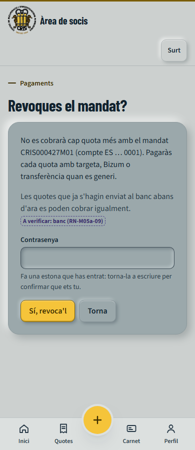

# T-M05a-10 · Canviar l'IBAN i revocar el mandat

| Data i hora (Europa/Madrid) | Commit | Proves | CI |
|---|---|---|---|
| 17/11/2026 00:39 | 63a002e | 5180 (7 noves; 1 e2e nova) | [A comprovar] |

**En tres línies:** el soci ja pot revocar el mandat de domiciliació des del seu compte, confirmant-ho i, si fa una estona que ha entrat, escrivint la contrasenya. A partir d'aquí paga cada quota quan es genera. Per canviar el compte bancari, signa un mandat nou, que substitueix l'anterior. Revocar funciona sempre, encara que la signatura de mandats nous estigui apagada.

## Què s'ha fet
- [P-M05a-C](../planning.md#M05a-5-processos): botons «Canvia l'IBAN» (obre el formulari de signatura, que ja substituïa l'anterior amb el motiu «substituït») i «Revoca el mandat…» a la pàgina del mandat.
- `/socis/pagaments/mandat/revoca/`: confirmació amb la referència i l'IBAN emmascarat, i la contrasenya (i el codi TOTP, si el compte en té) passats `MANDATE_REAUTH_MINUTES` ([RN-M05a-12](../planning.md#M05a-7-regles), CA-M05a-08).
- `mandates.revoke_mandate`: el mandat passa a «revocat» amb la data, el motiu «a petició del soci» i el compte, queda al registre d'activitat i la preferència passa a «pagar cada vegada». Comparteix el codi de revocació amb la substitució.

## Decisions i perquè
- **Revocar sempre funciona** ([P-127](../decisions/pendents.md)): amb la signatura apagada, la pàgina del mandat existeix només per a qui té un mandat actiu, sense el formulari per signar, i s'hi arriba per l'enllaç del correu G3.
- **Una pàgina de confirmació en lloc del diàleg** del wireframe: funciona sense JavaScript i el servidor decideix si cal la contrasenya. El pas de confirmació és el mateix.
- **La targeta guardada es manté** en revocar ([P-128](../decisions/pendents.md)): només passa a «pagar cada vegada» si la preferència era la domiciliació o no n'hi havia cap.

## Problemes trobats
- Amb la sessió recent, el formulari de revocar no porta cap camp: `request.POST or None` el deixava sense lligar i no revocava. Ara es lliga sempre amb el POST.
- **No s'ha fet:** el correu al soci en revocar (cal una línia a `apps/core/mail.py`, que ara toca un altre carril) i la revocació des de l'administració a petició escrita (A6, [P-133](../decisions/pendents.md)), que necessita un permís nou al catàleg. L'avís al tresorer si ja hi ha una remesa enviada (RN-M05a-09) arriba amb les remeses del 05b.

## Com se sap que funciona
- `apps/payments/tests/test_mandate_revocation.py`: revocar (data, motiu, compte, registre, preferència), contrasenya amb la sessió antiga, signatura apagada, targeta guardada, només el mandat propi, sense mandat actiu, i canviar l'IBAN des de la pantalla.
- `apps/core/tests/e2e/test_mandat_signatura.py`: el mandat actiu, la confirmació amb contrasenya i el mandat revocat, al navegador.

*17/11/2026 00:39 (Europa/Madrid) · local, dades inventades · commit 63a002e*

*17/11/2026 00:39 (Europa/Madrid) · local, dades inventades · commit 63a002e*

## Termes nous
- **Revocar un mandat:** retirar l'autorització perquè el club cobri la quota del compte bancari. Els càrrecs que es generin després ja no es cobren per domiciliació.
