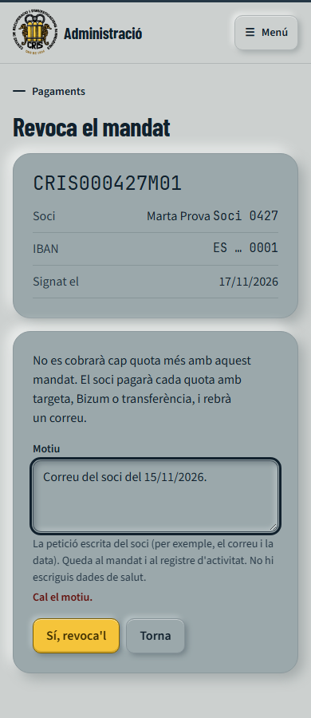
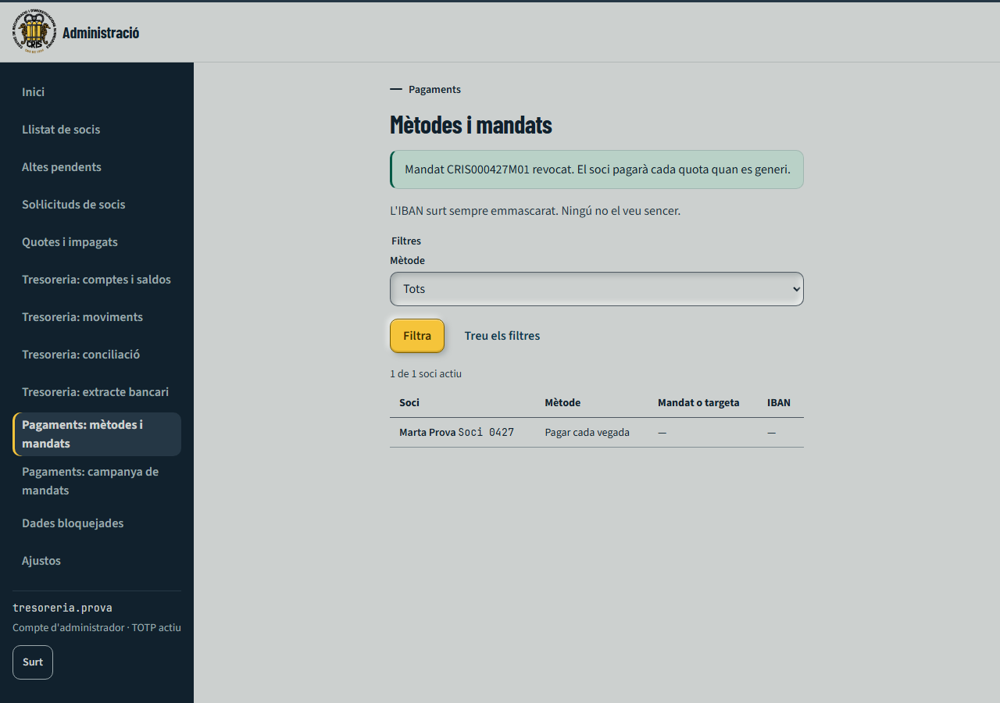

# T-M05a-10 · Revocar un mandat des de l'administració (tercera part)

| Data i hora (Europa/Madrid) | Commit | Proves | CI |
|---|---|---|---|
| 17/11/2026 02:40 | 07c677e | 5349 (15 noves; 1 e2e nova) | [A comprovar] |

**En tres línies:** quan un soci demana per escrit que se li retiri la domiciliació, el tresorer ja la pot revocar des del llistat de mandats. Ha d'escriure el motiu i confirmar-ho, i el soci passa a pagar cada quota quan es genera. Ningú no pot revocar el seu propi mandat des de l'administració.

## Què s'ha fet
- Permís A6 «Revocar un mandat a petició escrita del soci, amb motiu» ([M05a-4](../planning.md#M05a-4-rols)) al catàleg. Matriu inicial: Tresorer i Administrador, com diu el pla, amb una versió nova de la matriu (migració `core/0038`, com la 0037).
- Enllaç «Revoca…» a «Mètodes i mandats» i pàgina de confirmació amb la referència, el soci i l'IBAN emmascarat, i el motiu obligatori.
- La revocació fa servir `mandates.revoke_mandate` amb el motiu escrit i el compte del tresorer: mateix estat, registre d'activitat, canvi de preferència i correu al soci que quan ho fa el soci.

## Decisions i perquè
- **Sense tornar a demanar el codi TOTP** ([P-133](../decisions/pendents.md), opció per defecte): el compte d'administrador ja ha entrat amb TOTP i la revocació no mou diners.
- **Mai el mandat propi** ([M05a-4](../planning.md#M05a-4-rols), «Per objecte»): l'enllaç no surt i, si s'hi arriba per l'adreça, el servidor ho rebutja i ho explica. Es fa des del compte personal.
- L'enllaç té un nom accessible amb la referència («Revoca el mandat CRIS…»), perquè la taula en pot tenir molts.

## Problemes trobats
- Un text amagat dins de l'enllaç perdia l'espai inicial en el nom accessible del navegador: s'ha passat a `aria-label`.
- El llistat no mostrava els missatges de confirmació: ara sí.

## Com se sap que funciona
- `apps/payments/tests/test_mandate_admin_revoke.py`: la cel·la A6 de cada rol, motiu obligatori, estat, motiu i compte al mandat i al registre, preferència, mandat propi i l'IBAN que no surt sencer.
- `apps/core/tests/e2e/test_mandats.py`: el tresorer revoca des del llistat amb el motiu, al navegador.

*17/11/2026 02:40 (Europa/Madrid) · local, dades inventades · commit 07c677e*

*17/11/2026 02:40 (Europa/Madrid) · local, dades inventades · commit 07c677e*

## Termes nous
- Cap.
