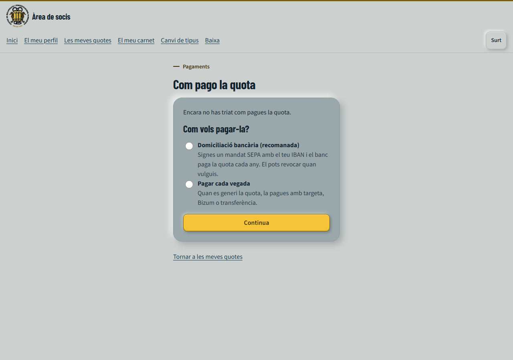
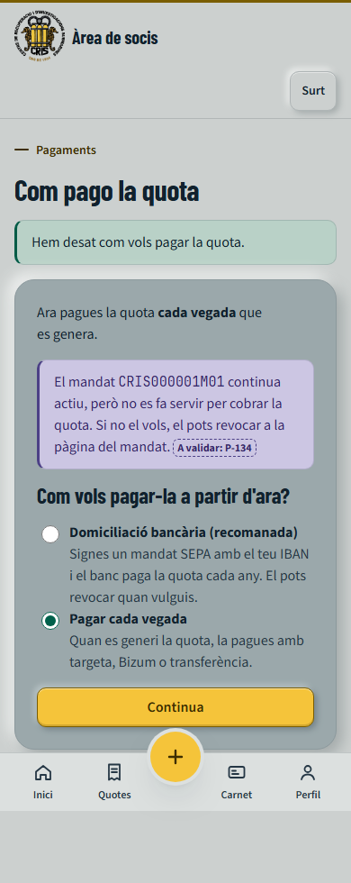

# T-M05a-11 · Com pago la quota

| Data i hora (Europa/Madrid) | Commit | Proves | CI |
|---|---|---|---|
| 16/11/2026 23:30 | 52d5d2e | 5109 (19 noves; 1 e2e nova) | [A comprovar] |

**En tres línies:** el soci ja pot dir com vol pagar la quota: domiciliació, targeta guardada (només si el proveïdor ho permet) o pagar cada vegada. La tria es desa amb la data i el compte, i queda al registre d'activitat. La domiciliació només es desa si el soci ja té un mandat actiu.

## Què s'ha fet
- `apps/payments/preferences.py`: `set_preference(member, method, by=...)`, `fee_payment_method(member)` (servei de [M05a-8](../planning.md#M05a-8-serveis)) i `offered_methods()`, que surt de `capabilities()` del proveïdor.
- Pantalla `/socis/pagaments/metode/` ([P-M05a-A](../planning.md#M05a-5-processos)), seguint el wireframe `socis.html#pagaments-metode`: estat actual, tres opcions amb `casella` i botó de ràdio (P-130, opció A) i «Continua».
- Només el soci de la sessió, actiu o impagat i amb número; qualsevol altra persona rep «no trobat». La ruta no porta cap identificador.

## Decisions i perquè
- **Targeta guardada només amb tokenització** del proveïdor ([P-196](../decisions/pendents.md)): el proveïdor fals diu que no, i l'opció no arriba a l'HTML. Si s'ofereix, surt com a recomanada (CA-M05a-19); si no, la domiciliació.
- **Domiciliació sense mandat:** no es desa res i la pantalla porta a signar-lo ([P-197](../decisions/pendents.md)). Mentre la pàgina del mandat (T-M05a-09) està apagada, un missatge ho explica. Signar no canvia la preferència (P-125, per defecte).
- **«Pagar cada vegada» amb un mandat actiu** el deixa actiu i la pantalla ho diu (P-134, opció per defecte A).
- Tornar a desar el mateix mètode no fa cap entrada nova al registre.

## Problemes trobats
- El compte personal de les proves ha d'estar actiu: amb un compte pendent, la pantalla redirigeix i la resposta és buida.
- La pàgina del mandat encara no és a master: l'enllaç es busca pel nom i, si no existeix o està apagada, no surt.

## Com se sap que funciona
- `apps/payments/tests/test_fee_method.py`: servei (registre, sense canvis no registra, domiciliació amb mandat i sense, P-134, targeta guardada amb tokenització i sense) i pantalla (CA-M05a-01, recomanada, desar, error, persona sense soci, soci pendent o de baixa, impagat, sense sessió, i un `member` d'un altre al formulari que no es fa servir).
- `apps/core/tests/e2e/test_metode_quota.py`: el soci tria domiciliació amb el mandat i després pagar cada vegada.
- Sortida de proves · commit 52d5d2e · executada el 16/11/2026 en local (PostgreSQL 16): `5109 passed`; e2e, `1 passed`.

*16/11/2026 23:30 (Europa/Madrid) · local, dades inventades · commit 52d5d2e*

*16/11/2026 23:30 (Europa/Madrid) · local, dades inventades · commit 52d5d2e*

## Termes nous
- **Preferència de pagament:** com vol pagar la quota el soci; no cobra res per si sola, la fan servir les remeses i els cobraments del 05b.
