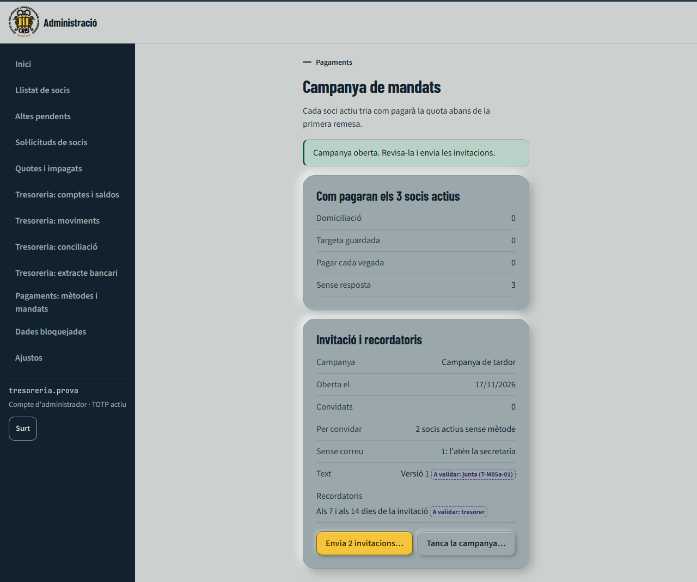
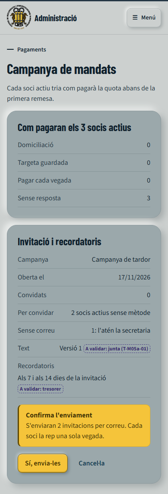

# T-M05a-13b · Pantalla de la campanya de mandats

| Data i hora (Europa/Madrid) | Commit | Proves | CI |
|---|---|---|---|
| 17/11/2026 | f1049b4 | 5249 (17 noves; 1 e2e nova) | [A comprovar] |

**En tres línies:** el tresorer ja té la pantalla de la campanya de mandats: veu quants socis han triat cada mètode, obre la campanya, envia les invitacions i la tanca. Enviar i tancar es confirmen en un segon pas, i les invitacions surten per la cua de correu. Amb la signatura del mandat apagada no hi ha cap formulari.

## Què s'ha fet
- Permís A5 «Enviar la campanya i els recordatoris» ([M05a-4](../planning.md#M05a-4-rols)), `payments.campaign.send`, al catàleg i a la matriu inicial del Tresorer i l'Administrador (migració `core/0037`, com la 0036).
- Pantalla C5 `/gestio/pagaments/campanya/`, seguint el wireframe `admin.html#vista-pagaments-campanya`: recompte per mètode, dades de la invitació (per convidar, sense correu, versió del text, recordatoris) i les accions.
- Al servei: `to_invite`, `blocking_reason`, el recompte sense cap campanya oberta i la versió del text al registre de l'enviament.

## Decisions i perquè
- **Veure, A4; actuar, A5** ([P-212](../decisions/pendents.md)): els recomptes són dades de pagament d'A4. Sense A5, els formularis no arriben a l'HTML i el servidor respon «no trobat» al POST.
- **Confirmació al servidor:** el primer POST d'enviar o tancar només mostra la confirmació; cal un segon POST amb `confirm`.
- **La feina de la cua es crea dins la transacció**, com els correus: si la petició falla, no queda cap enviament a mitges.

## Problemes trobats
- El recompte «sense compte personal activat» del wireframe no hi és: depèn de la [P-198](../decisions/pendents.md).
- La pantalla no té entrada al menú: és de la sessió de disseny.

## Com se sap que funciona
- `apps/payments/tests/test_campaign_screen.py`: la cel·la A4/A5 de cada rol, la consulta sense A5, obrir, la salvaguarda, enviar amb confirmació (la feina a la cua), tancar amb confirmació i el recompte sense noms.
- `apps/core/tests/e2e/test_campanya_mandats.py`: el tresorer obre, confirma l'enviament i tanca.
- Sortida de proves · commit f1049b4 · executada el 17/11/2026 en local (PostgreSQL 16): `5249 passed`; e2e, `1 passed`.

*17/11/2026 (Europa/Madrid) · local, dades inventades · commit f1049b4*

*17/11/2026 (Europa/Madrid) · local, dades inventades · commit f1049b4*

## Termes nous
- **Confirmació en dos passos:** l'acció no es fa amb el primer clic; la pantalla diu què passarà i cal tornar a confirmar-ho.
