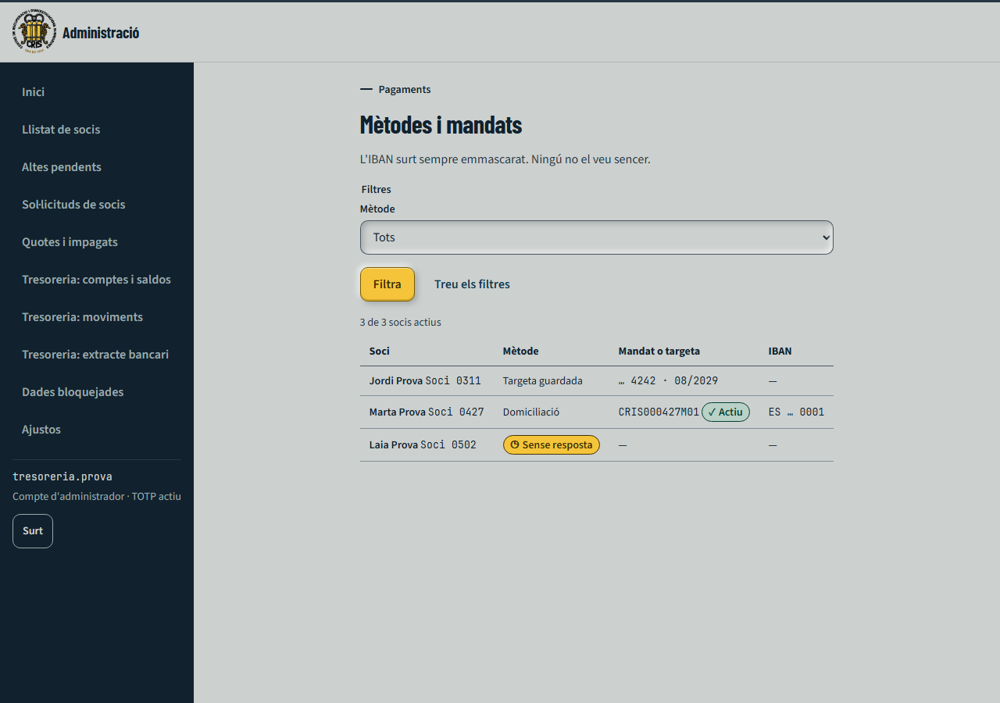
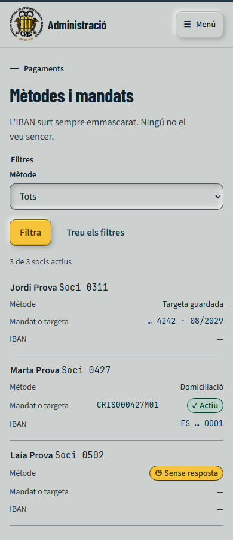

# T-M05a-14 · Llistat de mètodes i mandats per al tresorer

| Data i hora (Europa/Madrid) | Commit | Proves | CI |
|---|---|---|---|
| 16/11/2026 21:41 | b84936d | 4994 (14 cel·les i 5 proves noves; 1 e2e nova) | [A comprovar] |

**En tres línies:** el tresorer ja veu, per a cada soci actiu, com pagarà la quota: domiciliació amb la referència del mandat, targeta guardada, cada vegada o encara sense resposta. L'IBAN surt emmascarat (`ES … 1234`) i la plataforma no el desxifra per fer la llista. Pot filtrar per mètode per saber a qui li falta.

## Què s'ha fet
- Permís A4 «Veure mètodes i mandats de tots els socis» ([M05a-4](../planning.md#M05a-4-rols)) al catàleg, amb dos nivells: «Sí» i «Cons.». Matriu inicial: Tresorer i Administrador, amb una versió nova de la matriu (migració `core/0035`, com la 0033).
- Pantalla C6 «Mètodes i mandats» ([M05a-3](../planning.md#M05a-3-capacitats)), seguint el wireframe `admin.html#vista-pagaments-mandats`: soci i número, mètode, mandat o targeta, IBAN emmascarat i filtre per mètode.
- Amb «Cons.», el servidor només envia «té mètode: sí/no»: no consulta cap mandat ni targeta, i les altres columnes no arriben a l'HTML.

## Decisions i perquè
- **La Secretaria comença sense** ([P-193](../decisions/pendents.md)): la seva cel·la és [A validar] al pla i és un permís sobre dades bancàries. L'Administrador li pot donar «Cons.» des de l'editor de permisos.
- **L'IBAN no es desxifra mai** ([A9](../planning.md#M05a-4-rols), decisió 044): la llista fa servir el país i els quatre darrers dígits que ja es desen a part, i ni tan sols llegeix el text xifrat de la base de dades. Màscara amb «…» ([P-121](../decisions/pendents.md)).
- **Revocar (A6) no hi és:** és d'una altra tasca.

## Problemes trobats
- Les rutes d'administració han d'anar dins l'espai de noms `administration` perquè demanin la sessió d'administració amb TOTP. Cal una línia a `apps/accounts/admin_urls.py` que inclogui les del 05a.
- La prova del catàleg només admetia els mòduls `core`, `members`, `treasury` i `settings`; ara també `payments`.
- Un comentari de la prova duia el pic «•», que la prova dels punts volats prohibeix a tot `apps/`.
- La pantalla no té entrada al menú: la navegació és de la sessió de disseny.

## Com se sap que funciona
- `apps/payments/tests/test_mandates_list.py`: la cel·la de cada rol (la Secretaria, «no trobat»), sense sessió d'administració, només GET, el tresorer veu l'IBAN emmascarat sense cap crida a `decrypt`, el filtre, i amb «Cons.» només «sí/no».
- `apps/core/tests/test_permissions.py`: les proves per cel·la de la matriu inicial (T-RP-04) inclouen A4.
- `apps/core/tests/e2e/test_mandats.py`: el tresorer veu els tres socis i filtra els que no han respost.
- Sortida de proves · commit b84936d · executada el 16/11/2026 en local (PostgreSQL 16): `4994 passed`; e2e, `1 passed`.

*16/11/2026 21:41 (Europa/Madrid) · local, dades inventades · commit b84936d*

*16/11/2026 21:41 (Europa/Madrid) · local, dades inventades · commit b84936d*

## Termes nous
- **IBAN emmascarat:** el codi del país i els quatre darrers dígits del compte; prou per reconèixer-lo, no per fer-lo servir.
