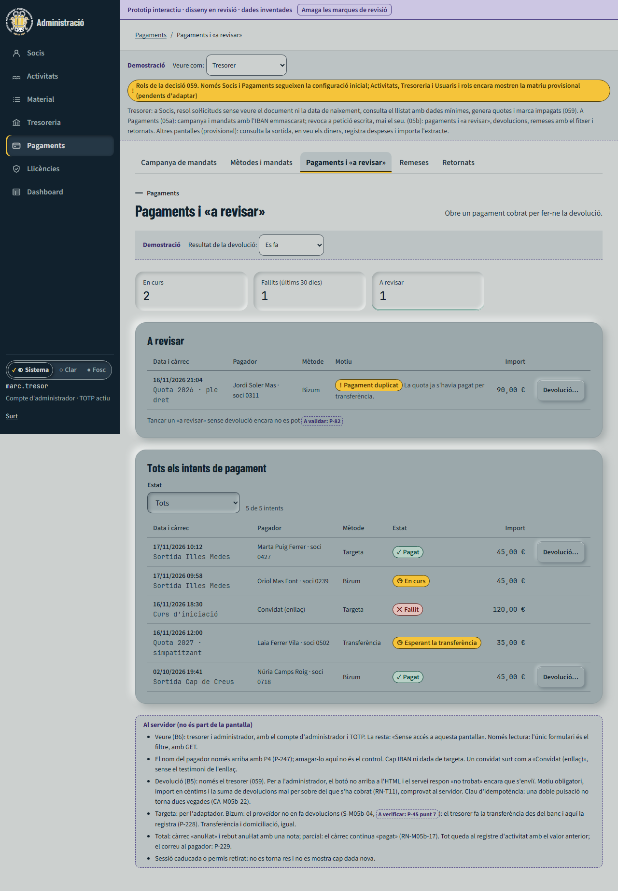
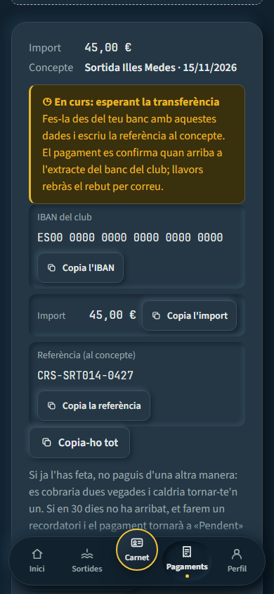

# T-M05b-02 · Wireframes de pagament, Bizum, transferència, rebut, remeses, retornats i devolució

| Data i hora (Europa/Madrid) | Commit | Proves | CI |
|---|---|---|---|
| 17/11/2026 12:48 | ecf3d20b (PR #176) | 0 noves de la suite; recorreguts i axe al navegador | [A comprovar] |

**En tres línies:** ja hi ha un esbós clicable de com un soci paga un càrrec i veu en quin estat és (pendent, en curs, pagat o fallit, sempre amb símbol i text), amb Bizum, transferència i el rebut. A l'administració, el tresorer veu els pagaments i els «a revisar», fa una devolució, prepara una remesa i decideix què fer amb un rebut retornat. L'IBAN d'un soci no surt mai sencer, i cada pantalla diu què ha de controlar el servidor.

## Què s'ha fet
- **Compte personal** (`socis.html`): «Pagar un càrrec» (`#pagaments-carrec`), amb els quatre estats de la taula «Estats visibles» de [M05b-5](../planning.md#M05b-5-processos), l'espera i el temps esgotat del Bizum, la transferència (IBAN del club, import, referència, «Copia-ho tot» i recordatori) i la domiciliació en curs; i el «Rebut» (`#pagaments-rebut`): pagat, amb una devolució parcial o anul·lat. S'hi arriba des de la targeta de Pagaments.
- **Administració** (`admin.html`, mòdul Pagaments): «Pagaments i «a revisar»» amb el diàleg de devolució, «Remeses» (previsualització amb les excloses i el motiu, avís previ, fitxer pain.008, enviada amb l'esborrat confirmat) i «Retornats» (codi de motiu, reintent o alternativa, segon retorn fora de les remeses).
- **Convidat** (`publica.html`): només un punter a la mateixa pantalla de pagament.
- **Dubtes:** P-310 i P-311 a [`pendents.md`](../decisions/pendents.md) i al tauler.

## Decisions i perquè
- **Coherència amb les pantalles reals:** textos i estats de `templates/payments/` (`_status.html`, `receipt.html`, `payments.html`, `remittances.html`, `remittance.html`, `returns.html`). El que el pla té i el codi encara no (devolucions, l'anotació d'una devolució parcial al rebut, l'enllaç d'un sol ús del fitxer) surt marcat [A validar].
- **Permisos per rol** (configuració inicial de la [059](../decisions/059-rols-i-permisos-editables.md)): remeses i retornats només el tresorer (B3, B4); la devolució només el tresorer (B5); l'administrador només consulta el llistat (B6). La secretaria té B7 per a les quotes, però cap pantalla del 05b que pugui obrir no té l'acció (P-310).
- **IBAN:** a la remesa, sempre `ES•• … 1332`; el fitxer el porta sencer, però la pantalla no ([044](../decisions/044-domiciliacio-sepa-iban-i-mandat-xifrats.md)). A la transferència surt l'IBAN del club, que és de configuració.
- **Devolució de Bizum:** per transferència des del banc (S-M05b-04), amb el codi TOTP al diàleg com a opció per defecte (P-311).
- **Cap component nou ni cap `style=` nou:** només classes que ja feien servir els wireframes.

## Problemes trobats
- A 390 i 320 px, les etiquetes d'estat llargues (`estat`, que no parteix línia) i els desplegables amb opcions llargues feien la pàgina més ampla que la pantalla. S'han escurçat: l'etiqueta diu l'estat i el detall va al costat en text normal.
- El diàleg «Paga ara» de la portada encara fa servir el número `JUS-…` i deixa pujar un comprovant de transferència, que les pantalles reals ja no fan. No s'ha tocat (és del carril de disseny); la pantalla nova és la de referència.

## Com se sap que funciona
- Playwright a Chromium, a 1280, 390 i 320 px i en fosc: els vuit estats del càrrec (un sol estat visible cada vegada), pagar per transferència, sessió caducada sense canviar l'estat, errors al costat del camp a la devolució, la remesa i el retorn, la devolució parcial, l'avís del banc per al Bizum, i «Sense accés» per a l'administrador a Remeses i per a la secretaria a Retornats. Cap error a la consola i cap desbordament horitzontal.
- axe (`axe-playwright-python` 0.1.8, WCAG 2.2 AA) en clar i en fosc a nou pantalles i estats: cap violació.
- Captures de totes les pantalles a 1280 i 390 px i en fosc, mirades.

## Evidències
- 
  *17/11/2026 12:48 (Europa/Madrid) · wireframe a Chromium sense finestra, dades inventades del prototip · commit ecf3d20b*
- 
  *17/11/2026 12:48 (Europa/Madrid) · wireframe a Chromium sense finestra, dades inventades del prototip · commit ecf3d20b*

## Termes nous
- **Remesa:** el fitxer amb tots els rebuts domiciliats d'un cobrament, que el tresorer puja al banc.
- **Retornat:** un rebut domiciliat que el banc torna després de cobrar-lo (per exemple, per fons insuficients).
