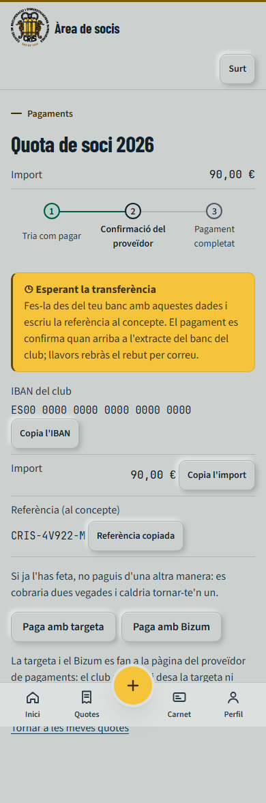
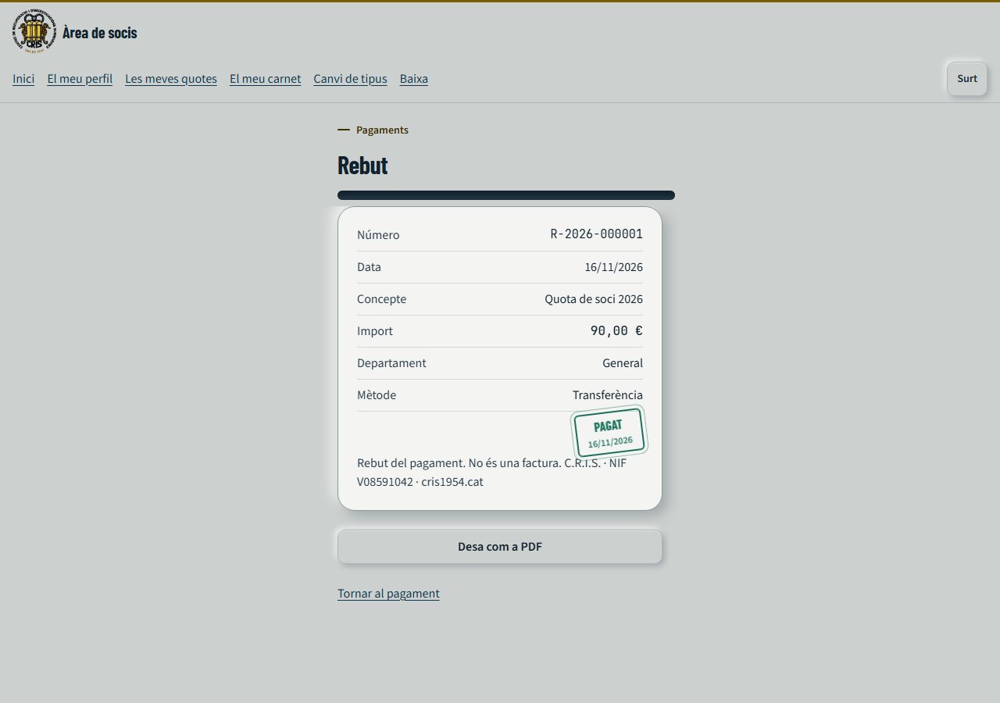

# T-M05b-06 · Transferència: pantalla i enllaç amb la conciliació de la 04

| Data i hora (Europa/Madrid) | Commit | Proves | CI |
|---|---|---|---|
| 16/11/2026 20:05 | d40c65e (PR #85) | 4898 (11 noves); 1 e2e nova | [A comprovar] |

**En tres línies:** ara un soci pot triar «Paga per transferència» i veu l'IBAN del club, l'import i la referència de la quota, cadascun amb un botó per copiar-lo. La quota no es dona per pagada fins que el tresorer troba la transferència a l'extracte del banc i en confirma la conciliació. Llavors el soci veu «Pagat» i té el rebut, també per correu.

## Què s'ha fet
- **Començar la transferència** (`checkout.start_payment`): l'intent queda «en curs» amb la referència del càrrec (`treasury.transfer_reference`, RN-T20); no hi ha cap ordre al proveïdor. Detall: [M05b-5, P-M05b-C](../planning.md#M05b-5-processos).
- **Pantalla** (`templates/payments/_status.html`): «Esperant la transferència», l'IBAN en grups de quatre, l'import i la referència, i els botons «Copia» (`static/js/copia.js`). No torna a preguntar l'estat: la prova és l'extracte.
- **Enllaç amb la conciliació** (`apps/payments/transfers.py`): quan la 04 crea el pagament per transferència, l'intent passa a «pagat» i s'emet el rebut, a la mateixa transacció (CA-M05b-11). Si el soci havia pagat sense passar per la pantalla, se n'obre un.
- **Dubtes:** P-136 a P-139 a [`pendents.md`](../decisions/pendents.md) i al tauler.

## Decisions i perquè
- **Sense l'IBAN del club configurat, no hi ha transferència** (falla tancada). `CLUB_IBAN_TRANSFERENCIES` (VC-09) encara no és a `config/settings`, que és d'un altre carril: la pantalla el llegeix si hi és.
- **Nivell 1:** tampoc cap transferència, que també és un cobrament real (RN-M05a-11).
- **Canviar de mètode** abandona la transferència que s'esperava (P-136, opció per defecte); si ja s'havia fet, la conciliació la veu d'un càrrec pagat (LT6).
- **Senyal del pagament de la 00** en lloc de l'esdeveniment `charge.paid`, que encara no existeix (T-M05b-21): queda marcat com a drecera. La conciliació (`reconciliation.py`) no s'ha tocat.
- **Plantilles de disseny sense canvis** (`_tramite.html`, `receipt.html`): el pas 2 diu «Confirmació del proveïdor» també per a la transferència (P-138).

## Problemes trobats
- `PaymentStart` tenia una prova que hi prohibeix un camp anomenat `iban` (dades del soci). L'IBAN del club s'hi diu `club_iban`.
- L'e2e feia servir el `make_admin` de les proves del nucli i la neteja de la base xocava amb el registre d'activitat; ara fa servir el de les e2e.

## Com se sap que funciona
- `apps/payments/tests/test_transfer.py`: CA-M05b-10 (dades i botons, sense consulta automàtica), CA-M05b-11 (conciliació → intent pagat, rebut i pantalla), sense IBAN, nivell 1, càrrec d'un altre, intent en curs, P-136 i P-137.
- e2e `test_pagament_transferencia.py`: del botó al rebut, amb la referència copiada al porta-retalls.
- Captures a 1280 i 390 px, mirades.

## Evidències
- 
  *16/11/2026 20:05 (Europa/Madrid) · local, dades inventades (e2e) · commit d40c65e*
- 
  *16/11/2026 20:05 (Europa/Madrid) · local, dades inventades (e2e) · commit d40c65e*

## Termes nous
- **Conciliació:** casar una línia de l'extracte del banc amb el càrrec que paga.
