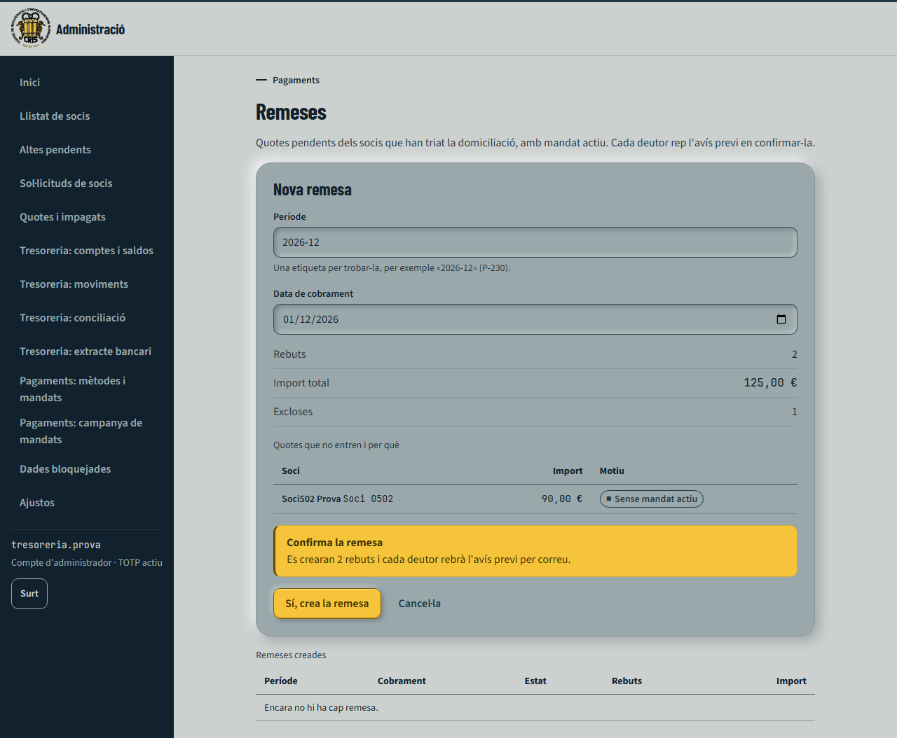
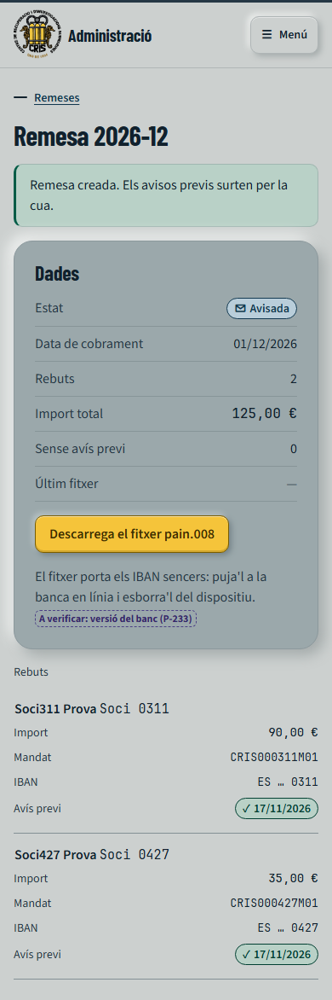

# T-M05b-09b · Pantalla de remeses

| Data i hora (Europa/Madrid) | Commit | Proves | CI |
|---|---|---|---|
| 17/11/2026 05:50 | 188691b | 5689 (16 noves, 1 e2e) | [A comprovar] |

**En tres línies:** el tresorer ja té una pantalla per a les remeses. Hi tria la data de cobrament, veu quines quotes hi entren i quines no i per què, i confirma la remesa en un segon pas. Al detall veu cada rebut amb l'IBAN emmascarat i descarrega el fitxer per al banc, que no es desa enlloc.

## Què s'ha fet
- `apps/payments/remittance_views.py`: llista i formulari, detall, «Torna a enviar els avisos que falten» i la descàrrega del pain.008 (POST, `no-store`). Rutes a `apps/payments/admin_urls.py`; plantilles `templates/payments/remittances.html`, `remittance.html` i `_remittance_status.html`.
- Permís B3 (`payments.remittances`) al servidor a totes les rutes; les accions demanen edició. Sense, «no trobat».

## Decisions i perquè
- **Dos passos i la data previsualitzada:** si el tresorer canvia la data després de previsualitzar, es torna a previsualitzar; no es confirma mai una remesa que no ha vist.
- **Només components existents** (`targeta`, `dades-soci`, `taula`, `estat`, `avis`, `formulari`): cap peça nova al sistema de disseny.
- **Sense entrada al menú:** la navegació és d'`apps/accounts`, d'un altre carril. Ara s'hi arriba per l'adreça.

## Com se sap que funciona
- `apps/payments/tests/test_remittance_screen.py`: B3 per a cada rol, previsualitzar sense crear res, data canviada, data massa propera, descàrrega (només POST, adjunt, `no-store`) i remesa en esborrany. `apps/core/tests/e2e/test_remeses.py`: el recorregut sencer al navegador.
- Sortida de proves · commit 188691b · executada el 17/11/2026 en local (PostgreSQL 16): `5689 passed`; e2e `1 passed`.

*17/11/2026 05:50 (Europa/Madrid) · local, dades inventades · commit 188691b*

*17/11/2026 05:50 (Europa/Madrid) · local, dades inventades · commit 188691b*
