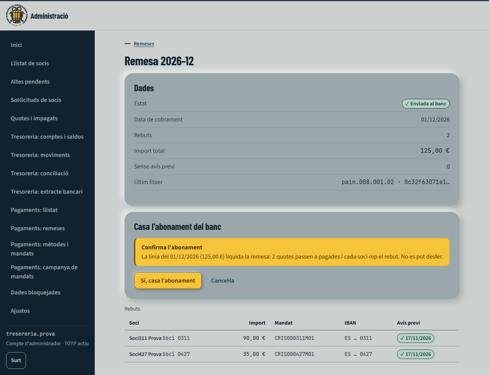

# T-M05b-11b · Botons de la remesa: enviada al banc i abonament

| Data i hora (Europa/Madrid) | Commit | Proves | CI |
|---|---|---|---|
| 17/11/2026 08:30 | f34b48a | 5800 (6 noves, e2e ampliada) | [A comprovar] |

**En tres línies:** el tresorer ja pot fer des de la pantalla els dos últims passos d'una remesa. Primer la marca com a enviada al banc, confirmant que ha esborrat el fitxer. Quan arriba l'abonament, escriu la comissió, tria la línia de l'extracte que li proposa la plataforma i ho confirma: les quotes queden pagades i els socis reben el rebut.

## Què s'ha fet
- `apps/payments/remittance_views.py`: `remittance_sent_view` i `remittance_settle_view`, amb rutes a `apps/payments/admin_urls.py`; seccions noves a `templates/payments/remittance.html`.
- L'estat «Enviada al banc» té ara el seu color d'informació (encara no és cobrada).

## Decisions i perquè
- **La línia es torna a comprovar al servidor:** només s'accepta si és una de les candidates en aquell moment, no qualsevol identificador que arribi del formulari.
- **Dos permisos per casar l'abonament:** B3 (remeses) i T4 (conciliar). La secció només surt amb tots dos, però el control és al servidor.
- **La comissió s'escriu amb coma** («2,60»), com la resta d'imports de la plataforma, i es torna a enviar igual al pas de confirmació.

## Com se sap que funciona
- `apps/payments/tests/test_remittance_buttons.py`: la casella de l'esborrat, l'abonament en dos passos amb comissió, una línia que no és candidata, sense T4 i sense B3. `apps/core/tests/e2e/test_remeses.py`: el recorregut sencer fins a «Liquidada».
- Sortida de proves · commit f34b48a · executada el 17/11/2026 en local (PostgreSQL 16): `5800 passed`; e2e `1 passed`.

*17/11/2026 08:30 (Europa/Madrid) · local, dades inventades · commit f34b48a*
