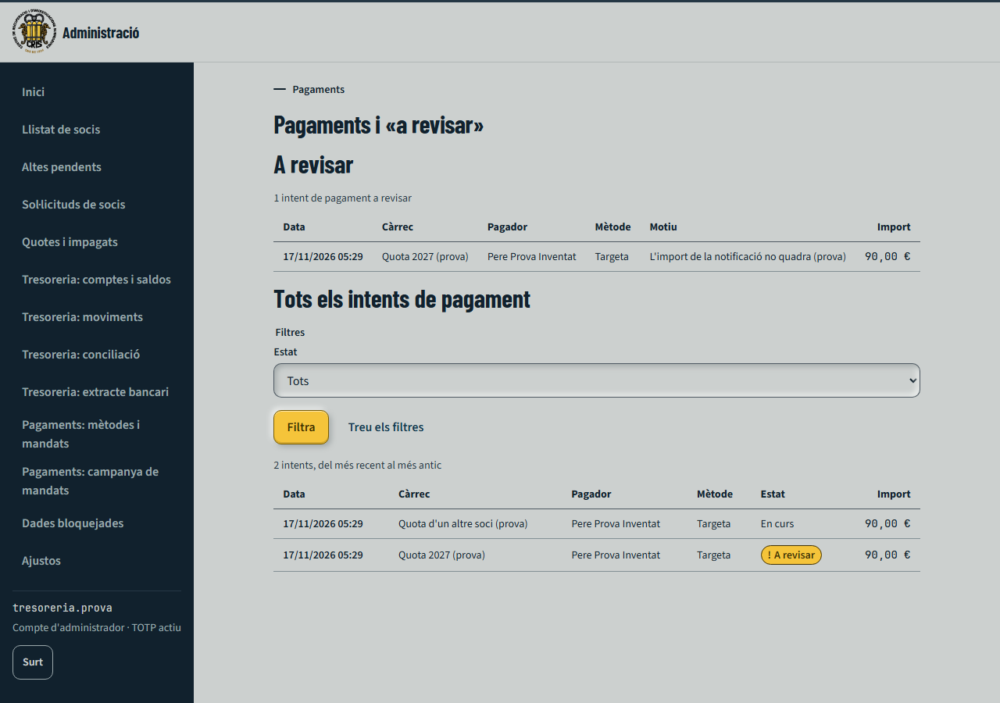
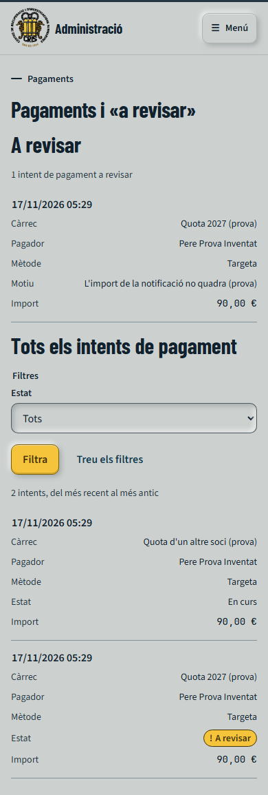

# T-M05b-16 · Llistat de pagaments i «a revisar» per al tresorer

| Data i hora (Europa/Madrid) | Commit | Proves | CI |
|---|---|---|---|
| 17/11/2026 05:36 | 1965606 | 19 noves i 1 al navegador | [A comprovar] |

**En tres línies:** el tresorer té una pantalla amb tots els intents de pagament (en curs, pagats, fallits) i, a dalt, el que cal revisar a mà: pagaments que no quadren, avisos del proveïdor que no s'han pogut casar amb cap pagament i transferències conciliades que s'han quedat sense rebut. Només es pot consultar; tancar un «a revisar» encara està per decidir. El nom de qui paga només surt a qui pot veure el llistat de socis.

## Què s'ha fet
- `/gestio/pagaments/` (`apps/payments/payment_admin_views.py`, `templates/payments/payments.html`), amb el permís B6, «Veure tots els pagaments» (Tresorer i Administrador).
- «A revisar»: intents marcats pel processament de notificacions i la xarxa de seguretat, notificacions sense intent i transferències sense rebut (P-137).
- «Tots els intents de pagament», amb filtre per estat i pàgines de 50.
- Detall: [M05b-4](../planning.md#M05b-4-rols) i [M05b-10](../planning.md#M05b-10-tasques).

## Decisions i perquè
- **Qui veu el nom:** qui té P4, «Llistat i fitxa de socis» ([P-247](../decisions/pendents.md), opció per defecte). Sense P4, el servidor no passa el nom a la plantilla.
- **Només lectura:** d'«a revisar» encara no se'n pot sortir ([P-82](../decisions/pendents.md)).
- **Les notificacions «error» no hi surten:** la xarxa de seguretat les torna a provar sola.
- **Les liquidacions «a revisar» tampoc:** són de la tresoreria ([P-191](../decisions/pendents.md)).

## Problemes trobats
- No hi havia wireframe d'aquesta pantalla: segueix el patró de taules de la tresoreria. L'entrada al menú la posa la sessió de disseny.

## Com se sap que funciona
- Cada rol de gestió: el Tresorer i l'Administrador hi entren; la resta, «no trobat».
- Cada mena d'«a revisar» hi surt amb el seu motiu, i el filtre per estat dona les files bones.
- Sense P4, ni el nom ni la columna «Pagador».
- Al navegador: el tresorer veu l'intent a revisar amb el motiu i filtra per «En curs».
- Sortida de proves · commit 1965606 · executada el 17/11/2026 en local (PostgreSQL 16):
  ```
  $ pytest -q -m "not e2e"
  5676 passed, 101 deselected
  ```


*17/11/2026 05:30 (Europa/Madrid) · local, dades inventades (prova e2e) · commit 1965606*


*17/11/2026 05:30 (Europa/Madrid) · local, dades inventades (prova e2e) · commit 1965606*

## Termes nous
- **Intent de pagament:** cada vegada que algú prova de pagar un càrrec; un càrrec en pot tenir diversos i només un acaba «pagat».
