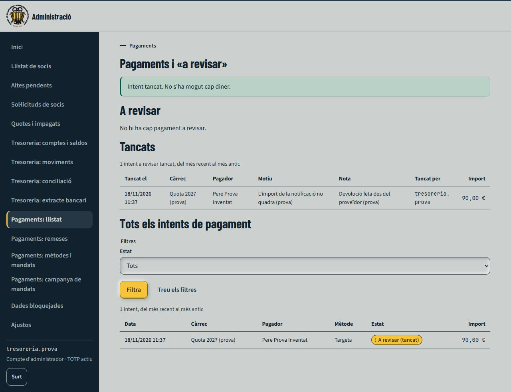
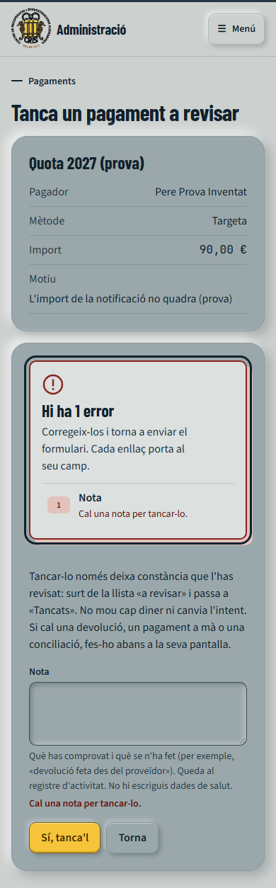

# T-M05b-16b · Tancar un pagament «a revisar» des de la pantalla

| Data i hora (Europa/Madrid) | Commit | Proves | CI |
|---|---|---|---|
| 18/11/2026 | ea7a4335 | 9 noves (19 casos) i 35 casos a les proves de rutes; 1 e2e | [A comprovar] |

**En tres línies:** la llista «a revisar» del tresorer només es podia mirar. Ara cada intent «a revisar» té un botó «Tanca» que porta a una confirmació amb una nota obligatòria. Tancar-lo no mou cap diner ni canvia l'intent: deixa constància de la revisió, i l'intent passa a «Tancats».

## Què s'ha fet
- `ReviewClosure` (migració `payments/0022`): una fila per intent tancat, amb la nota, qui i quan. Només INSERT, també amb SQL directe (com les anul·lacions de rebut).
- `apps/payments/reviews.py`, `close`: comprova B6 amb edició, la nota, que l'intent sigui «a revisar» i que no estigui tancat (amb l'intent bloquejat), i desa la fila i el registre `payments.review_closed` amb la nota.
- `/gestio/pagaments/revisar/<intent>/tanca/`: pàgina de confirmació amb el càrrec, el mètode, l'import i el motiu; POST amb CSRF. La llista oberta ja no mostra els tancats; «Tancats» en mostra els 50 més recents amb la nota i qui l'ha tancat, i «Tots els intents» diu «A revisar (tancat)».
- La línia de la [guia de cobraments](../guies/guia-cobraments.md#1-pagaments-i-a-revisar), la fila de l'estat i la fila de la P-82 amb el que s'ha construït.

## Decisions i perquè
- **L'intent no canvia d'estat.** L'opció per defecte de la [P-82](../decisions/pendents.md) és la llista de RN-M05b-03 tal com és, sense cap sortida d'«a revisar». El tancament és una fila a part; si la junta tria l'opció C, aquesta nota serà el motiu del tresorer.
- **Sense «resultat» (resolt / no cal fer res).** L'opció per defecte no en parla; la nota ho diu.
- **Permís B6 amb edició**, el de la llista. Dubte nou: [P-377](../decisions/pendents.md).
- **Només intents.** Les notificacions sense intent es queden a la llista ([P-378](../decisions/pendents.md)); les transferències sense rebut ja en surten soles; les liquidacions són de la 04 (P-191).

## Problemes trobats
- Cap.

## Com se sap que funciona
`apps/payments/tests/test_review_close.py`: la cel·la de cada rol (200 o «no trobat», a la pàgina i al POST), el servei sense permís, la nota buida, que surt de la llista oberta i entra a «Tancats» sense cap pagament nou ni canvi del càrrec, el segon tancament rebutjat, només un intent «a revisar», el registre amb la nota i que la fila no es pot modificar ni esborrar. `test_route_permissions.py` declara la ruta i el servei. Al navegador, `test_pagaments_llistat.py`: el tresorer prem «Tanca», veu l'error sense nota, tanca amb la nota i el troba a «Tancats», a 1280, 390 i 320 px.

## Termes nous
- **Tancar un «a revisar»:** deixar constància que el tresorer l'ha revisat, amb una nota. No mou diners.
