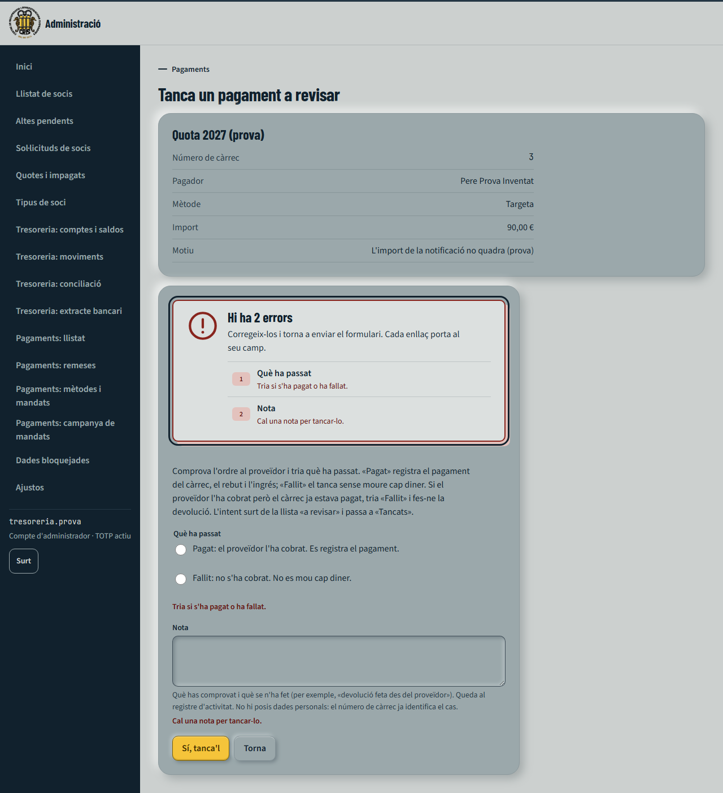
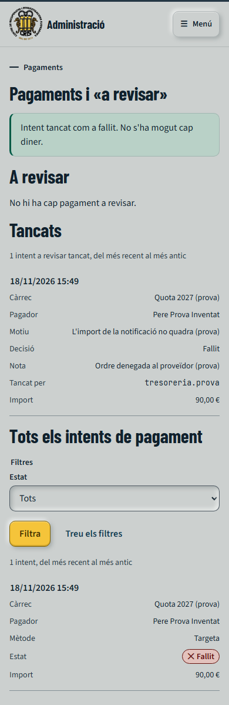

# T-M05b-16c · Transicions de la P-82: confirmació tardana i decisió del tresorer

| Data i hora (Europa/Madrid) | Commit | Proves | CI |
|---|---|---|---|
| 18/11/2026 | e92f5d63 | 12 noves o canviades (més les de la taula de transicions); 1 e2e canviada | [A comprovar] |

**En tres línies:** fins ara, un pagament que el proveïdor confirmava tard (quan l'intent ja s'havia donat per fallit o caducat) no es podia apuntar, i d'«a revisar» no se'n sortia. Amb la decisió [097](../decisions/097-respostes-del-propietari-a-les-preguntes-obertes-del-18-11-2026.md) (P-82, opció C), la confirmació tardana paga el càrrec si encara és pendent, i el tresorer decideix cada «a revisar»: «Pagat» (registra el pagament) o «Fallit» (cap diner).

## Què s'ha fet
- `ATTEMPT_TRANSITIONS` amb les transicions noves de RN-M05b-03: fallit, caducat o abandonat → pagat o «a revisar»; «a revisar» → pagat o fallit (amb el motiu del tresorer, també a `attempts.transition`); creat → cancel·lat.
- `processing.settle`: una confirmació vàlida d'un intent fallit, caducat o abandonat el paga amb `processing.pay` (el mateix camí que una notificació: pagament, ingrés, rebut i avís al 01) si el càrrec és pendent; si no, l'intent passa «a revisar» com a duplicat, sense cap pagament.
- `reviews.close(attempt, outcome=…, note=…)`: bloqueja el càrrec i l'intent com `settle`. «Pagat» només si el càrrec és pendent (si no, `ChargeNotPending`); «Fallit» no mou diners. La nota continua només al registre, sobre el tancament.
- `ReviewClosure` guarda la decisió i pot tenir més d'una fila per intent (migració `payments/0024`): un intent tancat com a fallit pot tornar «a revisar» amb una confirmació tardana d'un càrrec ja pagat.
- La pantalla de tancament demana «Què ha passat» (Pagat o Fallit); «Tancats» mostra la decisió. La guia de cobraments i la fila de l'estat.

## Decisions i perquè
- **El pagament del tresorer va per `processing.pay`**, no per un camí nou: els mateixos efectes i les mateixes garanties que una notificació (un sol pagament pel càrrec, a la base de dades i amb el bloqueig).
- **«Pagat» es rebutja amb el càrrec ja pagat**, i la pantalla diu que triï «Fallit» i en faci la devolució: mai dos pagaments.
- **El motiu de la transició és fix** («Decisió del tresorer (tancament N)»): la nota, text lliure, no va a l'entrada de l'intent, que l'esborrat RGPD no toca (revisió de la #221).
- **«Creat → cancel·lat»** és a la taula, però cap flux no el fa servir: avui cap intent no queda «creat» fora de la transacció que l'obre.
- **La xarxa de seguretat no canvia:** només consulta intents en curs; un intent tancat només es reobre amb una confirmació del proveïdor.

- **Revisió de la PR #241:** (1) una confirmació tardana no paga si un altre intent del mateix càrrec encara pot cobrar (en curs, al banc o «a revisar»): va «a revisar» i decideix el tresorer ([P-392](../decisions/pendents.md), resposta A del propietari, i l'excepció a RN-M05b-03 en un commit a part). (2) «Pagat» per decisió fa les guardes del pagament a mà: demana M14 a més de B6 (sense, l'opció no surt i el servidor la rebutja), mai un càrrec propi, cap altre intent viu i mai amb un import que no quadra (CA-M05b-05). (3) Els tancaments de la T-M05b-16b no tenen cap decisió: la 0024 els deixa «sense decisió», amb el motiu de l'intent, i continuen tancats (un intent és obert si ha canviat després del darrer tancament). (4) Cada tancament desa el motiu que tenia l'intent. (5) Un càrrec anul·lat té el seu motiu, no «pagament duplicat». (6) «Tancat per» mostra el nom de la persona, no el login. (7) La prova de la cursa espera un `Event`, no un temps.

## Problemes trobats
- Cap.

## Com se sap que funciona
Primer les proves, que fallaven amb el codi anterior (34). `test_attempts.py`: la taula sencera de transicions, una per una, i el motiu obligatori per sortir d'«a revisar». `test_remittance_settlement.py`: targeta caducada, quota a la remesa i «pagat» tardà: cap pagament i la remesa es liquida. `test_processing.py`: el càrrec anul·lat, la confirmació tardana d'un intent fallit, caducat o abandonat paga una sola vegada (dues notificacions), la d'un càrrec ja pagat va «a revisar» sense pagament, la d'un «a revisar» no el paga, i el tresorer que decideix «Pagat» mentre la conciliació paga el càrrec (dos fils, PostgreSQL de debò) és rebutjat. `test_review_close.py`: «Pagat» rebutjat amb un altre intent viu, amb un import que no quadra i sense M14; «Tancats» amb el motiu desat i sense el login; un tancament de la 16b i la migració 0024 amb dades d'abans; «Fallit» sense diners, «Pagat» amb pagament, ingrés i rebut, «Pagat» rebutjat amb el càrrec pagat, decisió obligatòria, un segon tancament i una segona revisió, a més de les de la #221. Al navegador, `test_pagaments_llistat.py`: els dos errors, «Fallit» i «Tancats», a 1280, 390 i 320 px.

## Termes nous
- **Confirmació tardana:** la notificació del proveïdor que diu «pagat» quan l'intent ja s'havia tancat (fallit, caducat o abandonat).
