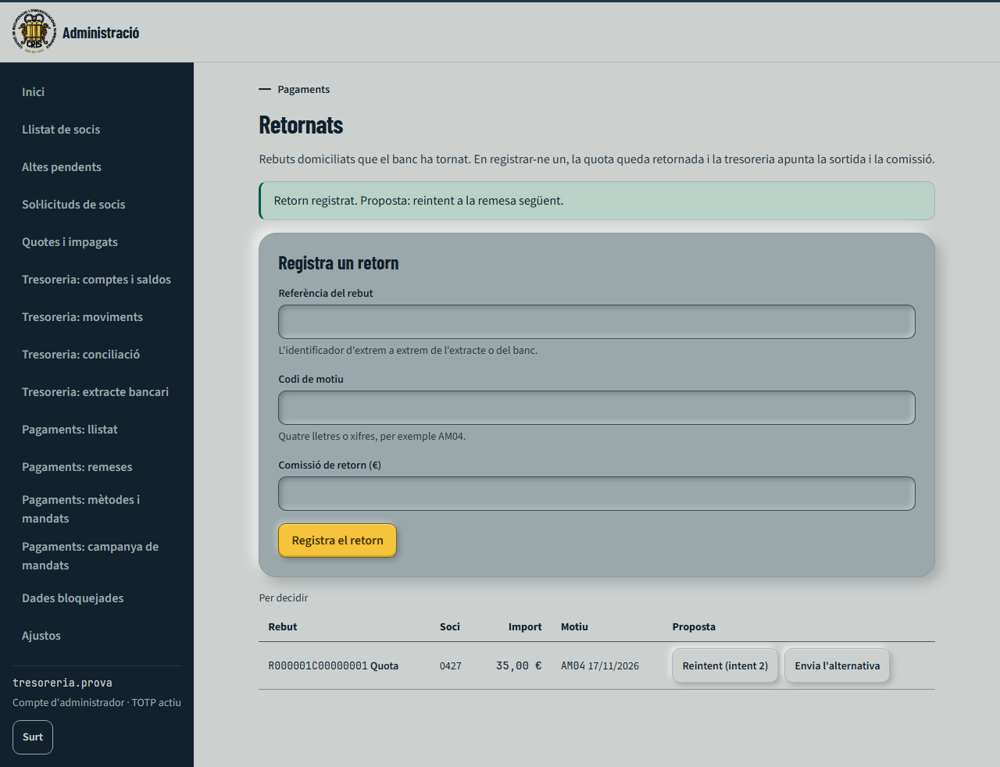
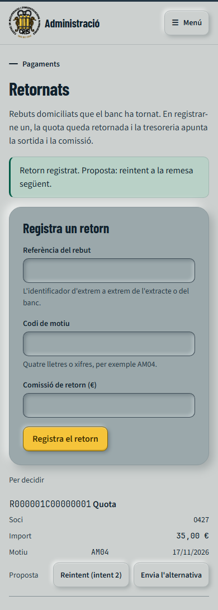

# T-M05b-27 · Intents esgotats, proposta d'alternativa i pantalla de retornats

| Data i hora (Europa/Madrid) | Commit | Proves | CI |
|---|---|---|---|
| 17/11/2026 08:00 | 48bf221 | 5862 (6 noves, 1 e2e) | [A comprovar] |

**En tres línies:** el tresorer té una pantalla per registrar els rebuts que torna el banc (la referència del rebut, el codi i la comissió) i decidir si es tornen a passar o si el soci paga d'una altra manera. Quan ja no es poden tornar a passar (dos intents, o el compte ja no serveix), el soci rep de seguida l'enllaç per pagar amb targeta, Bizum o transferència. La remesa següent ja no inclou aquesta quota i ho explica.

## Què s'ha fet
- `apps/payments/returns.py`: `register_return` aplica i envia l'alternativa quan no queda cap reintent possible ([P-M05b-F](../planning.md#M05b-5-processos); RN-M05b-30).
- `apps/payments/return_views.py` i `templates/payments/returns.html`: `/gestio/pagaments/retornats` amb B4 (registrar i decidir).
- `templates/payments/remittances.html`: la proposta d'alternativa al costat d'«Intents esgotats» (CA-M05b-32) i un enllaç a «Rebuts retornats».

## Decisions i perquè
- **Sense cap reintent possible, registrar el retorn ja és la decisió del tresorer** ([P-292](../decisions/pendents.md), opció per defecte precisada): així es compleixen CA-M05b-19 i 20 i la 048 alhora.
- **La pantalla no mostra noms ni IBAN:** número de soci, concepte, import i codi.
- **El permís d'edició de la VC-16 no s'ha fet:** demana una entrada al catàleg de permisos de la 00 i una migració de `core`, fora del carril.

## Com se sap que funciona
- `apps/payments/tests/test_return_screen.py`: B4 per a cada rol, registrar amb comissió i decidir el reintent, referència desconeguda i CA-M05b-32 (alternativa en registrar el segon retorn i proposta a la previsualització). `test_returns.py`, adaptat a l'alternativa automàtica. `apps/core/tests/e2e/test_retornats.py`: el recorregut al navegador.
- Sortida de proves · commit 48bf221 · executada el 17/11/2026 en local (PostgreSQL 16): `5862 passed`; e2e `2 passed` (retornats i remeses).

## Evidències

*17/11/2026 08:00 (Europa/Madrid) · local, dades inventades · commit 48bf221*

