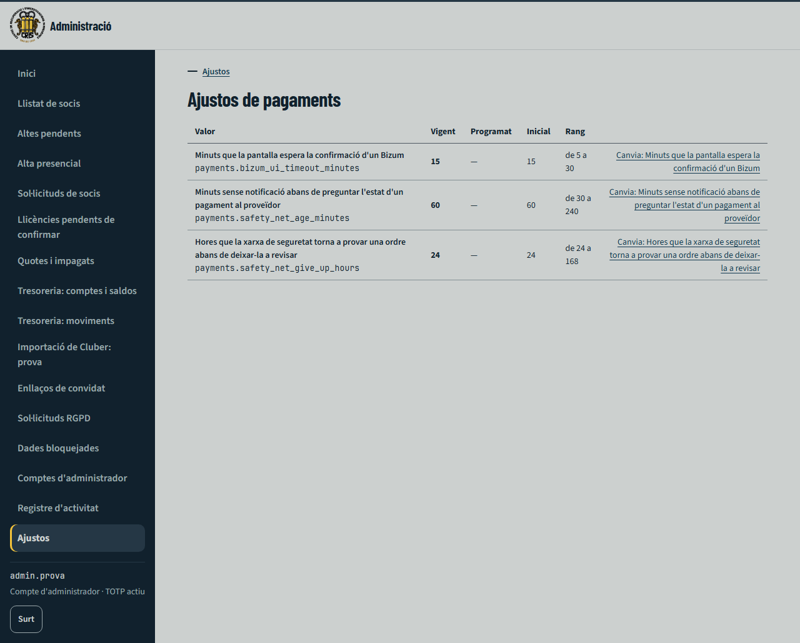

# T-M05b-28 · Hores de la xarxa de seguretat com a ajust

| Data i hora (Europa/Madrid) | Commit | Proves | CI |
|---|---|---|---|
| 16/11/2026 14:55 | bb5ede5 | 3 noves, 4 canviades | [A comprovar] |

**En tres línies:** quan la xarxa de seguretat no pot tancar una ordre de pagament, la torna a provar l'endemà i, passades 24 hores, la deixa «a revisar» perquè la vegi el tresorer. Aquestes 24 hores eren al codi; ara són un valor més de «Ajustos de pagaments», que només l'administrador canvia, entre 24 i 168 hores. Cap comportament no canvia en desplegar.

## Què s'ha fet
- Decisió [093](../decisions/093-hores-de-la-xarxa-de-seguretat-com-a-ajust.md), instrucció escrita del propietari: tot valor i temps de negoci és configurable.
- Una sola edició al pla, al final de l'[addenda de la 055 del 05b](../planning.md#M05b-addenda-055): el valor de VC-17, RN-M05b-31, CA-M05b-33 i la T-M05b-28.
- L'ajust `payments.safety_net_give_up_hours` i el permís per editar-lo (AJ5b-3), cadascun amb la seva migració; `processing.safety_net` el llegeix i la nota `shortcut:` desapareix.

## Decisions i perquè
- **Rang de 24 a 168 hores** (proposta, [P-102](../decisions/pendents.md)): la xarxa passa un cop al dia; per sota de 24, un sol reintent fallat ja enviaria l'intent a revisar.
- **La constant passa a ser la clau de l'ajust**, com `SAFETY_NET_AGE`, perquè qui llegeixi el codi trobi el mateix nom.

## Problemes trobats
- Dues proves de la xarxa posaven la constant a zero; amb un ajust que no baixa de 24, ara fan l'intent 25 hores més vell, que és el que passa de debò.
- La prova al navegador crea els ajustos ella mateixa (les migracions de dades no hi són); la fila nova hi és afegida.

## Com se sap que funciona
- CA-M05b-33: un intent de fa 30 hores que no es pot consultar es queda en curs amb l'ajust a 48 i va «a revisar» amb 24; el canvi queda al registre amb el valor anterior; el tresorer rep «no trobat».
- Rang: 23 i 169 es rebutgen; 168 s'accepta.
- La migració es desfà i es torna a aplicar amb les mateixes files.

## Evidències

*16/11/2026 14:40 (Europa/Madrid) · local, dades inventades (prova e2e) · commit bb5ede5*
- Sortida de proves · commit bb5ede5 · executada el 16/11/2026 en local (PostgreSQL 16):
  ```
  $ pytest -q
  4778 passed, 61 deselected
  $ pytest -q -m e2e apps/core/tests/e2e
  60 passed, 1 xfailed
  ```

## Termes nous
- Cap.
