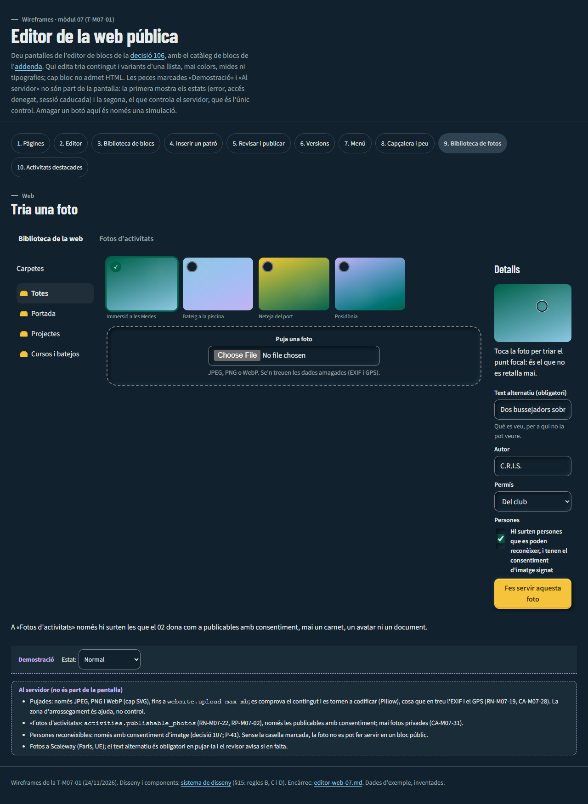
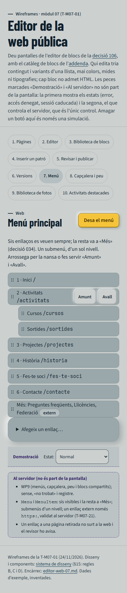

# T-M07-01 · Wireframes de l'editor de la web pública (Feina 1 de l'encàrrec)

| Data i hora (Europa/Madrid) | Commit | Proves | CI |
|---|---|---|---|
| 27/11/2026 22:28 | 602be634 | 1 nova, 1 e2e nova | [A comprovar] |

**En tres línies:** és la primera feina de l'[encàrrec de disseny del 07](../../design/encarrecs/editor-web-07.md), que una sessió anterior va deixar feta el 24/11 sense pujar i que s'ha rebasat i tornat a provar el 27/11. Són les deu pantalles de l'editor de blocs de la decisió 106, en un wireframe nou, `design/wireframes/editor-web.html`, fet amb els components i els recursos del sistema. Cada pantalla diu què controla el servidor i mostra els estats d'error, d'accés denegat i de sessió caducada.

## Què s'ha fet
- `design/wireframes/editor-web.html`. Les deu pantalles i els recursos que fa servir cadascuna:
  - **Pàgines:** filtres, estat de cada pàgina i pàgina nova amb una plantilla de la llista tancada.
  - **Editor:** pantalla partida, amb els blocs, l'ordre per arrossegament o amb «Amunt»/«Avall», el formulari del bloc i la vista prèvia amb Probador (dispositiu i tema). Avisa del desat automàtic i de quan una altra persona té la pàgina oberta.
  - **Biblioteca de blocs:** els 26 tipus en cinc grups, cercable, amb «Afegeix» com a alternativa a arrossegar.
  - **Patrons:** miniatures de Probador i inserció.
  - **Revisar i publicar:** els passos de Tramite, el revisor de qualitat, publicar ara o programar, i la vista per compartir de Pregon.
  - **Versions:** comparador bloc per bloc i restaurar a l'esborrany.
  - **Menú:** 6 enllaços + «Més», submenús d'un nivell i enllaç extern només `https://`.
  - **Capçalera i peu:** amb els enllaços legals fixos.
  - **Biblioteca de fotos:** Fototeca amb les dues pestanyes, punt focal, text alternatiu, autor, permís i consentiment; la pujada amb la zona d'arrossegament.
  - **Activitats destacades:** ordre i dates de visibilitat.
  - Sense JavaScript, totes les pantalles es veuen una sota l'altra; amb JavaScript, una cada vegada segons l'àncora.
- Proves:
  - `apps/core/tests/test_wireframes_editor_web.py`: les deu pantalles, la nota «Al servidor», la demostració i els tres estats de cadascuna, cap `style=` i cap color escrit a mà.
  - `apps/core/tests/e2e/test_wireframes_editor_web.py`: s'obre des del disc i sense connexió, i fa les captures.
- `docs/estat/M07.md`: T-M07-01 feta en part.

## Decisions i perquè
- **Un fitxer nou al costat dels altres:** és el que diu l'encàrrec. `admin.html` ja fa 250 kB, i l'editor és un espai de treball propi.
- **Reutilitzar recursos:** Probador, Pregon, Fototeca, Expositor, Tramite i la zona d'arrossegament (T-DX-117), amb els seus CSS de `static/`. No hi ha cap peça nova.
- **Sense «Color d'accent» a Probador:** la decisió 106 diu que qui edita mai tria colors. Probador només tria el dispositiu i el tema.
- **El catàleg és el de la #575**, amb els tres retocs acordats amb el pilot: el fons «marí» en lloc de «fosc», un sol botó principal per pàgina (el revisor ho avisa) i el text alternatiu de la biblioteca, obligatori.
- **Seguretat i privacitat:** cada pantalla porta les seves notes «Al servidor»:
  - WP1a, WP1b, WP9 i WP10, amb l'abast per pàgina;
  - la validació de l'esquema i el Markdown restringit;
  - la vista prèvia només amb sessió;
  - les pujades tornades a codificar i sense EXIF;
  - només fotos publicables amb consentiment;
  - cap còpia de les dades del 02.

  Amagar un botó al wireframe és només una simulació.

## Com se sap que funciona
- Passen les dues proves. L'e2e no troba cap error de consola ni cap desplaçament de costat a 320 px. Al primer intent, la pantalla de l'editor es desplaçava 101 px; ho van arreglar les columnes que es poden encongir i el selector de demostració més estret.

## Comprovació §15.5
- **Captures mirades** de les deu pantalles a 1280, 1024, 390 i 320 px, en clar i en fosc. Al segon intent es va corregir com es veien els controls segmentats i el lateral de la biblioteca de fotos.

## Queda
- La fila original de la T-M07-01 també preveu els wireframes de les pàgines públiques (portada, activitats i ajuda). Els faré amb les plantilles de pàgina, quan hi hagi el catàleg de blocs (T-M07-19).

## Evidències
- L'editor a 1280 px. `captures/2026-11-27_2228_T-M07-01_editor-1280.png`

  

  *27/11/2026 22:28 (Europa/Madrid) · local, prova e2e, dades inventades · commit 602be634*

- La biblioteca de fotos a 1280 px, en fosc. `captures/2026-11-27_2228_T-M07-01_fotos-1280-fosc.png`

  

  *27/11/2026 22:28 (Europa/Madrid) · local, prova e2e, dades inventades · commit 602be634*

- El menú a 390 px. `captures/2026-11-27_2228_T-M07-01_menu-390.png`

  

  *27/11/2026 22:28 (Europa/Madrid) · local, prova e2e, dades inventades · commit 602be634*
